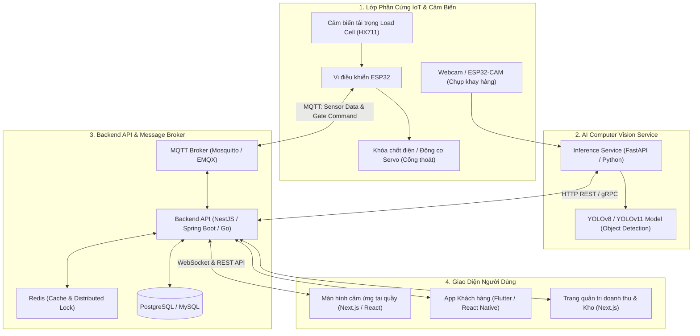
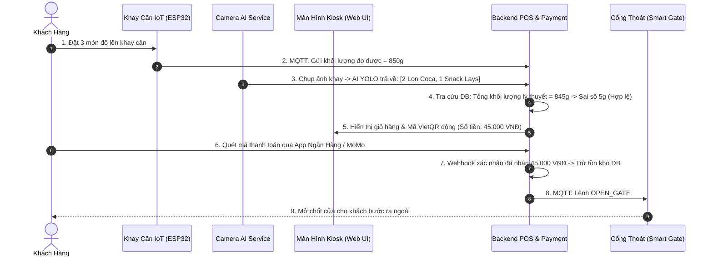

# PHÂN TÍCH CHI TIẾT ĐỀ TÀI 01: SMART RETAIL SELF-CHECKOUT COUNTER
## (Hệ thống Quầy Thanh toán Bán lẻ Tự động: Computer Vision + Cân IoT + Web POS)

---

## 1. TỔNG QUAN & BÀI TOÁN KINH DOANH THỰC TẾ

### 1.1. Bối cảnh
Tại các siêu thị mini, cửa hàng tiện lợi (Circle K, 7-Eleven, WinMart+), nút thắt lớn nhất vào giờ cao điểm là **xếp hàng chờ thu ngân quét từng mã vạch (barcode)**.
- Quét từng món tốn 15 - 45 giây cho mỗi khách.
- Dễ nhầm lẫn, sót hàng, tốn chi phí nhân sự ca đêm.

### 1.2. Giải pháp của dự án
Khách hàng mua hàng xong chỉ cần:
1. Đặt tất cả đồ đã chọn lên một **Khay thanh toán thông minh**.
2. **Camera AI phía trên** chụp ảnh và nhận diện đồng thời toàn bộ sản phẩm trong 0.5 giây.
3. **Cảm biến cân nặng IoT** dưới đáy khay đo tổng khối lượng thực tế, so khớp với tổng khối lượng lý thuyết của các món AI vừa nhận diện để phát hiện gian lận.
4. Màn hình Kiosk hiển thị giỏ hàng ngay lập tức kèm mã QR (MoMo / VNPay).
5. Khách quét thanh toán thành công -> Cổng chốt tự động mở ra.

---

## 2. SƠ ĐỒ KIẾN TRÚC HỆ THỐNG (SYSTEM ARCHITECTURE)



---

## 3. PHÂN RÃ CHỨC NĂNG CHI TIẾT (FUNCTIONAL REQUIREMENTS)

### 3.1. Phân hệ Kiosk & Bán hàng (Customer & POS)
- **Tự động tạo giỏ hàng (Auto Cart Generation):** Nhận diện danh sách vật phẩm từ AI và tải giá bán tương ứng.
- **Thanh toán tức thời (Instant Payment):** Tích hợp SDK/Webhook VNPay hoặc MoMo Sandbox. Tự động sinh mã VietQR động theo đúng số tiền của giỏ hàng.
- **Xử lý ngoại lệ:** Nếu khách bỏ thêm hoặc lấy bớt đồ trong lúc thanh toán, camera và cân tự động nhận diện lại giỏ hàng trong thời gian thực.

### 3.2. Phân hệ Phòng chống Gian lận (Anti-Fraud & Loss Prevention)
- **Thuật toán Double-Check (AI Vision vs IoT Load Cell):**
  $$\Delta W = | W_{\text{thực tế đo từ cân}} - \sum (W_{\text{sản phẩm AI nhận diện}}) |$$
  - Nếu $\Delta W \le 10g$: Hợp lệ -> Cho phép thanh toán.
  - Nếu $\Delta W > 10g$: Phát cảnh báo (Ví dụ: khách giấu thêm kẹo hoặc đặt vật lạ lên khay) -> Yêu cầu kiểm tra lại hoặc gọi nhân viên.

### 3.3. Phân hệ Quản trị (Admin Portal)
- Quản lý danh mục sản phẩm, mã SKU, hình ảnh huấn luyện, đơn giá, trọng lượng tiêu chuẩn ($W_{\text{standard}}$).
- Quản lý xuất - nhập kho tự động (Trừ tồn kho ngay khi đơn hàng chuyển sang trạng thái `PAID`).
- Báo cáo thống kê: Doanh thu theo giờ, tỉ lệ gian lận phát hiện được, thời gian trung bình mỗi phiên thanh toán.

---

## 4. BẢNG LINH KIỆN PHẦN CỨNG IOT (CỰC RẺ, DỄ MUA CHO CÁ NHÂN)

| Linh kiện | Vai trò trong hệ thống | Giá tham khảo (Shopee) |
| :--- | :--- | :---: |
| **ESP32 DevKit V1** | Vi điều khiển đọc cảm biến, gửi MQTT, mở khóa | ~80.000 VNĐ |
| **Cảm biến Load Cell 5kg + Mạch khuếch đại HX711** | Cân đo trọng lượng khay hàng với độ chính xác ~1g | ~65.000 VNĐ |
| **Động cơ Servo SG90 (hoặc Khóa điện từ Solenoid 12V)** | Mô phỏng thanh chắn / mở chốt cửa ra | ~30.000 - 80.000 VNĐ |
| **Webcam USB (720p hoặc 1080p)** | Chụp ảnh mặt khay gửi về AI Service | Có sẵn hoặc ~150.000 VNĐ |
| **Khay nhựa hoặc bìa Formex** | Dựng khung quầy thanh toán mini đặt trên bàn | ~30.000 VNĐ |
| **TỔNG CHI PHÍ PHẦN CỨNG** | | **~350.000 - 400.000 VNĐ** |

---

## 5. THIẾT KẾ CƠ SỞ DỮ LIỆU ĐỀ XUẤT (DATABASE SCHEMA)

```sql
-- 1. Bảng sản phẩm
CREATE TABLE products (
    id UUID PRIMARY KEY DEFAULT gen_random_uuid(),
    sku VARCHAR(50) UNIQUE NOT NULL,
    name VARCHAR(255) NOT NULL,
    price DECIMAL(12, 2) NOT NULL,
    standard_weight_grams FLOAT NOT NULL, -- Trọng lượng chuẩn để đối soát cân
    weight_tolerance_grams FLOAT DEFAULT 5.0, -- Sai số cho phép (ví dụ ±5g)
    image_url TEXT,
    ai_class_name VARCHAR(100) NOT NULL, -- Tên nhãn lớp trong model YOLO
    stock_quantity INT DEFAULT 0,
    created_at TIMESTAMP DEFAULT CURRENT_TIMESTAMP
);

-- 2. Phiên thanh toán tại quầy
CREATE TABLE checkout_sessions (
    id UUID PRIMARY KEY DEFAULT gen_random_uuid(),
    kiosk_id VARCHAR(50) NOT NULL,
    status VARCHAR(30) DEFAULT 'SCANNING', -- SCANNING, AWAITING_PAYMENT, PAID, FRAUD_ALERT, CANCELLED
    measured_weight_grams FLOAT,
    expected_weight_grams FLOAT,
    weight_difference FLOAT,
    total_amount DECIMAL(12, 2) DEFAULT 0,
    payment_method VARCHAR(50), -- MOMO, VNPAY, VIETQR
    payment_transaction_id VARCHAR(100),
    created_at TIMESTAMP DEFAULT CURRENT_TIMESTAMP,
    completed_at TIMESTAMP
);

-- 3. Chi tiết đơn hàng của phiên
CREATE TABLE session_items (
    id UUID PRIMARY KEY DEFAULT gen_random_uuid(),
    session_id UUID REFERENCES checkout_sessions(id) ON DELETE CASCADE,
    product_id UUID REFERENCES products(id),
    quantity INT NOT NULL,
    unit_price DECIMAL(12, 2) NOT NULL,
    detected_confidence FLOAT -- Độ tin cậy từ model AI (ví dụ 0.94)
);
```

---

## 6. PIPELINE HUẤN LUYỆN & XỬ LÝ AI COMPUTER VISION

1. **Thu thập dữ liệu (Dataset Collection):**
   - Chọn khoảng **8 - 12 loại sản phẩm** thông dụng (ví dụ: Lon Coca-Cola, Lon RedBull, Chai nước Aquafina, Bánh Chocopie, Mì Hảo Hảo...).
   - Dùng điện thoại/Webcam quay video khay hàng ở nhiều góc nghiêng, xoay lật, ánh sáng mạnh/yếu, che khuất một phần (Occlusion).
   - Xuất frame ảnh (khoảng 600 - 1000 ảnh) và gán nhãn bằng công cụ trực tuyến miễn phí **Roboflow**.
2. **Huấn luyện mô hình:**
   - Sử dụng **YOLOv8 Nano (yolov8n)** hoặc **YOLOv11 Nano**. Bản Nano cực nhẹ, chạy mượt mà ngay trên CPU máy tính cá nhân (Inference time ~20ms - 50ms không cần card đồ họa khủng).
3. **Triển khai AI Service:**
   - Dùng **FastAPI (Python)** để expose endpoint `/api/v1/detect-cart`. Nhận ảnh từ Camera -> Trả về JSON danh sách các vật phẩm kèm bounding box và confidence score.

---

## 7. BỘ CÂU HỎI BẢO VỆ PHẢN BIỆN & CÁCH TRẢ LỜI ĐẠT ĐIỂM TỐI ĐA

* **Câu hỏi 1:** *"Nếu khách hàng xếp chồng sản phẩm này lên sản phẩm khác khiến camera bị che khuất thì sao?"*
  - **Cách trả lời:** *"Dạ thưa thầy/cô, đó chính là lý do hệ thống kết hợp Cảm biến tải trọng Load Cell. Khi có sản phẩm bị che khuất, AI chỉ phát hiện được 1 món (ví dụ 300g), nhưng cân đo được 600g. Sai số vượt ngưỡng 10g lập tức kích hoạt trạng thái `FRAUD_ALERT` và màn hình Kiosk sẽ hiện nhắc nhở khách trải đều các món đồ trên khay."*
* **Câu hỏi 2:** *"Độ trễ truyền nhận giữa ESP32 và Server có làm chậm trải nghiệm của khách không?"*
  - **Cách trả lời:** *"Em sử dụng giao thức MQTT chạy trên nền TCP/IP với QoS = 1. Payload đo cân chỉ vài chục bytes, thời gian truyền dưới 15ms. Việc đối soát diễn ra song song với lúc AI phân tích ảnh nên tổng thời gian từ lúc đặt đồ đến khi hiện giỏ hàng chỉ dưới 1 giây."*

---

## 8. PHÂN TÍCH NGHIỆP VỤ & CÁC LUỒNG HOẠT ĐỘNG (BUSINESS FLOWS)

### 8.1. Các vai trò & Phân quyền nghiệp vụ (Actors & Roles)
- **Khách hàng tại quầy (Shopper):** Đặt đồ lên khay, kiểm tra giỏ hàng trên màn hình cảm ứng, quét mã QR thanh toán (MoMo/VNPay), đi qua cổng thông minh khi cửa mở.
- **Nhân viên giám sát cửa hàng (Store Supervisor):** Nhận thông báo khi có chuông cảnh báo gian lận (`FRAUD_ALERT`), dùng thẻ từ nhân viên hoặc mã PIN để mở khóa khẩn cấp hoặc hỗ trợ khách hàng.
- **Quản lý kho / Cửa hàng trưởng (Store Manager):** Xem báo cáo chênh lệch tồn kho thực tế vs hệ thống, thiết lập giá bán, cập nhật trọng lượng chuẩn ($W_{\text{standard}}$) cho sản phẩm mới.

### 8.2. Các quy tắc nghiệp vụ bất biến (Business Invariants)
1. **Nguyên tắc xác thực kép (Double-Check Invariant):** Giỏ hàng CHỈ được phép chuyển sang trạng thái sẵn sàng thanh toán (`READY_TO_PAY`) khi:
   $$|W_{\text{Cân IoT}} - \sum W_{\text{AI Vision}}| \le \text{Ngưỡng sai số cho phép (10g)}$$
2. **Quy tắc cổng thoát an toàn (Fail-Safe Gate):** Cổng mở (Servo quay 90 độ) chỉ khi giao dịch ngân hàng đã trả về trạng thái `PAYMENT_SUCCESS`. Sau khi khách bước qua (cảm biến hồng ngoại phát hiện đã đi qua), cổng tự động hạ xuống sau 3 giây.
3. **Quy tắc phiên thanh toán rỗi (Idle Timeout):** Nếu khay có đồ nhưng khách không thanh toán sau 120 giây, màn hình sẽ phát âm thanh nhắc nhở; sau 180 giây tự động hủy phiên để đón khách tiếp theo.

### 8.3. Luồng hoạt động 1: Quy trình Tự Phục Vụ Tại Quầy Kiosk (Happy Path)



### 8.4. Luồng hoạt động 2: Phát hiện Gian Lận & Xử Lý Sự Cố (Fraud Alert Flow)
- **Tình huống:** Khách đặt 1 lon nước ngọt (300g) nhưng lén bỏ thêm 1 thanh sô-cô-la mỏng dưới đáy (100g) mà camera không thấy được.
- **Quy trình:**
  1. AI nhận diện: 1 Lon nước ngọt $\rightarrow 300g$.
  2. Cân IoT đo được: $400g \rightarrow \Delta W = 100g > 10g$.
  3. Hệ thống kích hoạt trạng thái `FRAUD_ALERT`:
     - Khóa chức năng thanh toán trên màn hình.
     - Màn hình Kiosk hiển thị: *"Khối lượng trên khay không khớp với sản phẩm nhìn thấy. Vui lòng kiểm tra lại đồ trên khay hoặc đợi nhân viên hỗ trợ"*.
     - Đèn LED màu đỏ trên khay nhấp nháy, gửi thông báo đến máy tính bảng của nhân viên giám sát.
  4. Nhân viên đến kiểm tra, nhắc khách đặt lại đồ -> Hệ thống cân lại hợp lệ -> Mở lại chức năng thanh toán bình thường.

