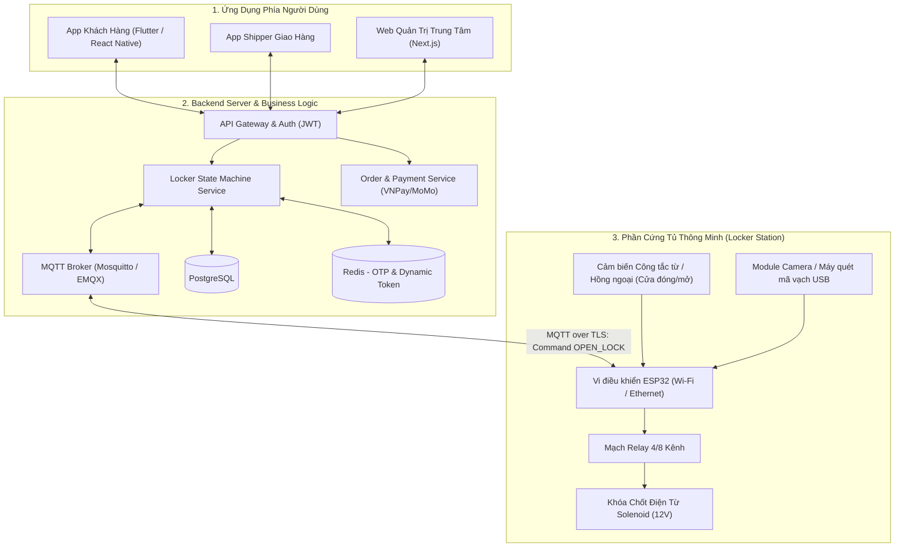
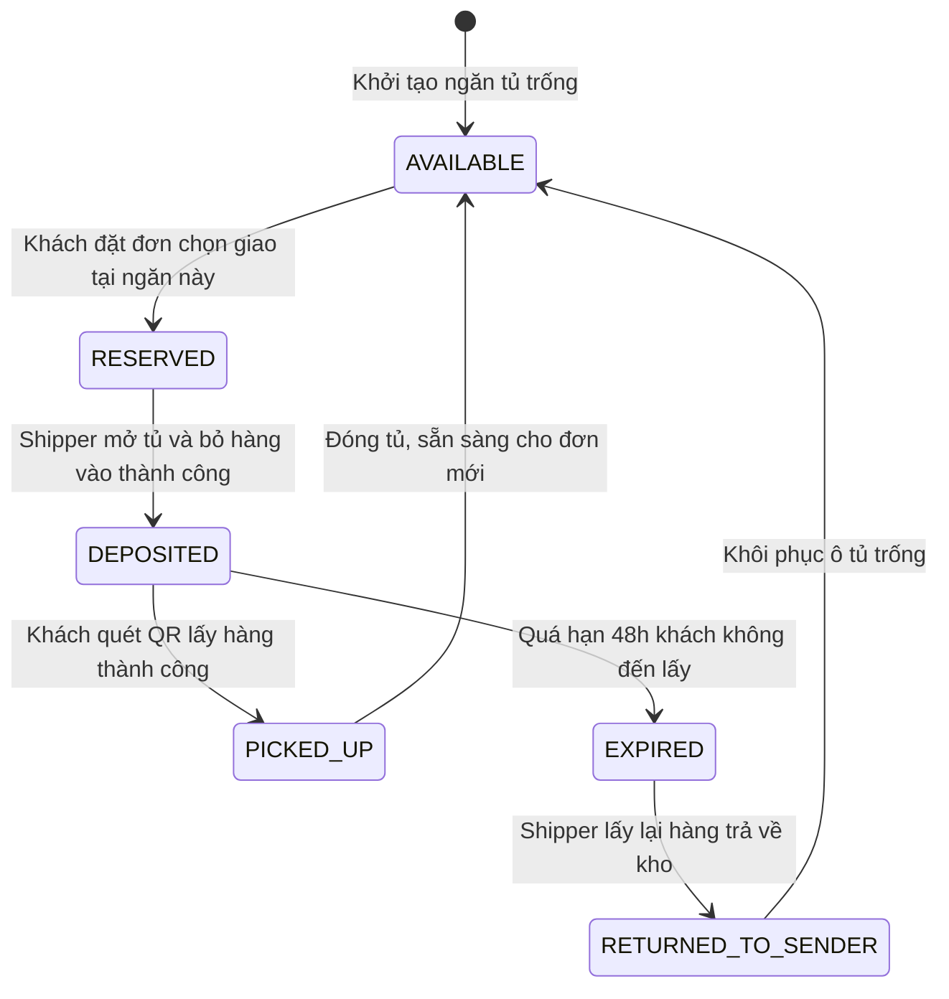
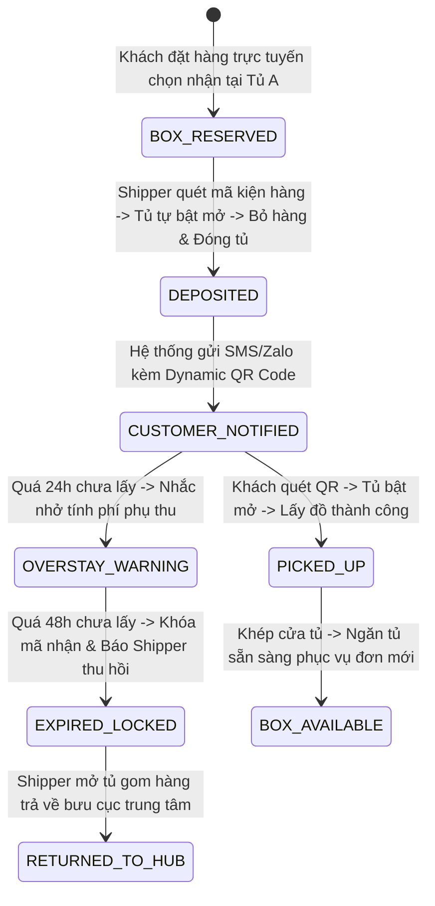

# PHÂN TÍCH CHI TIẾT ĐỀ TÀI 02: SMART LOCKER & CLICK-AND-COLLECT HUB
## (Hệ sinh thái Tủ Nhận Hàng Thông Minh Đa Kênh: ESP32 Relay + Dynamic QR + Mobile/Web App)

---

## 1. TỔNG QUAN & BÀI TOÁN THỰC TẾ

### 1.1. Bối cảnh
Sự bùng nổ của thương mại điện tử (Shopee, Lazada, TikTok Shop) kéo theo bài toán giao hàng chặng cuối (Last-Mile Delivery):
- Shipper đến nơi nhưng người nhận bận họp, không ở nhà, dẫn đến giao thất bại nhiều lần (tăng chi phí vận chuyển).
- Khách hàng không muốn để hàng trước cửa vì sợ mất cắp hoặc thời tiết mưa ướt.
- Xu hướng **Click-and-Collect** (Đặt hàng trên app -> Ghé tủ tự động gần nhà/công ty để lấy bất cứ lúc nào trong 24/7) đang trở thành tiêu chuẩn tại các khu chung cư, toà nhà văn phòng.

### 1.2. Giải pháp của dự án
Xây dựng một hệ thống gồm:
1. **Nền tảng E-Commerce (Web & Mobile):** Khách chọn mua hàng và chọn điểm giao tại **Tủ thông minh (Smart Locker)** gần nhất.
2. **Quy trình Shipper nạp hàng:** Shipper đến tủ, quét mã đơn hàng -> Ô tủ còn trống tương ứng kích thước tự động bật chốt mở ra -> Shipper bỏ hàng vào và đóng cửa lại.
3. **Quy trình Khách nhận hàng:** Hệ thống sinh mã **Dynamic QR / OTP 6 số** trên ứng dụng của khách. Khách đứng trước tủ quét mã QR -> Đúng ô tủ chứa đồ của khách tự động bật mở ra trong 1 giây.

---

## 2. SƠ ĐỒ KIẾN TRÚC HỆ THỐNG (SYSTEM ARCHITECTURE)



---

## 3. THIẾT KẾ MÁY TRẠNG THÁI Ô TỦ (LOCKER COMPARTMENT STATE MACHINE)

Một điểm nhấn kỹ thuật quan trọng của đề tài này là **State Machine** quản lý trạng thái của từng ngăn tủ, tránh xung đột khi nhiều người cùng thao tác:



---

## 4. BẢNG LINH KIỆN PHẦN CỨNG IOT (MÔ HÌNH 4 NGĂN TỦ MINI)

| Linh kiện | Số lượng | Vai trò | Giá ước lượng |
| :--- | :---: | :--- | :---: |
| **ESP32 DevKit V1** | 1 | Bộ não điều khiển kết nối Wi-Fi, nhận lệnh MQTT | ~80.000 VNĐ |
| **Khóa chốt điện từ Solenoid Lock 12V** | 4 | Khóa cơ mở chốt bằng xung điện 12V | ~160.000 VNĐ (40k/cái) |
| **Module Relay 4 Kênh cách ly quang** | 1 | Kích hoạt đóng ngắt nguồn 12V cho 4 khoá | ~45.000 VNĐ |
| **Nguồn Adapter 12V - 2A** | 1 | Cấp nguồn cho khóa chốt điện từ | ~40.000 VNĐ |
| **Cảm biến công tắc hành trình / Cảm biến từ** | 4 | Phát hiện cánh cửa tủ đang khép chặt hay hở | ~40.000 VNĐ |
| **Khung mô hình (Gỗ ép / Mica / Bìa cứng Formex)** | 1 | Dựng mô hình tủ 4 ngăn mini | ~60.000 VNĐ |
| **TỔNG CHI PHÍ PHẦN CỨNG** | | | **~425.000 VNĐ** |

---

## 5. THIẾT KẾ CƠ SỞ DỮ LIỆU ĐỀ XUẤT (POSTGRESQL)

```sql
-- 1. Trạm tủ thông minh
CREATE TABLE locker_stations (
    id UUID PRIMARY KEY DEFAULT gen_random_uuid(),
    code VARCHAR(50) UNIQUE NOT NULL, -- Ví dụ: 'STATION_HANOI_01'
    name VARCHAR(255) NOT NULL,
    address TEXT NOT NULL,
    latitude DOUBLE PRECISION,
    longitude DOUBLE PRECISION,
    is_online BOOLEAN DEFAULT false,
    last_heartbeat TIMESTAMP
);

-- 2. Chi tiết từng ngăn tủ trong trạm
CREATE TABLE locker_boxes (
    id UUID PRIMARY KEY DEFAULT gen_random_uuid(),
    station_id UUID REFERENCES locker_stations(id),
    box_number INT NOT NULL, -- Số thứ tự ngăn: 1, 2, 3, 4
    box_size VARCHAR(10) DEFAULT 'M', -- S, M, L
    status VARCHAR(30) DEFAULT 'AVAILABLE', -- AVAILABLE, RESERVED, DEPOSITED, EXPIRED
    is_door_closed BOOLEAN DEFAULT true,
    relay_pin_index INT NOT NULL, -- Chân GPIO/Relay điều khiển khoá này
    UNIQUE(station_id, box_number)
);

-- 3. Đơn hàng lưu tại tủ
CREATE TABLE locker_orders (
    id UUID PRIMARY KEY DEFAULT gen_random_uuid(),
    tracking_code VARCHAR(100) UNIQUE NOT NULL,
    customer_phone VARCHAR(20) NOT NULL,
    customer_id UUID,
    box_id UUID REFERENCES locker_boxes(id),
    pickup_otp VARCHAR(6), -- OTP 6 chữ số dự phòng
    pickup_qr_token VARCHAR(255), -- Token mã hoá sinh dynamic QR
    deposit_time TIMESTAMP,
    pickup_deadline TIMESTAMP, -- Hạn chót lấy hàng (ví dụ sau 48 tiếng)
    picked_up_time TIMESTAMP,
    status VARCHAR(30) DEFAULT 'AWAITING_DEPOSIT'
);
```

---

## 6. ĐIỂM NHẤN BẢO MẬT & KỸ THUẬT ĂN ĐIỂM

1. **Bảo mật mã QR nhận hàng (Dynamic TOTP / Anti-Screenshot):**
   - Không dùng mã QR tĩnh. Mã QR trên ứng dụng của khách được sinh động dựa trên thuật toán TOTP (Time-based One-Time Password) thay đổi sau mỗi **30 giây**. Khách không thể chụp ảnh gửi lung tung mà bắt buộc phải mở app trực tiếp trước tủ.
2. **Cơ chế Fallback khi mất mạng:**
   - Nếu đường truyền Internet tại trạm tủ bị chập chờn, ESP32 vẫn lưu bộ nhớ cache cục bộ (EEPROM / SPIFFS) danh sách mã PIN offline đã được mã hoá HMAC từ trước để khách vẫn bấm phím số mở tủ bình thường.
3. **Cơ chế xác thực an toàn phần cứng (Hardware Authentication):**
   - Lệnh mở tủ gửi qua MQTT được ký điện tử (HMAC-SHA256) kèm Timestamp và Nonce để chống tấn công nghe lén (Replay Attack).

---

## 7. MA TRẬN ACTORS & QUY TRÌNH NGHIỆP VỤ BIG PROJECT (SMART LOCKER NETWORK OPERATIONS)



### 7.1. Ma trận Actors & Phân quyền Mạng lưới Tủ Đa Điểm
| Actor / Vai trò | Trách nhiệm & Quyền hạn nghiệp vụ trong Big Project |
| :--- | :--- |
| **End Customer (Người nhận hàng)** | Mở app lấy mã Dynamic QR TOTP, quét nhận hàng, thanh toán phụ phí lưu kho quá hạn (nếu có). |
| **Courier / Shipper (Giao hàng bưu chính)** | Quét mã vận đơn để tủ gợi ý ngăn phù hợp (S/M/L), bỏ hàng vào tủ, thu hồi hàng quá hạn theo danh sách điều phối. |
| **Field Maintenance Tech (Kỹ thuật viên hiện trường)** | Kiểm tra bảo trì khóa chốt Solenoid, thay pin dự phòng UPS, can thiệp bằng Master Key khi có sự cố kẹt cửa. |
| **NOC Operations Manager (Trung tâm điều hành trạm tủ)** | Giám sát tỷ lệ lấp đầy ngăn tủ (Occupancy Rate) toàn thành phố, điều phối shipper tránh gửi vào các trạm đã kín chỗ. |

---

### 7.2. Nghiệp Vụ Tính Phí Lưu Kho Quá Hạn & Thu Hồi Tự Động (Overdue Storage & Eviction)
- **Quy tắc tính phí lưu trữ bậc thang (Step-Up Storage Pricing):**
  - Miễn phí lưu kho trong **24 giờ đầu tiên**.
  - Từ giờ thứ 25 đến giờ thứ 48: Tính phí 5.000 VNĐ / 12 giờ. Khách phải quét mã VietQR thanh toán tiền phụ phí trực tiếp trên màn hình tủ thì chốt khóa mới mở.
  - Sau 48 giờ: Hệ thống tự động vô hiệu hóa mã nhận của khách, chuyển trạng thái đơn sang `AWAITING_RETURN` và tự động gán nhiệm vụ thu hồi cho shipper tuyến đó gom hàng về kho bưu cục.

---

### 7.3. Xử Lý Sự Cố Phần Cứng & Kẹt Khóa Cửa (Hardware Anomaly & Fail-Safe Handling)
- Khi lệnh mở chốt gửi xuống ESP32 nhưng cảm biến từ báo `Door_Sensor = CLOSED` (cửa bị kẹt hoặc hỏng chốt):
  1. ESP32 tự động thử lại xung điện mở lần 2 sau 500ms.
  2. Nếu vẫn không mở được: Đánh dấu ngăn tủ bị `MALFUNCTION`, tự động hoàn trả token cho khách, tự động mở một ngăn tủ trống khác cùng kích cỡ trong trạm và phát cảnh báo về trung tâm bảo trì.

