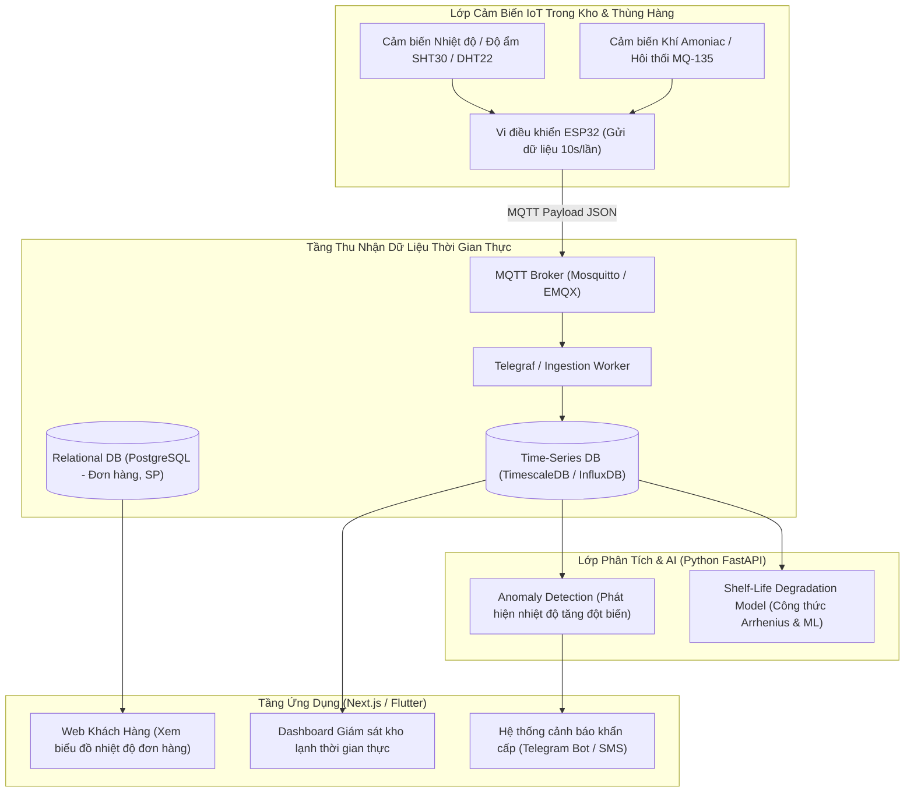
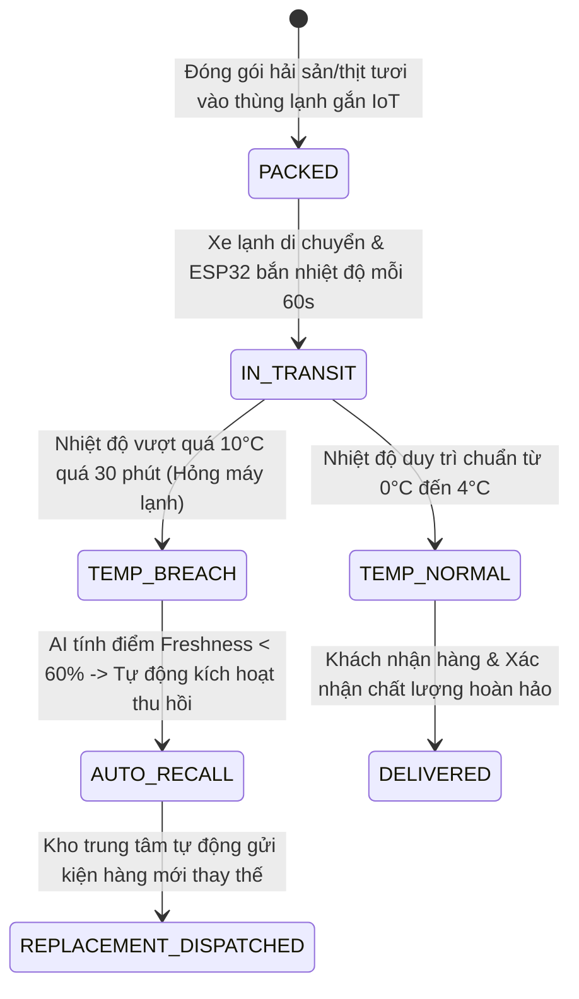

# PHÂN TÍCH CHI TIẾT ĐỀ TÀI 03: COLD-CHAIN FRESH FOOD E-COMMERCE
## (Sàn Bán Thực Phẩm Tươi Sống & Giám Sát Chuỗi Cung Ứng Lạnh IoT + AI Dự Báo Hạn Dùng)

---

## 1. TỔNG QUAN & BÀI TOÁN KINH DOANH THỰC TẾ

### 1.1. Bối cảnh
Khi mua sắm thực phẩm tươi sống (thịt bò Wagyu, hải sản đông lạnh, hoa quả nhập khẩu) hoặc dược phẩm (vaccine, insulin) qua mạng:
- Khách hàng luôn e ngại: *"Liệu trên đường vận chuyển, shipper có tắt máy lạnh để tiết kiệm xăng làm thực phẩm bị ôi thiu không?"*
- Doanh nghiệp thiếu công cụ giám sát chất lượng bảo quản theo thời gian thực xuyên suốt chuỗi cung ứng (từ kho đến xe tải và đến tay khách).

### 1.2. Giải pháp của dự án
1. **Sàn thương mại điện tử chuyên thực phẩm chất lượng cao (Web & Mobile):**
   - Đặt hàng, thanh toán, chọn khung giờ giao hàng (Delivery Slot).
   - **Tính năng minh bạch chất lượng (Quality Transparency):** Trên chi tiết mỗi đơn hàng, khách hàng có thể xem **Biểu đồ nhiệt độ & độ ẩm lịch sử** của chính kiện hàng đó từ khi đóng gói cho đến lúc giao.
2. **Hệ thống giám sát IoT (Cold-Chain Telemetry):**
   - Thiết bị IoT nhỏ gọn đặt bên trong thùng bảo ôn/kho lạnh: đo nhiệt độ, độ ẩm liên tục và cảnh báo tức thời nếu phát hiện phá vỡ ngưỡng bảo quản an toàn.
3. **Mô hình AI dự báo:**
   - Dự báo độ tươi sống còn lại (Remaining Shelf-Life) và dự báo nhu cầu nhập hàng (Demand Forecasting).

---

## 2. SƠ ĐỒ KIẾN TRÚC HỆ THỐNG

---

## 3. BẢNG LINH KIỆN IOT & SƠ ĐỒ KẾT NỐI

| Linh kiện | Vai trò kỹ thuật | Giá ước lượng |
| :--- | :--- | :---: |
| **ESP32 NodeMCU** | Thu thập dữ liệu cảm biến, kết nối Wi-Fi/4G gửi MQTT | ~80.000 VNĐ |
| **Cảm biến SHT30 (hoặc DHT22)** | Đo nhiệt độ (-40°C đến 125°C) và độ ẩm (0-100% RH) độ chính xác cao | ~45.000 VNĐ |
| **Cảm biến khí MQ-135** | Đo nồng độ các chất khí bay hơi hữu cơ (NH3, Alcohol) khi thịt cá bị ôi thiu | ~35.000 VNĐ |
| **Pin sạc 18650 + Mạch sạc TP4056** | Cấp nguồn độc lập cho hộp bảo quản không cần cắm dây | ~40.000 VNĐ |
| **Hộp xốp hoặc Hộp nhựa bảo ôn mini** | Mô phỏng thùng hàng giao thực phẩm lạnh | ~20.000 VNĐ |
| **TỔNG CHI PHÍ** | | **~220.000 VNĐ** |

---

## 4. MÔ HÌNH TOÁN HỌC & AI TRONG DỰ ÁN

### 4.1. Thuật toán phân tích suy giảm độ tươi sống (Kinetic Degradation Model)
Chất lượng thực phẩm suy giảm theo hàm nhiệt độ dựa trên **Định luật Arrhenius**:
$$k = A \cdot e^{-\frac{E_a}{R \cdot T}}$$
- Trong đó $T$ là nhiệt độ thực tế đo từ cảm biến IoT theo từng phút.
- Hệ thống tích phân tỷ lệ suy giảm $k$ theo chuỗi thời gian để tính ra **"Chỉ số tươi ngon (Freshness Index %)"**:
  - Khi bắt đầu đóng gói: $100\%$.
  - Nếu nhiệt độ duy trì chuẩn dưới 4°C: Tươi ngon giữ được 5 ngày.
  - Nếu bị gián đoạn nhiệt độ (lên 20°C trong 2 tiếng): Hệ thống lập tức giảm điểm tươi ngon xuống $65\%$ và cảnh báo trên giao diện khách hàng.

### 4.2. Cảnh báo tự động đa kênh (Instant Alerts)
Khi cảm biến vượt ngưỡng nguy hiểm (ví dụ: nhiệt độ tủ đông > -10°C trong 15 phút liên tục), backend tự động gửi tin nhắn báo động qua **Telegram Bot / Webhook** để nhân viên kho kiểm tra ngay hệ thống làm lạnh.

---

## 5. MA TRẬN ACTORS & PHÂN QUYỀN CHUỖI CUNG ỨNG LẠNH (COLD-CHAIN MATRIX)

| Actor / Vai trò | Trách nhiệm & Quyền hạn nghiệp vụ trong Big Project |
| :--- | :--- |
| **Fresh Food Supplier (Chủ nông trại / Cung ứng)** | Đóng gói thực phẩm tươi sống, gắn thẻ cảm biến IoT kèm mã kiện hàng, kích hoạt lộ trình bảo quản lạnh. |
| **Cold Logistics Dispatcher (Điều phối xe lạnh)** | Theo dõi bản đồ nhiệt độ toàn bộ đội xe tải lạnh trên đường, xử lý sự cố máy nén khí lạnh rò rỉ gas. |
| **Food Safety Auditor (Chuyên viên ATVSTP)** | Giám sát chỉ số tươi ngon theo chuẩn HACCP, ký số xác thực biên bản kiểm dịch trước khi xuất kho. |
| **End Consumer (Người tiêu dùng)** | Quét mã đơn hàng xem biểu đồ nhiệt độ liên tục từ lúc thu hoạch đến khi nhận hàng, từ chối nhận nếu bị sốc nhiệt. |

---

## 6. PHÂN TÍCH NGHIỆP VỤ BIG PROJECT & BẢN ĐỒ QUY TRÌNH (ENTERPRISE COLD-CHAIN WORKFLOWS)

---

### 6.1. Giao Thức Xử Lý Đứt Gãy Chuỗi Lạnh (Cold-Chain Breach Protocol)
- Trong vận chuyển vaccine hoặc thịt bò cao cấp nhập khẩu, việc giữ nhiệt độ liên tục là bắt buộc:
  - Nếu nhiệt độ vượt ngưỡng an toàn trong thời gian cho phép ($> 8^{\circ}\text{C}$ trong quá 30 phút):
  - Hệ thống tự động kích hoạt trạng thái `BREACH_ALERT`:
    1. Đánh dấu lô hàng bị hỏng phẩm chất, vô hiệu hóa việc giao cho khách để ngăn chặn nguy cơ ngộ độc thực phẩm.
    2. Tự động điều phối kho trung chuyển xuất một kiện hàng mới tương đương để giao thay thế kịp thời.
    3. Tự động lập biên bản sự cố gửi công ty bảo hiểm hàng hóa đòi bồi thường thiệt hại.

---

### 6.2. Lưu Trữ & Phân Tích Chuỗi Thời Gian IoT (Time-Series Telemetry at Scale)
- Dữ liệu nhiệt độ, độ ẩm và nồng độ khí gas được bắn về liên tục qua MQTT (hàng triệu điểm đo mỗi ngày):
  - Sử dụng cơ sở dữ liệu chuỗi thời gian chuyên biệt **TimescaleDB / InfluxDB** với chính sách nén dữ liệu (Data Downsampling): Sau 30 ngày, dữ liệu đo từng phút được nén lại thành dữ liệu trung bình từng giờ để tiết kiệm 80% dung lượng ổ đĩa.

