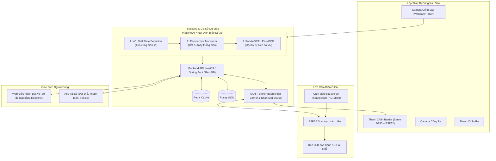

# PHÂN TÍCH CHI TIẾT ĐỀ TÀI 04: SMART PARKING & ANPR BARRIER
## (Hệ Thống Đặt Chỗ Đỗ Xe Thông Minh & Nhận Diện Biển Số Xe Tự Động Mở Barrier)

---

## 1. TỔNG QUAN & BÀI TOÁN THỰC TẾ

### 1.1. Bối cảnh
Tại các toà nhà văn phòng, chung cư và trung tâm thương mại lớn:
- Tài xế mất từ 10 - 20 phút chạy lòng vòng dưới hầm chỉ để tìm một vị trí đỗ xe còn trống.
- Cửa ngõ ra/vào bị ùn ứ do bảo vệ phải dùng thẻ từ quẹt thủ công, đối soát vé giấy dễ thất lạc hoặc gian lận tiền gửi xe.

### 1.2. Giải pháp của dự án
1. **Ứng dụng đặt chỗ trước (Mobile/Web App):**
   - Tài xế xem sơ đồ mặt bằng bãi xe (Slot Matrix) theo thời gian thực (vị trí nào đỏ là đã có xe, xanh là đang trống).
   - Đặt trước 1 ô đỗ xe, nhập biển số xe và thanh toán cọc qua ví điện tử.
2. **Hệ thống AI nhận diện biển số tự động (ANPR - Automatic Number Plate Recognition):**
   - Xe tiến đến cổng -> Camera nhận diện biển số trong 0.2s.
   - Đối chiếu với CSDL: Nếu xe đã đặt trước hoặc là cư dân toà nhà -> Hệ thống điều khiển vi điều khiển **mở thanh chắn barrier tự động**.
3. **Mạng cảm biến ô đỗ (Smart Slot IoT):**
   - Cảm biến siêu âm / từ trường tại từng ô đỗ xe gửi trạng thái có/không có xe lên Server.

---

## 2. SƠ ĐỒ KIẾN TRÚC HỆ THỐNG

---

## 3. BẢNG LINH KIỆN IOT MÔ PHỎNG

| Linh kiện | Vai trò trong hệ thống | Giá ước lượng |
| :--- | :--- | :---: |
| **ESP32 DevKit V1** | Nhận lệnh mở Barrier qua MQTT, đọc cảm biến | ~80.000 VNĐ |
| **Động cơ Servo SG90** | Làm cần gạt thanh chắn Barrier mô hình quay 90 độ | ~30.000 VNĐ |
| **Cảm biến siêu âm HC-SR04** | Đặt tại ô đỗ, phát hiện xe đã lùi vào chuồng hay chưa | ~25.000 VNĐ |
| **Đèn LED 2 màu (Xanh/Đỏ)** | Báo trạng thái trống (Xanh) hoặc có xe (Đỏ) | ~5.000 VNĐ |
| **Webcam USB máy tính** | Đóng vai trò Camera AI gắn trước cổng bãi xe | Có sẵn |
| **TỔNG CHI PHÍ** | | **~140.000 VNĐ** |

---

## 4. PIPELINE NHẬN DIỆN BIỂN SỐ VIỆT NAM (ANPR)

Pipeline gồm 3 bước rõ ràng:
1. **Bước 1 (Plate Localization):** Mô hình **YOLOv8n** được huấn luyện với dataset biển số xe máy / ô tô Việt Nam để xuất ra toạ độ Bounding Box `[x, y, w, h]` của biển số.
2. **Bước 2 (Image Pre-processing):** Cắt ảnh vùng biển số, chuyển đổi ảnh xám (Grayscale), cân bằng độ tương phản (Histogram Equalization) và xoay nghiêng nếu góc chụp bị chéo.
3. **Bước 3 (Character Recognition - OCR):** Đưa qua **PaddleOCR** hoặc **EasyOCR** để đọc chuỗi ký tự (Ví dụ: `29A-123.45` hoặc `59F1-888.88`). Thời gian xử lý toàn bộ pipeline: **~120ms - 200ms** trên CPU thường.
