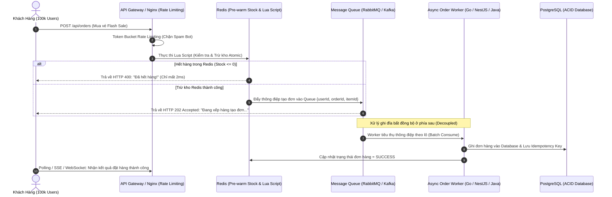
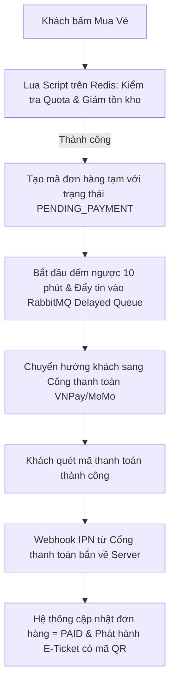
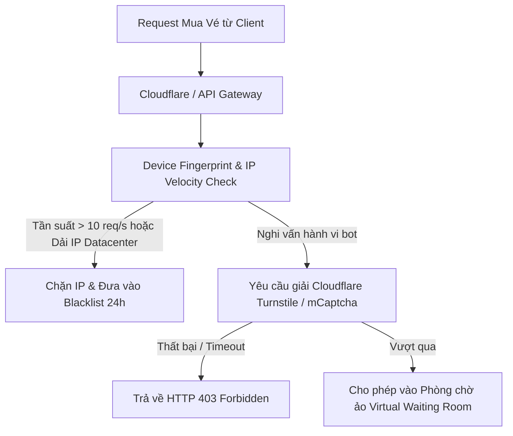

# PHÂN TÍCH CHI TIẾT ĐỀ TÀI 05: HIGH-CONCURRENCY FLASH SALE & TICKETING
## (Hệ Thống Săn Vé & Bán Hàng Flash Sale Chịu Tải Cao: Redis Lock, RabbitMQ & Idempotency)

---

## 1. TỔNG QUAN & BÀI TOÁN KỸ THUẬT

### 1.1. Bối cảnh
Khi mở bán vé concert (như BlackPink, Anh Trai Say Hi) hoặc Flash Sale 11/11 trên sàn TMĐT:
- Có **100.000 người dùng** cùng bấm nút "Đặt mua" vào đúng giây thứ 00:00.
- Số lượng hàng/vé trong kho chỉ có **1.000 sản phẩm**.
- Nếu dùng hệ thống CRUD thông thường (gọi thẳng lệnh SQL `SELECT ... UPDATE` vào cơ sở dữ liệu), DB sẽ bị nghẽn (Connection Pool Exhausted), CPU 100%, gây ra hiện tượng **Bán âm hàng (Overselling)** hoặc sập toàn bộ dịch vụ.

### 1.2. Mục tiêu dự án của cá nhân
Xây dựng một hệ thống phân tán chịu tải cao chuẩn doanh nghiệp:
- Xử lý được từ **5.000 đến 15.000 Requests/giây (RPS)** trên một máy chủ đơn lẻ.
- Đảm bảo tính nhất quán dữ liệu tuyệt đối (**Zero Overselling**).
- Khách hàng không bị trừ tiền 2 lần khi bấm nút nhiều lần (Idempotent API).
- Có số liệu đo lường, biểu đồ tải thực tế bằng công cụ Benchmark (**k6 / Locust**).

---

## 2. SƠ ĐỒ LUỒNG XỬ LÝ CHỊU TẢI CAO (ARCHITECTURAL FLOW)



---

## 3. CÁC KỸ THUẬT CỐT LÕI BẮT BUỘC CÓ TRONG DỰ ÁN

### 3.1. Chống bán âm bằng Redis Lua Script (Atomic Execution)
Trong Redis, Lua Script được thực thi đơn luồng nguyên tử (Atomic). Không bao giờ có hiện tượng 2 request cùng đọc thấy còn 1 sản phẩm:

```lua
-- stock_decrement.lua
local stock_key = KEYS[1]
local user_key = KEYS[2]
local user_id = ARGV[1]

-- 1. Kiểm tra xem user này đã mua món này chưa (Chống mua lặp lại)
if redis.call('SISMEMBER', user_key, user_id) == 1 then
    return -1 -- Mã lỗi: Mỗi người chỉ được mua 1 lần
end

-- 2. Kiểm tra tồn kho
local current_stock = tonumber(redis.call('GET', stock_key) or "0")
if current_stock <= 0 then
    return 0 -- Mã lỗi: Hết hàng
end

-- 3. Trừ kho và lưu vết user
redis.call('DECR', stock_key)
redis.call('SADD', user_key, user_id)
return 1 -- Thành công
```

### 3.2. Idempotency Key (Chống lặp thanh toán)
- Mỗi yêu cầu đặt hàng gửi lên kèm một `Idempotency-Key` (UUID) do client sinh ra.
- Server lưu key này vào Redis với thời gian sống TTL 5 phút. Nếu cùng 1 key được gửi lần 2, hệ thống lập tức trả về kết quả cũ mà không gọi thanh toán lại.

### 3.3. Xếp hàng bất đồng bộ (Asynchronous Queue Decoupling)
- Thay vì để người dùng chờ ghi vào PostgreSQL (tốn 50ms - 200ms), API trả về ngay sau khi trừ kho trên Redis (chỉ tốn 2ms - 5ms).
- **RabbitMQ** tiếp nhận đơn hàng và nhả dần cho Worker xử lý ở tốc độ mà Database có thể chịu đựng được (Backpressure Handling).

---

## 4. BỘ TEST CASE & KỊCH BẢN CHỨNG MINH KHI BẢO VỆ ĐỒ ÁN

Để đồ án đạt điểm A+ tuyệt đối, bạn chuẩn bị sẵn một bài kiểm thử tải bằng **k6**:
- **Kịch bản test:**
  - Cấu hình 1.000 sản phẩm trong kho.
  - Chạy k6 giả lập **20.000 Virtual Users (VU)** cùng bắn request mua trong 10 giây.
- **Kết quả minh chứng:**
  - Tỉ lệ thành công: Đúng chính xác **1.000 đơn hàng**, không bao giờ là 1.001 (Zero Overselling).
  - Tỉ lệ lỗi: 19.000 request còn lại nhận phản hồi HTTP 400 "Hết hàng" với độ trễ (P99 Latency) < 15ms.
  - Server không hề bị Crash hay treo CPU.

---

## 5. PHÂN TÍCH NGHIỆP VỤ & CÁC LUỒNG HOẠT ĐỘNG (BUSINESS FLOWS)

### 5.1. Các vai trò & Nghiệp vụ người dùng (Actors & Roles)
- **Khách hàng (Buyer):** Xếp hàng trong phòng chờ ảo (Waiting Room), tranh suất mua vé/hàng, giữ chỗ trong 10 phút, thanh toán trực tuyến.
- **Quản trị viên / Ban tổ chức (Event Admin):** Cấu hình sự kiện Flash Sale (thời điểm mở bán, số lượng vé từng hạng ghế, giới hạn số vé/user), xem biểu đồ lưu lượng và doanh thu realtime.

### 5.2. Các quy tắc nghiệp vụ bất biến (Business Rules)
1. **Quy tắc giữ chỗ có thời hạn (Order Hold Timeout):**
   - Khi trừ kho thành công trên Redis, người dùng có đúng **10 phút (600 giây)** để hoàn tất thanh toán.
   - Nếu sau 10 phút không thanh toán: Đơn hàng bị hủy, số lượng vé tự động được cộng trả lại kho Redis (**Stock Rollback**) để người khác mua.
2. **Quy tắc giới hạn mua (Purchase Quota):** Mỗi định danh người dùng (`user_id` + số điện thoại) chỉ được mua tối đa 2 vé trong 1 sự kiện.
3. **Quy tắc phòng chờ ảo (Virtual Waiting Room Throttling):**
   - Khi lưu lượng vượt quá 10.000 RPS, Gateway tự động chuyển hướng người dùng mới vào hàng chờ FIFO (sử dụng Redis ZSET với Score = Timestamp).
   - Hệ thống mở van (Leaky Bucket) cho phép 500 người dùng mỗi giây tiến vào trang thanh toán để bảo vệ hệ thống không bị sập.

### 5.3. Luồng hoạt động 1: Giữ Chỗ & Thanh Toán Thành Công (Happy Path)



### 5.4. Luồng hoạt động 2: Luồng Hết Hạn Thanh Toán & Tự Động Hoàn Tồn Kho (Rollback Flow)
1. Khách giữ chỗ thành công nhưng đóng trình duyệt hoặc không thanh toán.
2. Sau 10 phút, **RabbitMQ Delayed Exchange** (hoặc Redis Key Expiration) kích hoạt Consumer:
3. Worker kiểm tra đơn hàng trong Database:
   - Nếu trạng thái vẫn là `PENDING_PAYMENT`:
     - Chuyển trạng thái đơn hàng sang `EXPIRED_CANCELLED`.
     - Thực thi lệnh Redis `INCR stock_key` để hoàn trả 1 vé về kho.
     - Xóa `user_id` khỏi Redis Set để giải phóng quota.
4. Vé lập tức khả dụng cho những người đang xếp hàng tiếp theo.

---

### 5.5. Luồng hoạt động 3: Hệ Thống Phòng Thủ Chống Bot & Đầu Cơ Vé (Anti-Scalping Engine)

Trong các sự kiện săn vé concert hoặc flash sale lớn, hơn 70% lượng request đến từ các script tự động / chợ đen gom vé:



- **Đặc trưng nhận diện Bot:**
  - Nhận diện vân tay thiết bị (Canvas fingerprint, WebGL, User-Agent bất thường).
  - Tốc độ tương tác (Time to click): Khách hàng thật mất ít nhất 1.5 - 3 giây để nhìn và bấm nút mua; bot gửi request chỉ sau 10 mili-giây kể từ khi mở cổng.

---

### 5.6. Nghiệp vụ Đối soát Tồn kho & Dòng tiền Tự động (End-of-Sale Reconciliation)

Sau mỗi đợt mở bán, một Big Project bắt buộc phải có cơ chế **Đối soát 3 bên (3-Way Post-Sale Reconciliation)** để phát hiện lệch số liệu:

$$\Delta \text{Stock} = \text{Tồn kho ban đầu} - \left( \sum \text{Đơn hàng PAID} + \text{Tồn kho còn dư trên Redis} \right)$$

- Nếu $\Delta \text{Stock} \ne 0$: Hệ thống tự động kích hoạt tiến trình rà soát:
  1. Quét tìm các **Giao dịch mồ côi (Orphan Transactions):** Tiền đã trừ ở cổng VNPay nhưng Webhook bị rớt mạng nên đơn hàng trên hệ thống vẫn ở trạng thái `PENDING`.
  2. Tự động gọi API truy vấn trạng thái giao dịch sang cổng thanh toán (Query DR API).
  3. Nếu thanh toán thành công thật nhưng kho đã bị người khác mua mất do hết hạn giữ chỗ: Tự động kích hoạt **Quy trình Hoàn tiền tự động (Auto-Refund Flow)** về tài khoản khách hàng kèm email xin lỗi trong vòng 3 phút.

---

### 5.7. Chính Sách Hạ Tải Chủ Động & Cầu Chì Tự Ngắt (Circuit Breaker & Graceful Degradation)

Khi lưu lượng truy cập vượt quá ngưỡng tính toán (CPU server $\ge 90\%$ hoặc Connection Pool Database $\ge 85\%$):
- **Cơ chế Cắt tỉa tính năng (Feature Degradation):** Tự động tắt tạm thời các dịch vụ không thiết yếu: Gợi ý sản phẩm liên quan (Recommendation), Đánh giá/Bình luận (Reviews), Bắn thông báo đẩy (Push Notifications) để dành 100% tài nguyên CPU và RAM phục vụ độc quyền tiến trình **Checkout & Thanh toán**.
- **Cầu chì bảo vệ Database (Database Circuit Breaker):** Nếu độ trễ phản hồi của PostgreSQL vượt quá 500ms trong 30 giây liên tục, API Gateway lập tức chuyển trạng thái sang `OPEN`, từ chối nhận thêm đơn hàng mới với thông báo *"Hệ thống đang quá tải, vui lòng thử lại sau 30 giây"* nhằm bảo vệ cơ sở dữ liệu không bị sập hoàn toàn.


