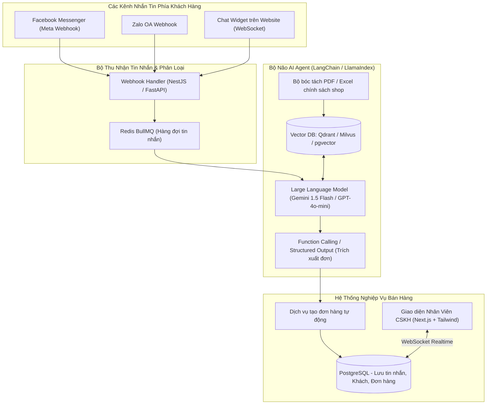
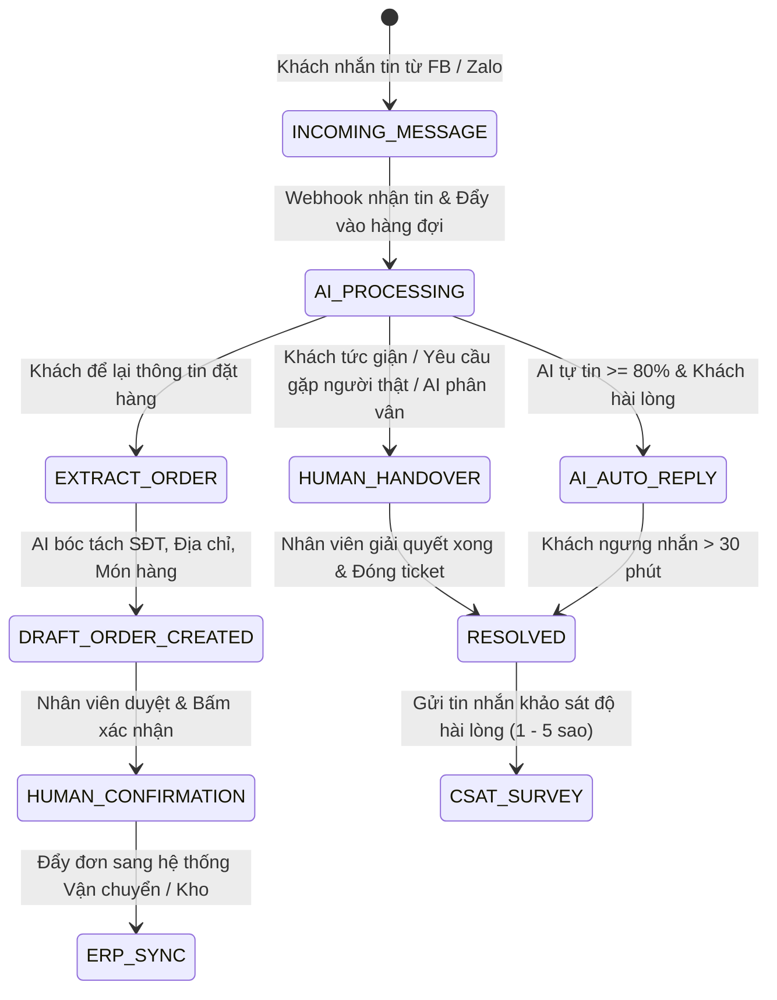

# PHÂN TÍCH CHI TIẾT ĐỀ TÀI 06: AI MULTI-CHANNEL CUSTOMER SUPPORT INBOX
## (Hộp Thư Chăm Sóc Khách Hàng Đa Kênh Tích Hợp RAG AI Agent Chốt Đơn Tự Động)

---

## 1. TỔNG QUAN & BÀI TOÁN KINH DOANH THỰC TẾ

### 1.1. Bối cảnh
Các shop kinh doanh online, doanh nghiệp vừa và nhỏ (SME) bán hàng trên nhiều nền tảng:
- Fanpage Facebook, Zalo Official Account (OA), Telegram, Website Livechat.
- Nhân viên phải chuyển qua lại giữa 4 - 5 tab trình duyệt khác nhau để trả lời tin nhắn của khách.
- Khách hàng hỏi vào ban đêm (23h - 6h sáng) không có ai trực -> Khách bỏ sang shop khác mua.
- Chatbot truyền thống (Rule-based dạng bấm phím 1, phím 2) quá cứng nhắc, trả lời sai ngữ cảnh khiến khách khó chịu.

### 1.2. Giải pháp của dự án
1. **Hộp thư hợp nhất (Unified Social Inbox):**
   - Gom toàn bộ tin nhắn từ Facebook Messenger, Zalo OA và Website Widget về một màn hình duy nhất cho nhân viên.
2. **AI Sales Agent (RAG - Retrieval-Augmented Generation):**
   - Chủ shop chỉ cần upload tài liệu Word/PDF bảng giá, catalogue sản phẩm, chính sách bảo hành.
   - Khi có tin nhắn đến, AI tự động tra cứu tài liệu và trả lời khách tự nhiên như người thật.
3. **Tự động trích xuất thông tin & Chốt đơn (Auto Order Extraction):**
   - Khi khách đồng ý mua: *"Ship cho anh 2 hộp cà phê về 123 Cầu Giấy, số điện thoại 0987654321"*.
   - AI tự động trích xuất thực thể (Named Entity Recognition: Số lượng, Tên món, Địa chỉ, Số điện thoại) và **tạo ngay đơn hàng nháp** vào hệ thống quản lý.

---

## 2. SƠ ĐỒ KIẾN TRÚC HỆ THỐNG

---

## 3. CÁC ĐIỂM NHẤN KỸ THUẬT NỔI BẬT

1. **RAG Hybrid Search (Tìm kiếm kết hợp):**
   - Kết hợp giữa **Dense Vector Search** (ngữ nghĩa câu hỏi) và **Sparse Keyword Search** (BM25 - tìm chính xác mã sản phẩm, SKU, số tiền) giúp AI không bao giờ bị "ảo giác" (hallucination) về giá tiền.
2. **Cơ chế Human-in-the-Loop (Bàn giao cho nhân viên):**
   - Nếu AI phát hiện sentiment của khách đang bực bội (tức giận, khiếu nại) hoặc câu hỏi vượt quá độ tin cậy $0.75$, hệ thống tự động tắt chế độ Auto-Reply và rung chuông thông báo cho nhân viên con người tiếp quản cuộc trò chuyện.
3. **Structured Output (Function Calling):**
   - Ép kiểu trả về của LLM thành JSON schema chuẩn của đơn hàng để đẩy thẳng vào Database mà không sợ lỗi định dạng.

---

## 4. MA TRẬN ACTORS & PHÂN QUYỀN ĐA DOANH NGHIỆP (MULTI-TENANT RBAC)

Hệ thống được thiết kế theo mô hình B2B SaaS phục vụ đồng thời hàng trăm doanh nghiệp/chủ shop độc lập:

| Actor / Vai trò | Trách nhiệm & Quyền hạn nghiệp vụ trong Big Project |
| :--- | :--- |
| **Tenant Owner (Chủ doanh nghiệp / Giám đốc kinh doanh)** | Quản lý tài khoản doanh nghiệp, nạp tiền mua token LLM, cấu hình kênh kết nối (Fanpage token, Zalo secret), xem Dashboard doanh thu và CSAT tổng. |
| **Customer Support Team Lead (Trưởng ca trực CSKH)** | Giám sát danh sách cuộc trò chuyện theo thời gian thực, can thiệp điều chuyển hội thoại giữa các nhân viên, phê duyệt tài liệu tri thức mới cho AI. |
| **Human Support Agent (Nhân viên tư vấn)** | Tiếp nhận các ca khó mà AI bàn giao (Handover), chat trực tiếp với khách, chỉnh sửa và xác nhận đơn hàng nháp do AI trích xuất. |
| **AI Sales & Support Agent** | Trực 24/7, tự động trả lời khách hàng dưới 2 giây theo phong cách thương hiệu, tra cứu chính sách, tự động tạo đơn hàng nháp. |
| **End Customer (Người mua hàng đa kênh)** | Nhắn tin từ Facebook Messenger, Zalo OA, Website Livechat, nhận tư vấn và link thanh toán/xác nhận đơn. |

---

## 5. PHÂN TÍCH NGHIỆP VỤ BIG PROJECT & BẢN ĐỒ QUY TRÌNH (ENTERPRISE AI CSKH WORKFLOWS)

---

### 5.1. Nghiệp vụ Phân luồng & Cân bằng tải Hội thoại (Skill-Based Routing & Load Balancing)
- **Thuật toán phân bổ nhân viên (Round-Robin & Workload Matching):**
  - Khi một cuộc trò chuyện cần chuyển giao cho con người, hệ thống không bắn bừa bãi mà kiểm tra:
    1. Trạng thái hoạt động của nhân viên (`ONLINE`, `BUSY`, `AWAY`).
    2. Số lượng cuộc trò chuyện đang xử lý đồng thời (Max 5 chats/nhân viên).
    3. Thẻ kỹ năng (Tag): Khách hỏi về kỹ thuật/bảo hành chuyển cho nhân viên kỹ thuật; khách hỏi mua sỉ chuyển cho nhân viên Sales B2B.

---

### 5.2. Nghiệp vụ Quản trị Cam kết Chất lượng & Leo thang SLA (SLA Escalation Engine)
- **Chỉ số thời gian phản hồi (First Response Time - FRT):** Cam kết phản hồi khách dưới 30 giây trong giờ hành chính.
- **Quy tắc leo thang (Escalation Rule):**
  - Nếu sau 2 phút nhân viên chưa phản hồi tin nhắn của khách: Hệ thống tự động gửi thông báo nhắc nhở lên màn hình nhân viên.
  - Nếu sau 5 phút vẫn chưa phản hồi: Hệ thống tự động chuyển cuộc trò chuyện lên cấp **Team Lead** và đánh dấu vi phạm chỉ số KPI của nhân viên trong ngày.

---

### 5.3. Quy trình Trích xuất Đơn hàng & Chống Bom Hàng COD (Auto-Order & Fraud Prevention)
- Khi AI phát hiện khách có ý định mua hàng:
  1. AI trích xuất thực thể: `Họ tên`, `Số điện thoại`, `Địa chỉ giao hàng`, `Danh sách sản phẩm & số lượng`.
  2. **Kiểm tra độ tin cậy số điện thoại (Blacklist & Spam Check):**
     - Tra cứu số điện thoại trong cơ sở dữ liệu lịch sử mua hàng hoặc API cảnh báo số điện thoại chuyên bom hàng.
     - Nếu số điện thoại có tỷ lệ hoàn đơn $> 40\%$: AI tự động thông báo: *"Dạ shop hỗ trợ giao hàng, tuy nhiên với đơn này shop nhờ anh/chị đặt cọc trước phí ship 30.000đ qua mã QR bên dưới nhé ạ"*.
  3. Tạo đơn hàng trạng thái `DRAFT` và gửi tin nhắn tóm tắt cho khách xác nhận: *"Shop xin chốt lại đơn của anh gồm [2 hộp Cà phê]. Anh kiểm tra thông tin đúng chưa ạ?"*.

---

### 5.4. Vòng đời Quản trị Tri thức & Giám sát Ảo giác AI (Knowledge Base & RAG Evaluation)
- **Quy trình cập nhật tri thức:** Khi chủ shop sửa bảng giá hoặc thêm sản phẩm mới:
  - File PDF/Excel được đưa vào luồng Chunking $\rightarrow$ Sinh Vector Embeddings mới $\rightarrow$ Cập nhật vào Vector Database trong vòng 60 giây.
- **Đánh giá phản hồi con người (RLHF / Human Feedback Loop):**
  - Nhân viên có quyền bấm nút "👍 Câu trả lời tốt" hoặc "👎 Trả lời sai" bên cạnh mỗi tin nhắn của AI.
  - Các câu trả lời bị gắn cờ "👎" tự động đưa vào danh sách **Audit Backlog** để quản trị viên bổ sung dữ liệu tri thức hoặc tinh chỉnh System Prompt.

---

### 5.5. Nghiệp vụ Quản lý Hạn mức Tiêu thụ Token SaaS (Token Metering & Billing Quota)
- Để tránh việc doanh nghiệp bị cạn tiền do khách spam bot:
  - Mỗi tài khoản Tenant được cấu hình hạn mức hàng tháng (Ví dụ: Gói Basic: 500.000 tokens/tháng; Gói Pro: 5.000.000 tokens/tháng).
  - Hệ thống áp dụng **Token Bucket Rate Limiting** trên từng số điện thoại người dùng: Mỗi khách hàng chỉ được nhắn tối đa 20 tin nhắn với AI trong vòng 10 phút để tránh bị bot tấn công tiêu hao chi phí API.

