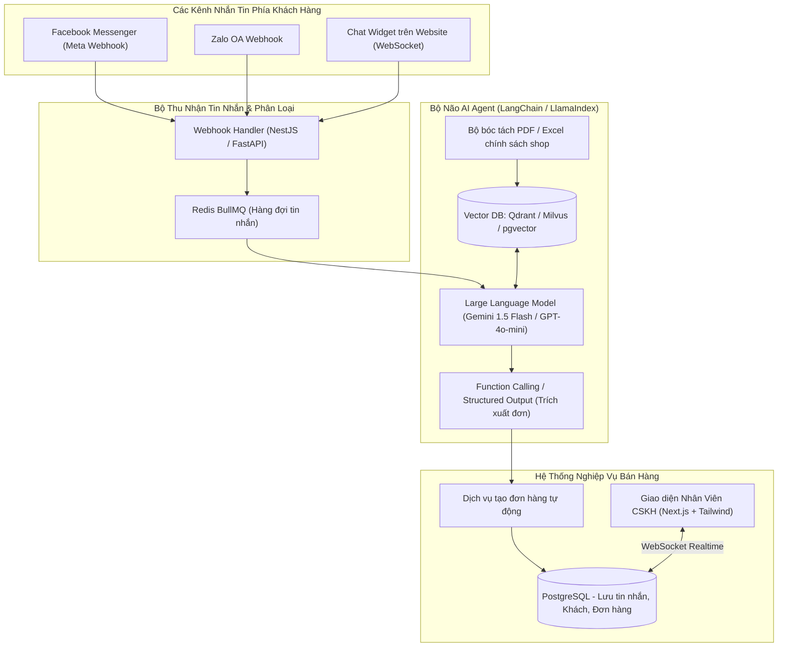

# PHÂN TÍCH CHI TIẾT ĐỀ TÀI 06: AI MULTI-CHANNEL CUSTOMER SUPPORT INBOX
## (Hộp Thư Chăm Sóc Khách Hàng Đa Kênh Tích Hợp RAG AI Agent Chốt Đơn Tự Động)

---

## 1. TỔNG QUAN & BÀI TOÁN KINH DOANH THỰC TẾ

### 1.1. Bối cảnh
Các shop kinh doanh online, doanh nghiệp vừa và nhỏ (SME) bán hàng trên nhiều nền tảng:
- Fanpage Facebook, Zalo Official Account (OA), Telegram, Website Livechat.
- Nhân viên phải chuyển qua lại giữa 4 - 5 tab trình duyệt khác nhau để trả lời tin nhắn của khách.
- Khách hàng hỏi vào ban đêm (23h - 6h sáng) không có ai trực -> Khách bỏ sang shop khác mua.
- Chatbot truyền thống (Rule-based dạng bấm phím 1, phím 2) quá cứng nhắc, trả lời sai ngữ cảnh khiến khách khó chịu.

### 1.2. Giải pháp của dự án
1. **Hộp thư hợp nhất (Unified Social Inbox):**
   - Gom toàn bộ tin nhắn từ Facebook Messenger, Zalo OA và Website Widget về một màn hình duy nhất cho nhân viên.
2. **AI Sales Agent (RAG - Retrieval-Augmented Generation):**
   - Chủ shop chỉ cần upload tài liệu Word/PDF bảng giá, catalogue sản phẩm, chính sách bảo hành.
   - Khi có tin nhắn đến, AI tự động tra cứu tài liệu và trả lời khách tự nhiên như người thật.
3. **Tự động trích xuất thông tin & Chốt đơn (Auto Order Extraction):**
   - Khi khách đồng ý mua: *"Ship cho anh 2 hộp cà phê về 123 Cầu Giấy, số điện thoại 0987654321"*.
   - AI tự động trích xuất thực thể (Named Entity Recognition: Số lượng, Tên món, Địa chỉ, Số điện thoại) và **tạo ngay đơn hàng nháp** vào hệ thống quản lý.

---

## 2. SƠ ĐỒ KIẾN TRÚC HỆ THỐNG

---

## 3. CÁC ĐIỂM NHẤN KỸ THUẬT NỔI BẬT

1. **RAG Hybrid Search (Tìm kiếm kết hợp):**
   - Kết hợp giữa **Dense Vector Search** (ngữ nghĩa câu hỏi) và **Sparse Keyword Search** (BM25 - tìm chính xác mã sản phẩm, SKU, số tiền) giúp AI không bao giờ bị "ảo giác" (hallucination) về giá tiền.
2. **Cơ chế Human-in-the-Loop (Bàn giao cho nhân viên):**
   - Nếu AI phát hiện sentiment của khách đang bực bội (tức giận, khiếu nại) hoặc câu hỏi vượt quá độ tin cậy $0.75$, hệ thống tự động tắt chế độ Auto-Reply và rung chuông thông báo cho nhân viên con người tiếp quản cuộc trò chuyện.
3. **Structured Output (Function Calling):**
   - Ép kiểu trả về của LLM thành JSON schema chuẩn của đơn hàng để đẩy thẳng vào Database mà không sợ lỗi định dạng.
