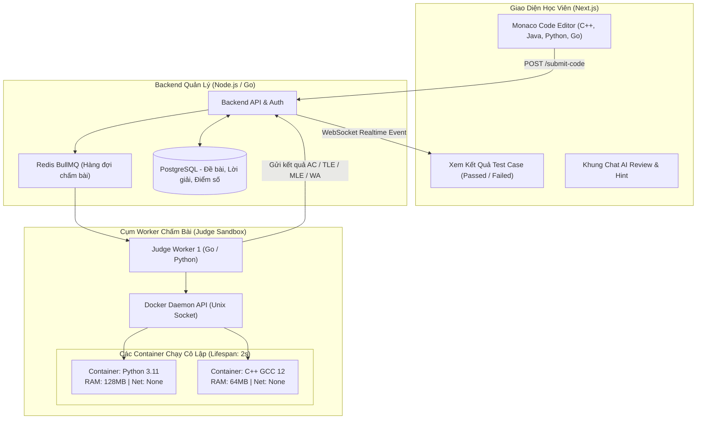
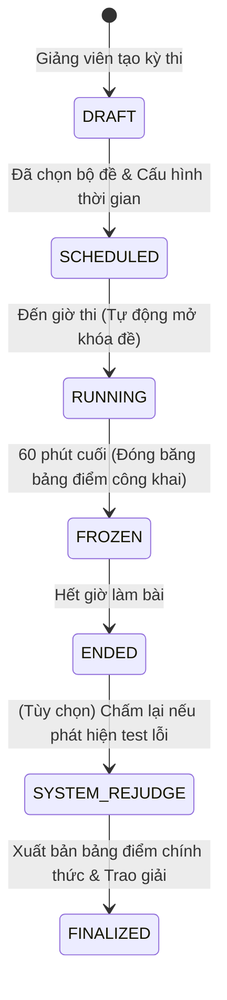
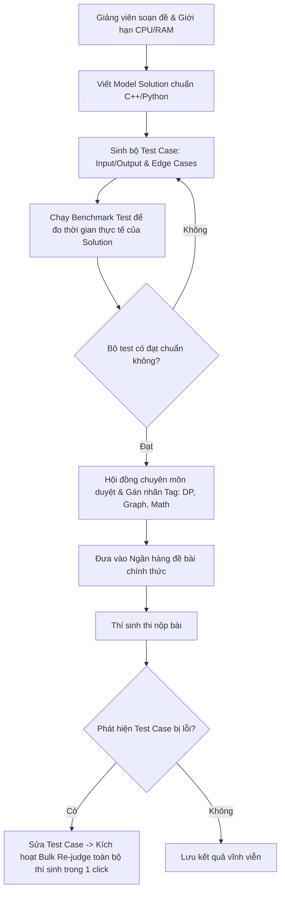

# PHÂN TÍCH CHI TIẾT ĐỀ TÀI 07: ONLINE CODE JUDGE & DOCKER SANDBOX
## (Nền Tảng Luyện Lập Trình & Chấm Code Trực Tuyến Bằng Docker Sandbox Cách Ly An Toàn)

---

## 1. TỔNG QUAN & BÀI TOÁN KỸ THUẬT

### 1.1. Bối cảnh
Các trường đại học CNTT và các doanh nghiệp tuyển dụng lập trình viên đều cần hệ thống kiểm tra năng lực code tự động (như LeetCode, HackerRank, Codeforces).
- Thách thức lớn nhất: **Làm sao để thực thi mã nguồn tùy ý (Python, C++, Java, JS) do người dùng gửi lên một cách an toàn mà không làm sập server hay bị hack máy chủ?**
- Người dùng có thể viết các đoạn mã độc: vòng lặp vô tận (Fork Bomb làm sập CPU), cấp phát RAM vô hạn (OOM Crash), đọc trộm file hệ thống `/etc/passwd` hoặc mở reverse shell tấn công ra ngoài Internet.

### 1.2. Giải pháp của dự án
1. **Trình soạn thảo trực quan (Monaco Editor):** Giao diện làm bài tập như VSCode thu nhỏ, hỗ trợ gợi ý code và chạy thử test case.
2. **Hệ thống chấm bài cô lập (Isolated Remote Code Execution Engine):**
   - Sử dụng **Docker Engine API** kết hợp **Linux Cgroups & Namespaces** để tạo môi trường sandbox siêu nhẹ cho từng lần nộp bài.
   - Giới hạn nghiêm ngặt: CPU (max 1 core), RAM (max 128MB), Thời gian chạy (Time Limit 1.0s), Tắt hoàn toàn card mạng (`--net=none`).
3. **Trợ lý AI hỗ trợ học tập (AI Tutor):**
   - Khi bài nộp bị `Wrong Answer` hoặc `Runtime Error`, học viên có thể bấm "Hỏi AI" để được giải thích lỗi và gợi ý thuật toán tối ưu mà không tiết lộ thẳng đáp án.

---

## 2. SƠ ĐỒ KIẾN TRÚC HỆ THỐNG

---

## 3. CÁC BIỆN PHÁP BẢO MẬT HỆ THỐNG CỐT LÕI (SECURITY HIGHLIGHTS)

Khi bảo vệ đề tài này, hội đồng luôn hỏi về bảo mật Sandbox. Bạn có các lớp phòng thủ chuẩn doanh nghiệp:

| Nguy cơ tấn công từ mã độc | Giải pháp kỹ thuật trong dự án |
| :--- | :--- |
| **Vòng lặp vô tận (Infinite Loop)** | Cấu hình `Timeout = 1.0s` bằng lệnh `timeout` của Linux. Quá giờ -> Trả về mã lỗi `TLE (Time Limit Exceeded)`. |
| **Tràn bộ nhớ RAM (OOM Bomb)** | Bật cgroup: `--memory=128m --memory-swap=128m`. Nếu ngốn quá RAM -> Container tự hủy và báo `MLE (Memory Limit Exceeded)`. |
| **Tấn công sập nhân Linux (Fork Bomb)** | Bật cgroup giới hạn tiến trình tối đa: `--pids-limit=32`. |
| **Đánh cắp dữ liệu máy chủ** | Chạy container với tài khoản không có quyền root (`--user 1000:1000`), hệ thống file chỉ đọc (`--read-only`), chỉ cho phép ghi tạm vào `/tmp` trong RAM (`tmpfs`). |
| **Gửi mã độc tấn công ra ngoài** | Ngắt kết nối mạng hoàn toàn của container (`--network=none`). |

---

## 4. BỘ KẾT QUẢ TRẢ VỀ CHUẨN OLYMPIAD / LEETCODE

Worker so sánh output của chương trình với đáp án ẩn và trả về các mã trạng thái:
- **AC (Accepted):** Vượt qua 100% test case trong giới hạn thời gian/bộ nhớ.
- **WA (Wrong Answer):** Output sai so với đáp án mẫu.
- **TLE (Time Limit Exceeded):** Chạy quá thời gian cho phép.
- **MLE (Memory Limit Exceeded):** Ngốn quá dung lượng RAM cho phép.
- **RE (Runtime Error):** Crash lỗi ngoại lệ (Index out of range, Divide by zero...).
- **CE (Compilation Error):** Lỗi cú pháp khi biên dịch.

---

## 5. PHÂN TÍCH NGHIỆP VỤ BIG PROJECT & BẢN ĐỒ QUY TRÌNH (ENTERPRISE EDTECH & DEVTOOLS WORKFLOWS)

Để đề tài đạt chuẩn **Big Project cấp Doanh nghiệp / Nền tảng SaaS quy mô lớn** (tương tự HackerEarth, LeetCode Enterprise, Codeforces), hệ thống không chỉ dừng ở việc "chạy Docker chấm code", mà sở hữu hệ thống nghiệp vụ toàn diện sau:

### 5.1. Ma trận Actors & Phân quyền Đa thực thể (Multi-Tenant RBAC)

Hệ thống hỗ trợ mô hình Multi-Tenancy (phục vụ đồng thời nhiều trường đại học hoặc doanh nghiệp công nghệ tuyển dụng trên cùng một hạ tầng):

| Actor / Vai trò | Trách nhiệm & Quyền hạn nghiệp vụ trong Big Project |
| :--- | :--- |
| **Platform Super Admin** | Quản trị toàn bộ cụm worker chấm bài, giám sát tài nguyên CPU/RAM hệ thống, cấu hình quota cho từng Tenant (trường học/doanh nghiệp). |
| **Tenant Admin (Trưởng khoa / Giám đốc kỹ thuật)** | Quản lý không gian riêng của tổ chức (subdomain riêng, logo riêng), quản lý danh sách giảng viên, phòng ban và ngân sách thi cử. |
| **Problem Setter (Tác giả đề bài / Giảng viên)** | Soạn thảo bài toán, thiết kế bộ test case ẩn, viết solution chuẩn (Model Solution) và checker tùy biến (Special Judge), thiết lập cấu hình giới hạn thời gian/bộ nhớ. |
| **Proctor / Reviewer (Giám thị / Hội đồng duyệt đề)** | Phê duyệt đề bài vào ngân hàng đề chung, giám sát phòng thi realtime qua Dashboard vi phạm, can thiệp xử lý hủy bài thi gian lận. |
| **Contestant / Candidate (Học viên / Ứng viên tuyển dụng)** | Tham gia giải bài, thi đấu contest thời gian thực, xem phân tích lỗi thuật toán, lịch sử submission và chứng chỉ năng lực code. |

---

### 5.2. Nghiệp vụ Tổ chức Kỳ thi & Bảng xếp hạng Thời gian thực (Contest Engine)

Hệ thống hỗ trợ 2 cơ chế tính điểm thi đấu chuẩn quốc tế:
1. **Chuẩn ACM-ICPC (Áp dụng cho kỳ thi lập trình sinh viên & tuyển dụng nhanh):**
   - Xếp hạng theo **Số bài giải được (Solved count)** $\rightarrow$ nếu bằng nhau xét **Tổng thời gian phạt (Penalty time)**.
   - Công thức Penalty:
     $$\text{Penalty} = \sum_{\text{bài AC}} \left( T_{\text{nộp thành công}} + 20 \text{ phút} \times N_{\text{lần nộp lỗi trước đó}} \right)$$
   - Bài nộp lỗi (WA, TLE, MLE, RE) chỉ bị cộng phạt nếu bài đó sau cùng đạt AC; nếu không AC thì không tính phạt.
2. **Chuẩn IOI / Olympiad (Chấm điểm từng phần theo Subtask):**
   - Đề bài chia làm nhiều Subtask với ràng buộc dữ liệu tăng dần (VD: Subtask 1: $N \le 100 \rightarrow$ 30 điểm; Subtask 2: $N \le 10^5 \rightarrow$ 70 điểm).
   - Điểm của thí sinh là tổng điểm cao nhất đạt được trên từng subtask độc lập.
3. **Quy tắc Đóng băng Bảng xếp hạng (Scoreboard Freeze):**
   - Trong 60 phút cuối của kỳ thi, bảng xếp hạng công khai tự động đóng băng: Thí sinh nộp bài chỉ thấy trạng thái `Pending/Chờ bế mạc` để giữ bí mật giải quán quân cho đến lễ trao giải.

---

### 5.3. Nghiệp vụ Chống Gian lận & Quét Đạo văn Mã nguồn (Anti-Cheat & Plagiarism Engine)

Trong môi trường thi cử trực tuyến, nghiệp vụ chống gian lận là tiêu chuẩn bắt buộc của một Big Project:

1. **Thuật toán quét đạo văn mã nguồn (AST Plagiarism Detection):**
   - Không dùng so khớp chuỗi thông thường (dễ bị qua mặt bằng cách đổi tên biến).
   - Hệ thống parse mã nguồn thành **Cây cú pháp trừu tượng (Abstract Syntax Tree - AST)**, chuẩn hóa tên định danh và áp dụng thuật toán Winnowing / MOSS.
   - Báo cáo ma trận tương đồng (Similarity Matrix): Nếu 2 bài nộp có độ tương đồng $\ge 85\%$, hệ thống tự động bôi đỏ các khối logic trùng khớp và cảnh báo giám thị.
2. **Giám sát môi trường thi (Proctoring Telemetry):**
   - Ghi nhận và phát hiện realtime: Sự kiện rời màn hình (Window Blur / Tab Switch count), paste đoạn code lớn bất thường từ bên ngoài (> 50 dòng trong 1 giây).
   - Cảnh báo trùng lặp IP hoặc Token thiết bị giữa nhiều tài khoản đang thi đồng thời.

---

### 5.4. Quy trình Vòng đời Soạn đề & Tái chấm thi (Problem Authoring & Re-judge Workflow)

- **Nghiệp vụ Re-judge hàng loạt:** Khi tác giả phát hiện một test case bị sai output hoặc đề bài bị mơ hồ, Admin chỉ cần upload test case mới và bấm `Re-judge Contest`. Hệ thống tự động đẩy hàng ngàn submission cũ vào hàng đợi ưu tiên thấp để chấm lại và tự động cập nhật lại bảng xếp hạng mà không làm gián đoạn hệ thống.

---

### 5.5. Nghiệp vụ Đánh giá Năng lực Ứng viên (Candidate Skill Profiling & Analytics)

Dành cho các doanh nghiệp B2B sử dụng nền tảng để tuyển dụng lập trình viên:
- **Biểu đồ Radar Năng lực 5 chiều:** Đánh giá ứng viên theo: *Hiệu quả thuật toán (Time Complexity), Tối ưu bộ nhớ (Memory Efficiency), Tốc độ gõ code & hoàn thành (Speed), Độ sạch của mã nguồn (Code Style), Khả năng xử lý biên ngoại lệ (Corner Cases).*
- **Phân tích hành vi gõ code (Code Playback):** Cho phép nhà tuyển dụng xem lại toàn bộ quá trình gõ từng ký tự của ứng viên như một thước phim video ngắn để đánh giá luồng tư duy giải quyết vấn đề.

