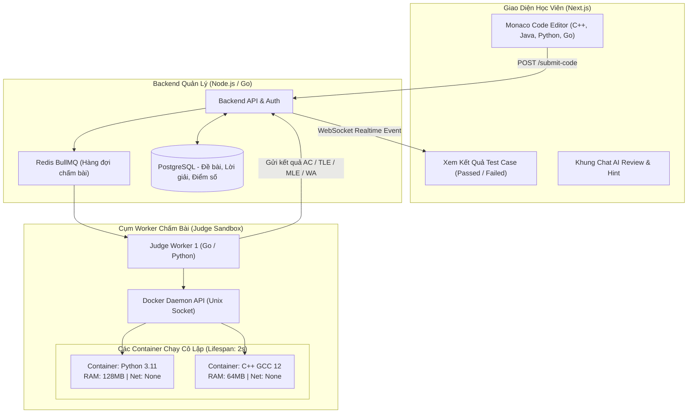

# PHÂN TÍCH CHI TIẾT ĐỀ TÀI 07: ONLINE CODE JUDGE & DOCKER SANDBOX
## (Nền Tảng Luyện Lập Trình & Chấm Code Trực Tuyến Bằng Docker Sandbox Cách Ly An Toàn)

---

## 1. TỔNG QUAN & BÀI TOÁN KỸ THUẬT

### 1.1. Bối cảnh
Các trường đại học CNTT và các doanh nghiệp tuyển dụng lập trình viên đều cần hệ thống kiểm tra năng lực code tự động (như LeetCode, HackerRank, Codeforces).
- Thách thức lớn nhất: **Làm sao để thực thi mã nguồn tùy ý (Python, C++, Java, JS) do người dùng gửi lên một cách an toàn mà không làm sập server hay bị hack máy chủ?**
- Người dùng có thể viết các đoạn mã độc: vòng lặp vô tận (Fork Bomb làm sập CPU), cấp phát RAM vô hạn (OOM Crash), đọc trộm file hệ thống `/etc/passwd` hoặc mở reverse shell tấn công ra ngoài Internet.

### 1.2. Giải pháp của dự án
1. **Trình soạn thảo trực quan (Monaco Editor):** Giao diện làm bài tập như VSCode thu nhỏ, hỗ trợ gợi ý code và chạy thử test case.
2. **Hệ thống chấm bài cô lập (Isolated Remote Code Execution Engine):**
   - Sử dụng **Docker Engine API** kết hợp **Linux Cgroups & Namespaces** để tạo môi trường sandbox siêu nhẹ cho từng lần nộp bài.
   - Giới hạn nghiêm ngặt: CPU (max 1 core), RAM (max 128MB), Thời gian chạy (Time Limit 1.0s), Tắt hoàn toàn card mạng (`--net=none`).
3. **Trợ lý AI hỗ trợ học tập (AI Tutor):**
   - Khi bài nộp bị `Wrong Answer` hoặc `Runtime Error`, học viên có thể bấm "Hỏi AI" để được giải thích lỗi và gợi ý thuật toán tối ưu mà không tiết lộ thẳng đáp án.

---

## 2. SƠ ĐỒ KIẾN TRÚC HỆ THỐNG

---

## 3. CÁC BIỆN PHÁP BẢO MẬT HỆ THỐNG CỐT LÕI (SECURITY HIGHLIGHTS)

Khi bảo vệ đề tài này, hội đồng luôn hỏi về bảo mật Sandbox. Bạn có các lớp phòng thủ chuẩn doanh nghiệp:

| Nguy cơ tấn công từ mã độc | Giải pháp kỹ thuật trong dự án |
| :--- | :--- |
| **Vòng lặp vô tận (Infinite Loop)** | Cấu hình `Timeout = 1.0s` bằng lệnh `timeout` của Linux. Quá giờ -> Trả về mã lỗi `TLE (Time Limit Exceeded)`. |
| **Tràn bộ nhớ RAM (OOM Bomb)** | Bật cgroup: `--memory=128m --memory-swap=128m`. Nếu ngốn quá RAM -> Container tự hủy và báo `MLE (Memory Limit Exceeded)`. |
| **Tấn công sập nhân Linux (Fork Bomb)** | Bật cgroup giới hạn tiến trình tối đa: `--pids-limit=32`. |
| **Đánh cắp dữ liệu máy chủ** | Chạy container với tài khoản không có quyền root (`--user 1000:1000`), hệ thống file chỉ đọc (`--read-only`), chỉ cho phép ghi tạm vào `/tmp` trong RAM (`tmpfs`). |
| **Gửi mã độc tấn công ra ngoài** | Ngắt kết nối mạng hoàn toàn của container (`--network=none`). |

---

## 4. BỘ KẾT QUẢ TRẢ VỀ CHUẨN OLYMPIAD / LEETCODE

Worker so sánh output của chương trình với đáp án ẩn và trả về các mã trạng thái:
- **AC (Accepted):** Vượt qua 100% test case trong giới hạn thời gian/bộ nhớ.
- **WA (Wrong Answer):** Output sai so với đáp án mẫu.
- **TLE (Time Limit Exceeded):** Chạy quá thời gian cho phép.
- **MLE (Memory Limit Exceeded):** Ngốn quá dung lượng RAM cho phép.
- **RE (Runtime Error):** Crash lỗi ngoại lệ (Index out of range, Divide by zero...).
- **CE (Compilation Error):** Lỗi cú pháp khi biên dịch.
