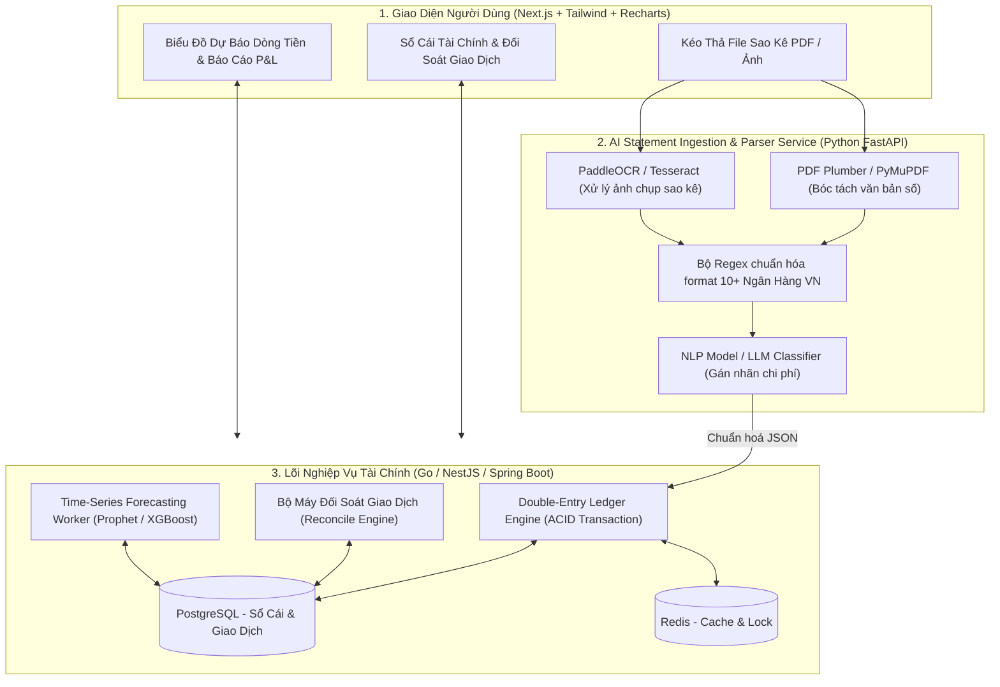
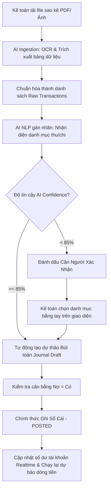

# PHÂN TÍCH CHI TIẾT ĐỀ TÀI: FINTECH & SME CASH-FLOW INTELLIGENCE
## (Hệ Thống Quản Trị Dòng Tiền Doanh Nghiệp SME & Tự Động Bóc Tách Sao Kê Ngân Hàng Bằng AI)

---

## 1. TỔNG QUAN & BÀI TOÁN KINH DOANH THỰC TẾ

### 1.1. Bối cảnh
Doanh nghiệp vừa và nhỏ (SME), các hộ kinh doanh và chủ shop bán hàng online thường sử dụng nhiều tài khoản ngân hàng (Vietcombank, MB, Techcombank, ACB...).
- Cuối tháng hoặc mỗi quý, kế toán/chủ shop mất hàng chục giờ để tải từng file sao kê định dạng PDF hoặc ảnh chụp biến động số dư, sau đó gõ tay từng dòng vào Excel để tính toán thu chi.
- Nhập tay rất dễ sai sót, không đối soát (reconcile) được với đơn hàng thực tế.
- Quan trọng nhất: Chủ doanh nghiệp không nhìn thấy được **bức tranh dự báo dòng tiền tương lai** (Cash Runway) dẫn đến tình trạng doanh thu trên giấy tờ có lãi nhưng tài khoản thực tế lại cạn tiền mặt để nhập hàng hoặc trả lương.

### 1.2. Giải pháp của dự án
1. **Lõi Sổ Cái Kế Toán Kép (Double-Entry General Ledger Engine):** Đảm bảo tính toàn vẹn và chuẩn mực tài chính kế toán quốc tế, mọi biến động tiền tệ đều tuân theo nguyên tắc cân bằng Nợ - Có (Debit = Credit).
2. **AI Statement Ingestion Pipeline (OCR & Regex Parser):** Người dùng chỉ cần kéo thả file sao kê PDF hoặc ảnh chụp sao kê từ các ngân hàng Việt Nam. AI tự động trích xuất cấu trúc: Ngày giao dịch, Số tiền, Tài khoản đối ứng, Nội dung chuyển khoản.
3. **Bộ Máy Tự Động Phân Loại Chi Phí (Auto-Categorization):** Sử dụng NLP / Embeddings để tự động gán nhãn giao dịch vào các danh mục tài chính (Ví dụ: *"TT tien thue nha T10"* -> Chi phí mặt bằng; *"Thanh toan tien bia HN"* -> Giá vốn hàng bán).
4. **Dự Báo Dòng Tiền Tương Lai (Cash-Flow Forecasting):** Sử dụng mô hình Time-Series Machine Learning để cảnh báo các điểm gãy dòng tiền trong 30 - 90 ngày tới.

---

## 2. SƠ ĐỒ KIẾN TRÚC HỆ THỐNG (SYSTEM ARCHITECTURE)



---

## 3. THIẾT KẾ CƠ SỞ DỮ LIỆU SỔ CÁI KẾ TOÁN KÉP (DOUBLE-ENTRY SCHEMA)

Đây là chuẩn mực tài chính cấp cao, tạo sự khác biệt hoàn toàn so với các ứng dụng ghi chép chi tiêu sinh viên thông thường:

```sql
-- 1. Bảng hệ thống tài khoản kế toán (Chart of Accounts)
CREATE TABLE accounts (
    id UUID PRIMARY KEY DEFAULT gen_random_uuid(),
    code VARCHAR(20) UNIQUE NOT NULL, -- Ví dụ: 111 (Tiền mặt), 112 (Tiền gửi ngân hàng), 511 (Doanh thu), 642 (Chi phí quản lý)
    name VARCHAR(255) NOT NULL,
    type VARCHAR(30) NOT NULL, -- ASSET (Tài sản), LIABILITY (Nợ), EQUITY (Vốn), REVENUE (Doanh thu), EXPENSE (Chi phí)
    balance DECIMAL(15, 2) DEFAULT 0.00,
    created_at TIMESTAMP DEFAULT CURRENT_TIMESTAMP
);

-- 2. Phiên giao dịch sổ cái (Journal Entry)
CREATE TABLE journal_entries (
    id UUID PRIMARY KEY DEFAULT gen_random_uuid(),
    entry_number VARCHAR(50) UNIQUE NOT NULL, -- Mã chứng từ kế toán
    transaction_date DATE NOT NULL,
    description TEXT NOT NULL,
    source_type VARCHAR(50), -- BANK_STATEMENT, MANUAL, INVOICE_SYNC
    created_by UUID,
    created_at TIMESTAMP DEFAULT CURRENT_TIMESTAMP
);

-- 3. Chi tiết bút toán Nợ - Có (Bắt buộc Tổng Nợ = Tổng Có)
CREATE TABLE journal_lines (
    id UUID PRIMARY KEY DEFAULT gen_random_uuid(),
    entry_id UUID REFERENCES journal_entries(id) ON DELETE CASCADE,
    account_id UUID REFERENCES accounts(id),
    entry_type VARCHAR(10) NOT NULL CHECK (entry_type IN ('DEBIT', 'CREDIT')), -- NỢ hoặc CÓ
    amount DECIMAL(15, 2) NOT NULL CHECK (amount > 0),
    bank_transaction_ref VARCHAR(100) -- Mã tham chiếu ngân hàng
);

-- 4. Bảng lưu trữ giao dịch sao kê thô từ file ngân hàng
CREATE TABLE raw_bank_transactions (
    id UUID PRIMARY KEY DEFAULT gen_random_uuid(),
    bank_name VARCHAR(50) NOT NULL, -- VCB, TCB, MB, ACB
    transaction_date DATE NOT NULL,
    amount DECIMAL(15, 2) NOT NULL,
    balance_after DECIMAL(15, 2),
    narration TEXT NOT NULL, -- Nội dung chuyển khoản
    is_reconciled BOOLEAN DEFAULT false,
    matched_entry_id UUID REFERENCES journal_entries(id)
);
```

---

## 4. QUY TẮC RÀNG BUỘC TOÁN HỌC & ACID TRONG SỔ CÁI

Trong nghiệp vụ tài chính, mọi giao dịch được ghi nhận đều phải chạy trong một Database Transaction mức độ cô lập cao (Serializable/Repeatable Read):

$$\sum \text{Debit (Nợ)} - \sum \text{Credit (Có)} = 0$$

- **Ví dụ thực tế:** Khi khách hàng chuyển khoản 10.000.000 VNĐ mua hàng vào tài khoản Vietcombank:
  - Bút toán Nợ (Debit) tài khoản `112 - Tiền gửi ngân hàng`: $+10.000.000$ VNĐ (Tài sản tăng).
  - Bút toán Có (Credit) tài khoản `511 - Doanh thu bán hàng`: $+10.000.000$ VNĐ (Doanh thu tăng).
- Nếu tổng số tiền lệch dù chỉ 1 đồng, Database Trigger sẽ lập tức `ROLLBACK` và ném lỗi `UNBALANCED_TRANSACTION`.

---

## 5. MÔ HÌNH DỰ BÁO DÒNG TIỀN (CASH-FLOW FORECASTING)

1. **Chuẩn bị dữ liệu chuỗi thời gian (Time-Series):**
   - Tổng hợp dòng tiền vào (Inflow) và dòng tiền ra (Outflow) theo từng ngày trong quá khứ (tối thiểu 90 - 180 ngày).
2. **Áp dụng mô hình dự báo:**
   - Sử dụng thư viện **Facebook Prophet** hoặc **SARIMA** trong Python để mô hình hóa:
     - Xu hướng dài hạn (Trend).
     - Tính chu kỳ hàng tuần (Weekly Seasonality: doanh thu cuối tuần cao hơn trong tuần).
     - Tính chu kỳ hàng tháng (Monthly Seasonality: dòng tiền ra đột biến vào ngày 5 - 10 hàng tháng do trả lương và trả tiền thuê nhà).
3. **Cảnh báo sớm vùng thâm hụt (Deficit Alert):**
   - Tính toán chỉ số `Cash Runway` = $\frac{\text{Số dư tiền mặt hiện tại}}{\text{Tốc độ đốt tiền trung bình mỗi ngày (Burn Rate)}}$.
   - Nếu đường dự báo tiền mặt cắt xuống dưới ngưỡng an toàn (ví dụ < 20 triệu VNĐ) trong 30 ngày tới -> Bắn thông báo cảnh báo nguy cơ mất thanh khoản.

---

## 6. BỘ CÂU HỎI PHẢN BIỆN BẢO VỆ ĐỒ ÁN & CÁCH TRẢ LỜI

* **Câu hỏi 1:** *"Mỗi ngân hàng ở Việt Nam có định dạng file sao kê PDF khác nhau, làm sao hệ thống của bạn đọc được hết?"*
  - **Cách trả lời:** *"Dạ thưa thầy/cô, em thiết kế hệ thống theo mô hình `Strategy Pattern`. Mỗi ngân hàng (VCB, TCB, MB, ACB) sẽ có một bộ tiền xử lý (Parser Strategy) riêng kết hợp giữa biểu thức chính quy (Regex) và vị trí tọa độ bảng trong PDF (dùng thư viện `pdfplumber`). Đối với các ngân hàng mới chưa có mẫu, hệ thống sẽ chuyển sang dùng mô hình ngôn ngữ lớn (LLM/Gemini) với Zero-shot Parsing để tự động suy luận cấu trúc cột."*
* **Câu hỏi 2:** *"Làm sao bạn đảm bảo dữ liệu tài chính không bị sửa đổi gian lận?"*
  - **Cách trả lời:** *"Em áp dụng cơ chế `Append-Only Ledger`. Khi một bút toán sổ cái đã được duyệt ghi sổ (Posted), hệ thống không cho phép thực hiện lệnh SQL `UPDATE` hoặc `DELETE`. Nếu muốn sửa sai sót, kế toán bắt buộc phải tạo một bút toán điều chỉnh ngược chiều (Reversal Entry) để lưu lại toàn bộ dấu vết kiểm toán (Audit Trail)."*

---

## 7. PHÂN TÍCH NGHIỆP VỤ & CÁC LUỒNG HOẠT ĐỘNG (BUSINESS FLOWS)

### 7.1. Các vai trò & Phân quyền nghiệp vụ (Actors & Permissions)
- **Chủ doanh nghiệp / CEO (Owner):** Xem Dashboard báo cáo P&L (Lãi/Lỗ), dự báo dòng tiền 90 ngày, thiết lập định mức chi tiêu, phê duyệt các khoản chi lớn.
- **Kế toán viên (Accountant):** Tải lên file sao kê, đối soát giao dịch (Reconcile), điều chỉnh danh mục chi phí do AI gợi ý, lập bút toán điều chỉnh.
- **Kiểm toán viên (Auditor):** Quyền chỉ đọc (Read-only), tra cứu lịch sử ghi sổ (Audit Trail), kiểm tra tính cân đối Nợ - Có.

### 7.2. Các quy tắc nghiệp vụ bất biến (Business Invariants)
1. **Bất biến số dư (Zero-Sum Rule):** Mọi bút toán phát sinh bắt buộc $\sum \text{Debit} = \sum \text{Credit}$.
2. **Nguyên tắc không xóa sửa (Immutability):** Bút toán đã ở trạng thái `POSTED` thì không được phép UPDATE hay DELETE. Mọi chỉnh sửa phải dùng bút toán đảo (Reversal Entry).
3. **Quy tắc đối soát (Reconciliation Rule):** Giao dịch ngân hàng chỉ được chuyển trạng thái `RECONCILED` khi khớp hoàn toàn: Ngày giao dịch (sai số $\le 2$ ngày), Số tiền (khớp 100%), và Mã tham chiếu/Nội dung chuyển khoản.

### 7.3. Luồng hoạt động 1: Xử lý Sao kê & Ghi sổ tự động (Happy Path)



### 7.4. Luồng hoạt động 2: Đối soát (Bank Reconciliation) & Xử lý sai lệch
- **Tình huống:** Trong sao kê có khoản tiền 5.000.000đ nhưng nội dung chỉ ghi *"Nguyen Van A chuyen tien"*, không có mã đơn hàng.
- **Quy trình xử lý:**
  1. Hệ thống tìm kiếm trong bảng `orders` các đơn hàng chưa thanh toán có giá trị đúng 5.000.000đ được tạo trong vòng 48h.
  2. Nếu tìm thấy duy nhất 1 đơn: Gợi ý đối soát 1-click cho kế toán.
  3. Nếu tìm thấy nhiều đơn trùng giá: Yêu cầu kế toán tra soát thủ công và gắn nhãn mã đơn.
  4. Nếu không khớp đơn nào: Đưa vào tài khoản trung gian `Tạm thu chờ làm rõ` (Account 3388) để không làm lệch tổng số dư tài khoản ngân hàng.

### 7.5. Luồng hoạt động 3: Cảnh báo vỡ dòng tiền (Deficit Trigger & Action Flow)
1. Worker chạy ngầm lúc 02:00 sáng mỗi ngày: Lấy toàn bộ số dư thực tế + Lịch biểu chi phí cố định (tiền thuê nhà ngày 01, tiền lương ngày 05, nợ nhà cung cấp đến hạn).
2. Mô hình Time-Series kết hợp dự báo doanh thu tương lai.
3. Nếu phát hiện ngày $D+X$ số dư tiền mặt $< \text{Ngưỡng an toàn}$:
   - Gửi Push Notification / Email khẩn cấp cho CEO.
   - Hiển thị Actionable Advice trên Dashboard: *"Khuyến nghị thu hồi công nợ của 3 khách hàng lớn sau đây để bù đắp 40 triệu thiếu hụt"*.

