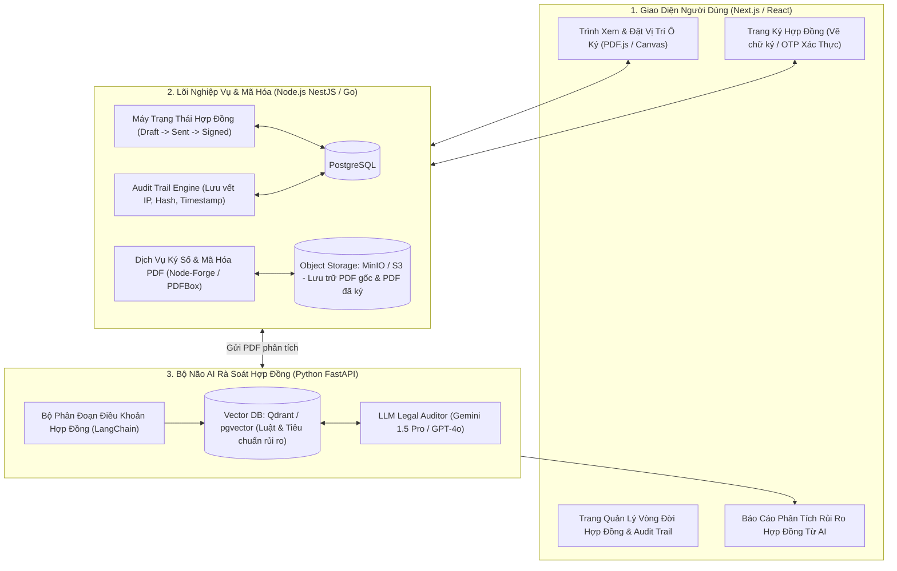
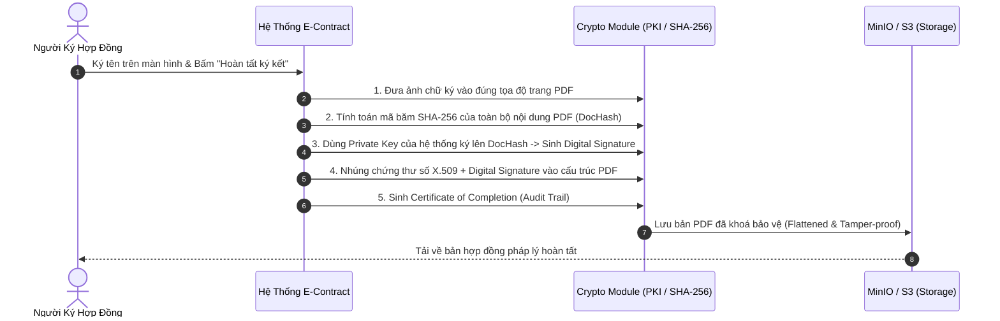
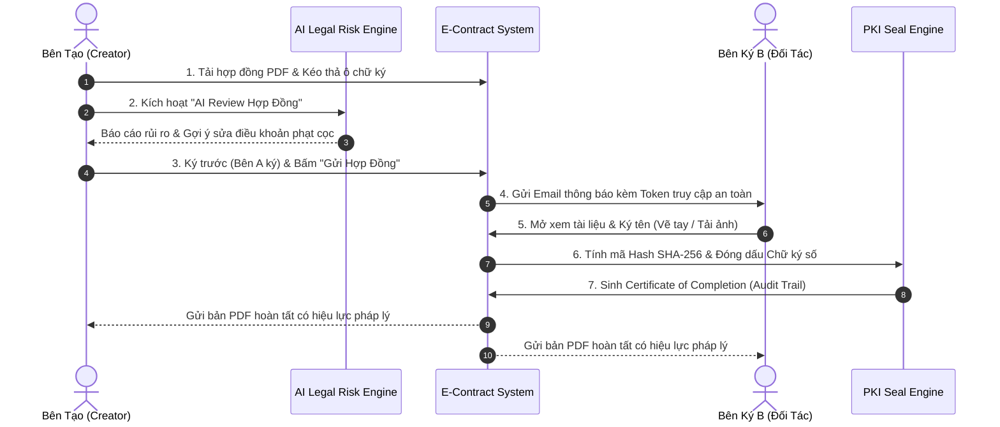

# PHÂN TÍCH CHI TIẾT ĐỀ TÀI: LEGALTECH & E-CONTRACT PLATFORM
## (Nền Tảng Ký Kết Hợp Đồng Điện Tử Bằng Mật Mã Học PKI & Trợ Lý AI Thẩm Định Điều Khoản)

---

## 1. TỔNG QUAN & BÀI TOÁN KINH DOANH THỰC TẾ

### 1.1. Bối cảnh
Doanh nghiệp hiện đại ký kết hàng trăm hợp đồng dịch vụ, hợp đồng lao động, NDA (thỏa thuận bảo mật) mỗi tháng.
- Quy trình ký giấy truyền thống: In ấn, trình ký sếp, gửi bưu điện sang đối tác, chờ ký rồi gửi về mất từ 3 - 7 ngày. Chi phí chuyển phát nhanh và lưu trữ kho giấy tốn kém hàng chục triệu đồng mỗi năm.
- Nguy cơ pháp lý: Hợp đồng giấy dễ bị tráo trang, giả mạo chữ ký, hoặc chứa các điều khoản bất lợi (điều khoản bẫy về phạt vi phạm, tự động gia hạn vô thời hạn) mà nhân sự không đủ kiến thức pháp lý để phát hiện.

### 1.2. Giải pháp của dự án
1. **Quy trình ký hợp đồng điện tử chuẩn pháp lý (E-Contract Workflow):**
   - Tạo mẫu hợp đồng, cấu hình các bên tham gia ký (Bên A, Bên B, Người chứng kiến), đặt vị trí ô chữ ký (Signature Fields) trực quan trên trình duyệt.
   - Ký bằng vẽ tay, tải ảnh chữ ký, hoặc chứng thư số cá nhân.
2. **Cơ chế mật mã học bảo mật (Cryptography & PKI):**
   - Ứng dụng mã băm **SHA-256**, cặp khóa công khai / bí mật (**RSA-2048 / ECDSA**) và đóng dấu thời gian (Timestamping).
   - Ngay sau khi tất cả các bên ký xong, file PDF được đóng dấu chữ ký số (Digital Signature). Bất kỳ ai cố tình chỉnh sửa dù chỉ 1 ký tự trong file PDF sau đó, Adobe Acrobat Reader hoặc hệ thống kiểm tra sẽ lập tức hiện cảnh báo đỏ: *"Tài liệu đã bị sửa đổi, chữ ký không còn hợp lệ!"* (Tamper-evident).
3. **Audit Trail bất biến (Nhật ký pháp lý):**
   - Sinh kèm một trang Chứng chỉ Hoàn thành (Certificate of Completion) ghi rõ: Mã định danh tài liệu, địa chỉ IP của từng bên khi bấm ký, vị trí địa lý, thời gian chính xác đến từng mili-giây.
4. **AI Legal Assistant (Trợ lý pháp lý RAG):**
   - Tự động rà soát file hợp đồng PDF tải lên, so khớp với Bộ luật Dân sự/Thương mại, bôi đỏ các điều khoản rủi ro cao và đưa ra khuyến nghị chỉnh sửa.

---

## 2. SƠ ĐỒ KIẾN TRÚC HỆ THỐNG



---

## 3. CƠ CHẾ KỸ THUẬT KÝ SỐ & MẬT MÃ HỌC (PKI SIGNATURE)

Quy trình bảo vệ tính toàn vẹn của hợp đồng diễn ra theo các bước chuẩn mật mã học:



---

## 4. TÍNH NĂNG AI: THẨM ĐỊNH RỦI RO HỢP ĐỒNG (LEGAL RISK AUDITOR)

Hệ thống AI không chỉ trả lời chung chung mà phân tích theo **3 cấp độ rủi ro (Risk Matrix)**:

1. **Rủi ro Cao (High Risk - Bôi Đỏ):**
   - *Ví dụ:* Điều khoản bồi thường thiệt hại vô hạn định; Mức phạt vi phạm vượt quá $8\%$ giá trị hợp đồng (vi phạm Điều 301 Luật Thương mại 2005 của Việt Nam).
2. **Rủi ro Trung bình (Medium Risk - Bôi Vàng):**
   - *Ví dụ:* Điều khoản tự động gia hạn hợp đồng thêm 12 tháng nếu không có văn bản thông báo trước 60 ngày; Điều khoản chọn toà án giải quyết tranh chấp ở một tỉnh thành xa lạ.
3. **Khuyến nghị chỉnh sửa cụ thể:**
   - AI đưa ra ngay đoạn văn bản thay thế (Suggested Wording) chuẩn pháp lý để người ký gửi lại đàm phán với đối tác.

---

## 5. THIẾT KẾ CƠ SỞ DỮ LIỆU ĐỀ XUẤT (POSTGRESQL)

```sql
-- 1. Hợp đồng
CREATE TABLE contracts (
    id UUID PRIMARY KEY DEFAULT gen_random_uuid(),
    title VARCHAR(255) NOT NULL,
    status VARCHAR(50) DEFAULT 'DRAFT', -- DRAFT, SENT, IN_PROGRESS, COMPLETED, REJECTED, EXPIRED
    original_pdf_url TEXT NOT NULL,
    signed_pdf_url TEXT,
    document_hash_sha256 VARCHAR(64), -- Mã băm toàn vẹn của file hoàn tất
    created_by UUID NOT NULL,
    expires_at TIMESTAMP,
    completed_at TIMESTAMP,
    created_at TIMESTAMP DEFAULT CURRENT_TIMESTAMP
);

-- 2. Danh sách các bên tham gia ký
CREATE TABLE contract_signers (
    id UUID PRIMARY KEY DEFAULT gen_random_uuid(),
    contract_id UUID REFERENCES contracts(id) ON DELETE CASCADE,
    email VARCHAR(255) NOT NULL,
    full_name VARCHAR(255) NOT NULL,
    role VARCHAR(50) DEFAULT 'SIGNER', -- SIGNER, VIEWER, APPROVER
    signing_order INT DEFAULT 1, -- Thứ tự ký (Bên A ký trước, Bên B ký sau)
    status VARCHAR(30) DEFAULT 'PENDING', -- PENDING, VIEWED, SIGNED, DECLINED
    signature_image_url TEXT,
    signed_at TIMESTAMP
);

-- 3. Nhật ký pháp lý bất biến (Audit Trail Log)
CREATE TABLE contract_audit_logs (
    id UUID PRIMARY KEY DEFAULT gen_random_uuid(),
    contract_id UUID REFERENCES contracts(id) ON DELETE CASCADE,
    signer_email VARCHAR(255),
    action VARCHAR(100) NOT NULL, -- CONTRACT_CREATED, INVITATION_SENT, CONTRACT_VIEWED, SIGNATURE_APPLIED
    ip_address VARCHAR(50) NOT NULL,
    user_agent TEXT NOT NULL,
    geolocation VARCHAR(255),
    snapshot_hash VARCHAR(64) NOT NULL, -- Mã băm file tại thời điểm hành vi diễn ra
    created_at TIMESTAMP DEFAULT CURRENT_TIMESTAMP
);
```

---

## 6. ĐIỂM SỐ GÂY ẤN TƯỢNG VỚI HỘI ĐỒNG / NHÀ TUYỂN DỤNG

1. **Khả năng kiểm tra tính pháp lý trực tiếp:** Khi bạn tải file PDF đã ký từ hệ thống về và mở bằng **Adobe Acrobat Reader trên máy tính của giám khảo**, phần mềm Adobe sẽ tự động hiển thị thanh thông báo xanh: *"Signed and all signatures are valid. Document has not been modified since it was certified."* -> Đây là minh chứng kỹ thuật thuyết phục tuyệt đối.
2. **Kỹ thuật xử lý PDF phức tạp:** Xử lý tọa độ pixel trên trình duyệt (PDF.js Canvas) khớp chính xác $100\%$ với tọa độ trang in trong file PDF thực tế.

---

## 7. PHÂN TÍCH NGHIỆP VỤ & CÁC LUỒNG HOẠT ĐỘNG (BUSINESS FLOWS)

### 7.1. Các vai trò & Phân quyền nghiệp vụ (Actors & Roles)
- **Người khởi tạo (Sender/Creator):** Soạn thảo, tải PDF lên, cấu hình danh sách người ký, kéo thả các ô ký (Signature Tags), kích hoạt AI quét rủi ro trước khi gửi.
- **Người ký (Signer):** Nhận email lời mời qua liên kết an toàn (Magic Link/OTP), xem nội dung, ký tên điện tử. Không cần tạo tài khoản mật khẩu phức tạp.
- **Người phê duyệt (Approver):** Duyệt nội dung hợp đồng trước khi cho phép gửi sang đối tác ký.
- **Quản trị viên công ty (Enterprise Admin):** Cấu hình chứng thư số X.509 của doanh nghiệp, quản lý kho lưu trữ, kiểm tra Audit Trail toàn hệ thống.

### 7.2. Các quy tắc nghiệp vụ bất biến (Business Invariants)
1. **Bất biến thứ tự ký (Strict Signing Order):** Nếu hợp đồng cấu hình `Bên A (Order 1)` và `Bên B (Order 2)`, email mời ký chỉ được gửi tới Bên B **sau khi Bên A đã hoàn tất ký**.
2. **Khóa chỉnh sửa tuyệt đối (Sealed Document):** Một khi hợp đồng đã ở trạng thái `SENT`, không ai (kể cả Creator) được phép sửa nội dung chữ hoặc di chuyển ô ký. Nếu muốn sửa, bắt buộc phải Hủy hợp đồng (Void) và tạo bản mới.
3. **Hiệu lực chữ ký số:** Chữ ký số mã hóa PKI cấp doanh nghiệp chỉ được hệ thống đóng dấu một lần duy nhất vào thời điểm **tất cả các bên hoàn tất ký**.

### 7.3. Luồng hoạt động 1: Quy trình Ký Hợp Đồng Tuần Tự (Happy Path)



### 7.4. Luồng hoạt động 2: Luồng Từ Chối Ký (Decline to Sign) & Hủy Hợp Đồng
- **Tình huống:** Bên B khi đọc hợp đồng phát hiện điều khoản thanh toán không đúng như thỏa thuận miệng.
- **Quy trình:**
  1. Bên B bấm nút *"Từ chối ký (Decline to Sign)"* và nhập lý do bắt buộc (tối thiểu 20 ký tự).
  2. Hệ thống chuyển trạng thái hợp đồng sang `DECLINED`, vô hiệu hóa toàn bộ link truy cập của tất cả các bên.
  3. Gửi email thông báo tức thì cho Bên A kèm lý do từ chối.
  4. Ghi nhận hành vi từ chối vào `contract_audit_logs` để lưu vết tranh chấp.

### 7.5. Luồng hoạt động 3: Xác thực tính toàn vẹn khi kiểm toán (Verification Flow)
1. Người dùng hoặc luật sư tải file PDF bất kỳ lên trang `/verify-contract`.
2. Hệ thống đọc trực tiếp cấu trúc nhúng ByteRange và Certificate trong file PDF:
   - Trích xuất Public Key từ chứng thư số X.509 nhúng trong PDF.
   - Tính toán lại mã băm SHA-256 của các byte tài liệu.
   - Giải mã Digital Signature bằng Public Key để so khớp mã băm.
3. Nếu khớp $100\%$: Hiển thị tích xanh *"Văn bản nguyên gốc, chữ ký hợp lệ"*.
4. Nếu sai lệch dù 1 byte: Hiển thị cảnh báo đỏ *"Tài liệu đã bị can thiệp trái phép sau khi ký"*.

