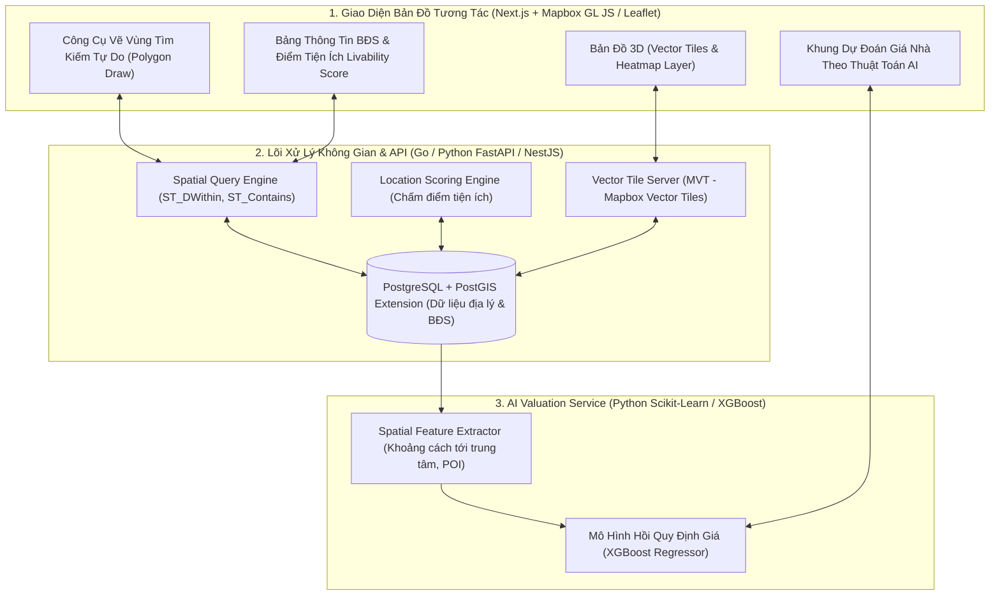
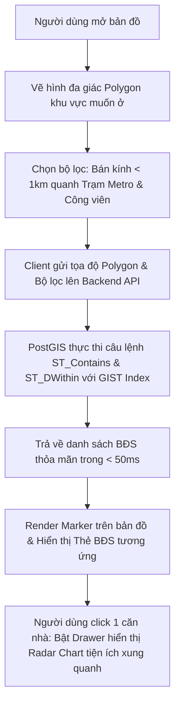
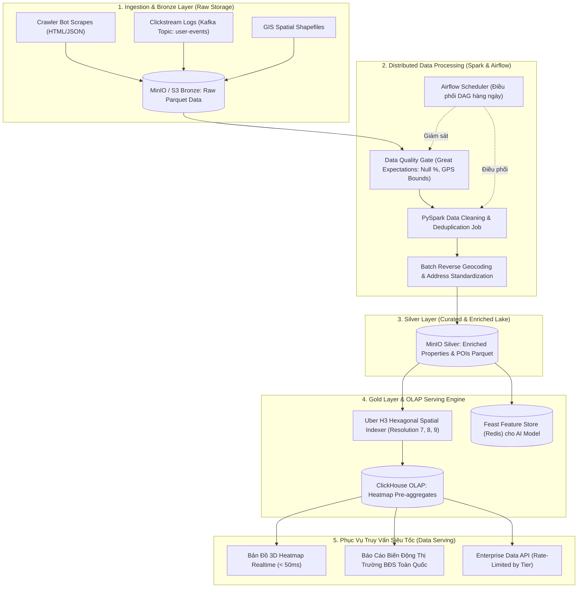

# PHÂN TÍCH CHI TIẾT ĐỀ TÀI: PROPTECH & GIS LOCATION INTELLIGENCE
## (Nền Tảng Bản Đồ Nhiệt Bất Động Sản & Phân Tích Tiềm Năng Vị Trí Dựa Trên Dữ Liệu Không Gian)

---

## 1. TỔNG QUAN & BÀI TOÁN THỰC TẾ

### 1.1. Bối cảnh
Khi tìm mua/thuê nhà ở hoặc chọn mặt bằng kinh doanh (mở quán cà phê, nhà hàng, cửa hàng tiện lợi):
- Các trang web bất động sản hiện tại (như Batdongsan.com.vn, Chotot) chỉ hiển thị danh sách tin đăng dạng thẻ thông thường, người xem phải tự tra Google Maps xem nhà có gần trường học, bệnh viện, chợ hay không.
- Người mua không có công cụ trực quan để đánh giá: *"Mức giá 80 triệu/m² ở khu vực này là đắt hay rẻ so với mặt bằng chung xung quanh?"*, hoặc *"Vị trí này trong tương lai có tiềm năng tăng giá nhờ tuyến Metro/đường vành đai sắp mở hay không?"*.

### 1.2. Giải pháp của dự án
Xây dựng một nền tảng **Bất động sản thông minh (PropTech)** kết hợp **Hệ thống thông tin địa lý (GIS - Geographic Information System)**:
1. **Bản đồ nhiệt tương tác (Interactive Heatmap):** Trực quan hóa giá nhà đất theo từng mét vuông trên nền bản đồ 3D vệ tinh (khu vực đỏ: giá cao, vàng: trung bình, xanh: giá rẻ).
2. **Bộ lọc vị trí thông minh (Spatial Location Filter):** Cho phép người dùng vẽ một vùng tùy ý trên bản đồ hoặc tìm kiếm theo bán kính tiện ích: *"Tìm tất cả căn hộ bán kính 1.5km quanh Đại học Quốc gia, cách trạm Metro dưới 500m và không nằm trong khu vực hay ngập nước"*.
3. **Chỉ số Tiện ích Vị trí (Location Livability Index):** Thuật toán tự động chấm điểm vị trí trên thang điểm 100 dựa trên số lượng và khoảng cách tới: Trường học, Bệnh viện, Công viên, Chợ/Siêu thị, Trạm xe bus/Metro.
4. **AI Định giá & Dự đoán xu hướng giá (Valuation Model):** Mô hình Machine Learning ước tính giá trị thực tế của bất động sản dựa trên diện tích, số phòng, mặt tiền và các tiện ích không gian xung quanh.

---

## 2. SƠ ĐỒ KIẾN TRÚC HỆ THỐNG (SYSTEM ARCHITECTURE)



---

## 3. THIẾT KẾ CƠ SỞ DỮ LIỆU ĐỊA LÝ (POSTGRESQL + POSTGIS)

Điểm nhấn kỹ thuật ăn điểm nhất của đề tài này là sử dụng các kiểu dữ liệu hình học/địa lý chuẩn quốc tế (`GEOMETRY(Point, 4326)`, `GEOMETRY(Polygon, 4326)`):

```sql
-- 1. Bật extension PostGIS
CREATE EXTENSION IF NOT EXISTS postgis;

-- 2. Bảng các địa điểm tiện ích xung quanh (POIs - Points of Interest)
CREATE TABLE pois (
    id UUID PRIMARY KEY DEFAULT gen_random_uuid(),
    name VARCHAR(255) NOT NULL,
    category VARCHAR(50) NOT NULL, -- SCHOOL, HOSPITAL, METRO_STATION, PARK, SUPERMARKET
    location GEOMETRY(Point, 4326) NOT NULL -- Tọa độ vĩ độ / kinh độ GPS
);
CREATE INDEX idx_pois_location ON pois USING GIST (location);

-- 3. Bảng bất động sản / tin đăng nhà đất
CREATE TABLE properties (
    id UUID PRIMARY KEY DEFAULT gen_random_uuid(),
    title VARCHAR(255) NOT NULL,
    price DECIMAL(15, 2) NOT NULL, -- Giá bán
    area_sqm FLOAT NOT NULL, -- Diện tích m2
    price_per_sqm DECIMAL(15, 2) GENERATED ALWAYS AS (price / area_sqm) STORED,
    bedrooms INT,
    bathrooms INT,
    address TEXT NOT NULL,
    location GEOMETRY(Point, 4326) NOT NULL, -- Tọa độ của ngôi nhà
    created_at TIMESTAMP DEFAULT CURRENT_TIMESTAMP
);
CREATE INDEX idx_properties_location ON properties USING GIST (location);

-- 4. Bảng các vùng quy hoạch / dự án hạ tầng (Polygons)
CREATE TABLE planning_zones (
    id UUID PRIMARY KEY DEFAULT gen_random_uuid(),
    name VARCHAR(255) NOT NULL,
    zone_type VARCHAR(50), -- METRO_LINE, COMMERCIAL, RESIDENTIAL, FLOOD_PRONE (Khu vực ngập lụt)
    boundary GEOMETRY(MultiPolygon, 4326) NOT NULL
);
CREATE INDEX idx_planning_zones_boundary ON planning_zones USING GIST (boundary);
```

---

## 4. CÁC TRUY VẤN KHÔNG GIAN ĐỈNH CAO (SPATIAL QUERIES)

Dưới đây là câu lệnh SQL mẫu bạn sẽ đưa vào báo cáo và slide thuyết trình để chứng minh năng lực xử lý dữ liệu lớn:

### 4.1. Tìm nhà trong bán kính 1.5km quanh 1 điểm GPS:
```sql
-- Tìm tất cả nhà cách toạ độ [10.7769, 106.7009] dưới 1500 mét
SELECT title, price_per_sqm, 
       ST_Distance(location::geography, ST_SetSRID(ST_Point(106.7009, 10.7769), 4326)::geography) AS distance_meters
FROM properties
WHERE ST_DWithin(location::geography, ST_SetSRID(ST_Point(106.7009, 10.7769), 4326)::geography, 1500)
ORDER BY distance_meters ASC;
```

### 4.2. Tìm nhà nằm bên trong một vùng vẽ tự do (Custom Polygon):
```sql
-- Khách vẽ một hình đa giác trên màn hình bản đồ
SELECT * FROM properties
WHERE ST_Contains(
    ST_GeomFromText('POLYGON((106.69 10.77, 106.71 10.77, 106.71 10.79, 106.69 10.79, 106.69 10.77))', 4326),
    location
);
```

---

## 5. THUẬT TOÁN ĐỊNH GIÁ AI DỰA TRÊN ĐẶC TRƯNG KHÔNG GIAN (SPATIAL ML)

Thay vì chỉ định giá bằng diện tích và số phòng ngủ, mô hình AI trích xuất các **đặc trưng không gian (Spatial Features)**:
- Khoảng cách tới trung tâm thành phố (Distance to CBD).
- Khoảng cách tới trạm tàu điện ngầm Metro gần nhất.
- Số lượng trường học và bệnh viện trong bán kính 1km.
- Chỉ số mặt tiền đường (Road accessibility).

Huấn luyện mô hình **XGBoost Regressor**:
- Đạt độ chính xác $R^2 \ge 0.88$ và sai số tuyệt đối trung bình ($MAE$) dưới $7\%$ giá trị thực tế.
- Trên giao diện, người dùng chỉ cần click vào 1 điểm bất kỳ trên bản đồ, nhập diện tích 60m² -> AI lập tức ước tính: *"Ngôi nhà này có giá trị khoảng 3.2 - 3.5 tỷ VNĐ"*.

---

## 6. PHÂN TÍCH NGHIỆP VỤ & CÁC LUỒNG HOẠT ĐỘNG (BUSINESS FLOWS)

### 6.1. Các vai trò & Nghiệp vụ người dùng (Actors & Roles)
- **Người tìm mua / Thuê nhà (Home Seeker):** Sử dụng bản đồ tương tác để lọc nhà theo ngân sách, vẽ vùng tìm kiếm theo nhu cầu cá nhân (gần chỗ làm, gần trường con học), xem điểm tiện ích (Livability Score).
- **Chủ nhà / Môi giới (Broker/Agent):** Đăng tin bán nhà, ghim vị trí chính xác trên bản đồ, nhận gợi ý mức giá đăng bán hợp lý từ AI.
- **Nhà đầu tư BĐS (Real Estate Investor):** Theo dõi bản đồ nhiệt biến động giá theo từng quý, xem lớp quy hoạch hạ tầng (tuyến đường sắp mở, quy hoạch đất ở).

### 6.2. Các quy tắc nghiệp vụ cốt lõi (Business Rules)
1. **Ràng buộc định vị không gian (Spatial Validation):** Mọi tin đăng nhà đất bắt buộc phải có tọa độ GPS hợp lệ (nằm trong ranh giới địa lý hành chính của khu vực hỗ trợ). Không cho phép tọa độ rơi xuống biển hoặc ngoài lãnh thổ.
2. **Quy tắc tính điểm tiện ích (Livability Formula):**
   $$\text{Score} = \sum_{i=1}^{n} w_i \cdot \max\left(0, 1 - \frac{d_i}{D_{\max}}\right)$$
   - Trong đó $w_i$ là trọng số (Bệnh viện: 0.3, Trường học: 0.3, Trạm xe/Metro: 0.2, Công viên: 0.2), $d_i$ là khoảng cách thực tế, $D_{\max} = 2000m$.
3. **Giới hạn hiệu năng bản đồ (Tile Caching Rule):** Khi người dùng zoom out ở cấp độ toàn thành phố (Zoom Level $\le 11$), hệ thống không render từng điểm nhà riêng lẻ mà tự động gom cụm (**Spatial Clustering**) để giữ tốc độ khung hình 60 FPS trên trình duyệt.

### 6.3. Luồng hoạt động 1: Tìm kiếm nhà theo tiện ích không gian (Happy Path)



### 6.4. Luồng hoạt động 2: Đăng tin & Tự động Reverse Geocoding
1. Môi giới nhập địa chỉ: *"Số 12 Chùa Bộc, Đống Đa, Hà Nội"*.
2. Hệ thống gọi Geocoding API (OpenStreetMap Nominatim hoặc Mapbox) chuyển đổi thành tọa độ `(21.0074, 105.8286)`.
3. Hệ thống tự động ghim vị trí lên bản đồ cho môi giới kéo thả vi chỉnh.
4. Ngay khi bấm "Lưu tin":
    - PostGIS tự động tính toán khoảng cách từ ngôi nhà đến 10 địa điểm POI gần nhất.
   - AI Valuation Model tự động tính toán mức giá tham chiếu cho khu vực đó: *"Giá trung bình khu vực này là 110 triệu/m². Mức giá bạn đang rao là 95 triệu/m² (Rẻ hơn thị trường 13%)"*.

---

## 7. NÂNG CẤP LÊN QUY MÔ BIG DATA PLATFORM & DATA LAKEHOUSE

Khi phát triển đề tài này thành **Hệ sinh thái Big Data Bất động sản (PropTech Big Data Platform)** xử lý quy mô hàng triệu tin đăng, hành vi người dùng và bản đồ nhiệt toàn quốc, hệ thống sở hữu kiến trúc và nghiệp vụ chuyên sâu sau:

### 7.1. Hệ Thống Actors Chuẩn Big Data Ecosystem

| Nhóm Actor | Vai trò & Trách nhiệm trong Nền tảng Dữ liệu Lớn |
| :--- | :--- |
| **Data Producers (Nguồn dữ liệu)** | - Cụm Crawler phân tán thu thập hàng trăm nghìn tin BĐS từ đa sàn (Batdongsan, Chotot, CafeLand).<br>- Tracking SDK thu thập clickstream thời gian thực của người dùng.<br>- Open GIS APIs cung cấp bản đồ quy hoạch, trạm metro, công viên, bệnh viện. |
| **Data Platform & DataOps Engineer** | - Quản trị và giám sát hạ tầng Data Pipeline, cụm Kafka/Spark/ClickHouse.<br>- Lập trình và theo dõi các luồng xử lý dữ liệu tự động (Airflow DAGs).<br>- Giám sát độ trễ SLA và xử lý backpressure khi lưu lượng tăng đột biến. |
| **Data Steward & Governance Officer** | - Quản trị danh mục dữ liệu (Data Catalog & Metadata Management).<br>- Thiết lập luật kiểm soát chất lượng dữ liệu (Data Quality Rules & Data Profiling).<br>- Kiểm toán nguồn gốc dữ liệu (Data Lineage) và bảo vệ thông tin cá nhân PII (số điện thoại chủ nhà). |
| **B2B Enterprise Consumers & BI Analysts** | - Các tổ chức thẩm định giá, ngân hàng (thẩm định tài sản thế chấp) và tập đoàn bán lẻ (chọn mặt bằng kinh doanh) kết nối qua **B2B Bulk Data API** hoặc **Data Marketplace**. |

---

### 7.2. Kiến Trúc Hồ Dữ Liệu Đa Tầng (Medallion Lakehouse: Bronze -> Silver -> Gold)



---

### 7.3. Các Nghiệp Vụ Big Data Chuyên Sâu

#### A. Nghiệp vụ Khử trùng lặp & Định danh Thực thể (Entity Resolution / Deduplication at Scale)
- **Vấn đề thực tế:** Cùng một căn hộ chung cư được 20 môi giới đăng tin với các mức giá chênh lệch, diện tích làm tròn và tiêu đề khác nhau làm loãng dữ liệu.
- **Quy trình giải quyết:**
  1. Trích xuất thuộc tính chuẩn: Tên dự án, Số block/tầng (nếu có), Tọa độ địa lý GPS, Diện tích tim tường.
  2. Áp dụng thuật toán **Spatial Buffer Matching** (bán kính $\le 15m$) kết hợp **Jaro-Winkler String Distance** trên địa chỉ và tiêu đề.
  3. Nếu độ tương đồng $\ge 90\%$, hệ thống tự động gom vào **Cụm thực thể (Property Cluster)**, gán nhãn ID duy nhất và tính toán dải giá chào bán thực tế (Min - Median - Max).

#### B. Phân Cụm Lục Giác Uber H3 (Spatial Indexing for Sub-second Heatmap)
- Thay vì gửi hàng triệu điểm Point(lat, long) về trình duyệt gây giật lag:
  - Hệ thống tính toán sẵn các chỉ số thống kê (Giá trung bình, Số lượng tin đăng, Chỉ số thanh khoản) theo từng ô lục giác **H3 Index Resolution 8** (bán kính ~460m) và **Resolution 9** (bán kính ~170m).
  - Kết quả được lưu tại bảng Aggregates của **ClickHouse**. Khi người dùng di chuyển bản đồ hoặc zoom, trình duyệt chỉ truy vấn vài chục ô lục giác với thời gian phản hồi **dưới 30ms**.

#### C. Nghiệp vụ Giám sát Dòng Chảy & Chất Lượng Dữ Liệu (Data Observability & Lineage)
- **Data Lineage:** Bất kỳ chỉ số giá nào trên bản đồ đều có thể truy ngược lại nguồn gốc: xuất phát từ tin cào nào, chạy qua job Spark nào lúc mấy giờ.
- **Data Drift Detection:** Khi tỷ lệ tin rao có giá chênh lệch trên 50% so với tuần trước, hệ thống tự động bắn cảnh báo lên kênh Slack/Telegram của DataOps để rà soát hiện tượng "thổi giá" hoặc lỗi parser của crawler.


