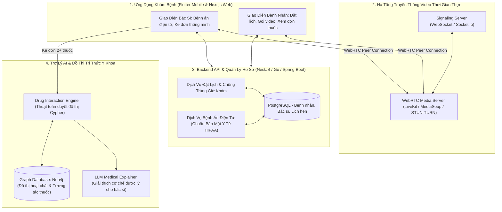
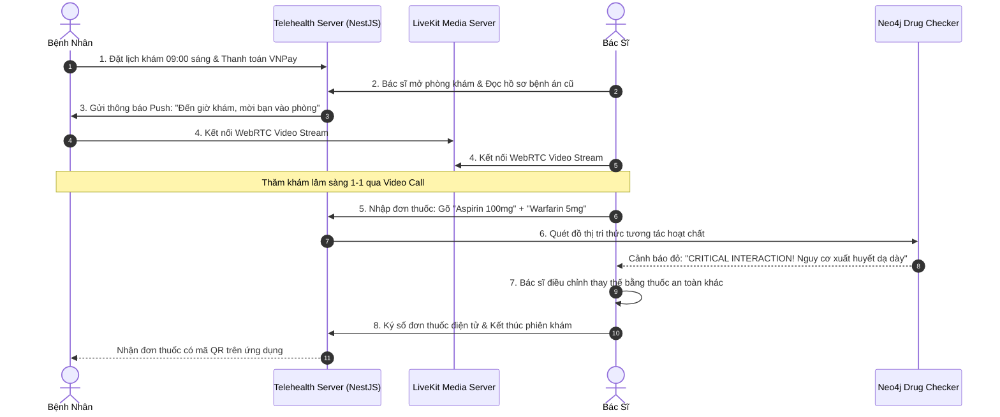

# PHÂN TÍCH CHI TIẾT ĐỀ TÀI: HEALTHTECH & TELEMEDICINE ECOSYSTEM
## (Hệ Sinh Thái Khám Bệnh Từ Xa WebRTC & Trợ Lý AI Tra Cứu Tương Tác Thuốc Bằng Knowledge Graph)

---

## 1. TỔNG QUAN & BÀI TOÁN THỰC TẾ

### 1.1. Bối cảnh
Sau đại dịch và trong bối cảnh các bệnh viện lớn tuyến trung ương luôn trong tình trạng quá tải:
- Bệnh nhân mắc các bệnh mãn tính (tiểu đường, huyết áp cao, bệnh da liễu) phải mất cả buổi sáng xếp hàng chỉ để gặp bác sĩ 5 phút tái khám và lấy lại đơn thuốc cũ.
- Nguy hiểm chết người trong việc kê đơn: Khi bệnh nhân đi khám ở 2 chuyên khoa khác nhau hoặc uống thêm thuốc bổ mua ngoài tiệm, các hoạt chất trong thuốc có thể **xung đột đối kháng (Drug-Drug Interaction - DDI)**, gây suy thận, xuất huyết dạ dày hoặc giảm tác dụng điều trị.

### 1.2. Giải pháp của dự án
1. **Phòng khám trực tuyến bảo mật thời gian thực (Telemedicine WebRTC):**
   - Video call 1-1 độ trễ cực thấp giữa Bác sĩ và Bệnh nhân trên Web/Mobile.
   - Hỗ trợ chia sẻ màn hình hồ sơ xét nghiệm (X-ray, kết quả máu) trực tiếp trong cuộc gọi.
2. **Hồ sơ bệnh án điện tử tập trung (EHR - Electronic Health Records):**
   - Lưu trữ toàn bộ lịch sử khám bệnh, dị ứng thuốc và đơn thuốc của bệnh nhân qua các đợt khám.
3. **Bộ máy AI cảnh báo tương tác thuốc (AI Drug Interaction Engine):**
   - Ứng dụng **Cơ sở dữ liệu đồ thị tri thức y khoa (Medical Knowledge Graph)**.
   - Khi bác sĩ vừa gõ tên 2 hoặc 3 loại thuốc vào đơn, hệ thống lập tức quét ma trận hoạt chất và bật cảnh báo đỏ kèm mức độ nghiêm trọng nếu phát hiện tương tác đối kháng.

---

## 2. SƠ ĐỒ KIẾN TRÚC HỆ THỐNG



---

## 3. CƠ CHẾ TRA CỨU ĐỒ THỊ TRI THỨC TƯƠNG TÁC THUỐC (NEO4J GRAPH)

Vì sao dùng **Graph Database (Neo4j)** thay vì cơ sở dữ liệu bảng SQL truyền thống?
- Trong y học, một viên thuốc (Brand Name, ví dụ: *Panadol Extra*) chứa nhiều hoạt chất (*Paracetamol*, *Caffeine*). Hoạt chất này lại tương tác với hoạt chất của viên thuốc khác (*Warfarin*).
- Trong SQL, bạn phải `JOIN` qua 5 - 6 bảng trung gian cực kỳ chậm. Trong Neo4j, việc tìm kiếm đường đi tương tác giữa 2 loại thuốc chỉ tốn **dưới 5 mili-giây** bằng ngôn ngữ Cypher:

```cypher
// Truy vấn kiểm tra xem Thuốc A và Thuốc B có hoạt chất nào kỵ nhau không
MATCH (d1:Drug {name: "Aspirin"})-[:CONTAINS]->(c1:ActiveIngredient)
MATCH (d2:Drug {name: "Warfarin"})-[:CONTAINS]->(c2:ActiveIngredient)
MATCH (c1)-[r:INTERACTS_WITH]->(c2)
RETURN c1.name AS Ingredient1, 
       c2.name AS Ingredient2, 
       r.severity AS SeverityLevel, -- CRITICAL, MAJOR, MINOR
       r.clinical_effect AS Effect -- "Tăng nguy cơ xuất huyết dạ dày nghiêm trọng"
```

---

## 4. QUẢN LÝ LỊCH KHÁM CHỐNG TRÙNG GIỜ (CONFLICT-FREE SCHEDULING)

- Bác sĩ cấu hình các khung giờ khám (ví dụ: mỗi slot 20 phút: `08:00 - 08:20`, `08:20 - 08:40`).
- Áp dụng **Redis Distributed Lock** khi 2 bệnh nhân cùng bấm chọn 1 khung giờ khám của cùng 1 bác sĩ vào cùng 1 thời điểm:
  - Request nào đến trước 1 mili-giây sẽ lấy được Lock và chuyển trạng thái slot sang `BOOKED`.
  - Request đến sau lập tức nhận thông báo: *"Khung giờ này vừa có người đặt, vui lòng chọn slot khác"*.

---

## 5. BẢO MẬT HỒ SƠ Y TẾ CHUẨN HIPAA & ENCRYPTION AT REST

- Dữ liệu bệnh án điện tử (tiền sử bệnh tật, nhóm máu, ghi chú nhạy cảm của bác sĩ) được mã hóa ở tầng ứng dụng bằng thuật toán **AES-256-GCM** trước khi lưu vào Database.
- Ngay cả quản trị viên Database (DBA) khi mở bảng PostgreSQL ra cũng chỉ nhìn thấy chuỗi ký tự đã mã hóa, không lộ thông tin cá nhân của bệnh nhân.

---

## 6. PHÂN TÍCH NGHIỆP VỤ & CÁC LUỒNG HOẠT ĐỘNG (BUSINESS FLOWS)

### 6.1. Các vai trò & Nghiệp vụ người dùng (Actors & Roles)
- **Bệnh nhân (Patient):** Tìm kiếm bác sĩ theo chuyên khoa, đặt lịch khám, thanh toán tiền khám, tham gia phòng gọi video 1-1, nhận đơn thuốc điện tử và hướng dẫn dùng thuốc.
- **Bác sĩ (Doctor):** Mở phòng khám, tra cứu hồ sơ bệnh án cũ của bệnh nhân, gọi video thăm khám, kê đơn thuốc điện tử (được AI hỗ trợ kiểm tra kỵ thuốc), xuất bệnh án.
- **Dược sĩ / Nhà thuốc liên kết (Pharmacist):** Tiếp nhận đơn thuốc điện tử có mã định danh QR, xuất thuốc và giao tận nhà cho bệnh nhân.

### 6.2. Các quy tắc nghiệp vụ y khoa cốt lõi (Medical Business Rules)
1. **Ràng buộc tương tác thuốc cấp độ CRITICAL (Critical Interaction Override):**
   - Nếu 2 hoạt chất trong đơn thuốc gây tương tác cấp độ `CRITICAL` (ví dụ: nguy cơ ngừng tim hoặc xuất huyết nội tạng), hệ thống **khóa nút Kê Đơn**.
   - Bác sĩ nếu vẫn muốn kê đơn bắt buộc phải tích chọn *"Tôi nhận thức rõ rủi ro y khoa này"* và nhập giải trình lâm sàng tối thiểu 50 từ (để lưu hồ sơ pháp lý).
2. **Quy tắc phiên phòng gọi WebRTC (Room Lifecycle):**
   - Phòng gọi video chỉ được mở trước giờ hẹn khám 5 phút và tự động đóng sau khi bác sĩ bấm *"Kết thúc khám"* hoặc quá giờ hẹn 30 phút.
   - Kết nối Peer-to-Peer được mã hóa đầu cuối bằng chuẩn **DTLS-SRTP**.
3. **Quy tắc bảo mật dữ liệu nhạy cảm (EHR Privacy):** Bác sĩ chỉ được quyền xem hồ sơ bệnh án của bệnh nhân trong khoảng thời gian có lịch hẹn hợp lệ với bệnh nhân đó.

### 6.3. Luồng hoạt động 1: Quy trình Khám Bệnh Trực Tuyến & Kê Đơn (Happy Path)



### 6.4. Luồng hoạt động 2: Xử lý Bệnh nhân bị mất kết nối mạng giữa chừng (Disconnection Resilience)
- **Tình huống:** Bệnh nhân đang gọi video thì Wi-Fi bị ngắt hoặc rớt mạng 4G.
- **Quy trình:**
  1. WebRTC ICE Connection State chuyển sang `disconnected`.
  2. Hệ thống giữ phòng khám ở trạng thái chờ (Grace Period) trong **90 giây**.
  3. Màn hình bác sĩ hiển thị trạng thái: *"Bệnh nhân đang bị gián đoạn mạng, vui lòng chờ trong giây lát..."*.
  4. Bệnh nhân mở lại app -> Hệ thống dùng Reconnect Token tự động đưa thẳng bệnh nhân trở lại phòng gọi mà không cần bác sĩ bấm mời lại.
  5. Nếu sau 90 giây vẫn không thể kết nối: Hệ thống tự động chuyển sang chế độ Chat văn bản / SMS nhắc nhở.

---

### 6.5. Nghiệp Vụ Liên Thông Đơn Thuốc Quốc Gia & Điều Phối Giao Thuốc Tận Nhà (Pharmacy Fulfillment)
- **Chuẩn hóa Đơn thuốc Điện tử Quốc gia (Bộ Y Tế):**
  - Sau khi bác sĩ ký số đơn thuốc, hệ thống sinh mã định danh đơn thuốc quốc gia theo thông tư Bộ Y Tế và đồng bộ qua API `donthuocquocgia.vn`.
- **Định tuyến Nhà thuốc Gần nhất (Smart Pharmacy Dispatching):**
  - Bệnh nhân có thể bấm nút "Mua thuốc giao tận nhà":
  - Hệ thống tự động tìm kiếm chuỗi nhà thuốc đối tác (Long Châu, Pharmacity, An Khang) trong bán kính 3km có **đủ 100% danh mục thuốc trong đơn**.
  - Tự động tạo đơn giao hàng hỏa tốc trong vòng 2 giờ cho bệnh nhân.

---

### 6.6. Chuẩn Hóa Dữ Liệu Y Tế Quốc Tế FHIR / HL7 & Bảo Mật Dữ Liệu Bệnh Án
- Mọi hồ sơ bệnh án điện tử (EMR) được lưu trữ theo chuẩn cấu trúc **HL7 FHIR JSON Schema** (`Patient`, `Encounter`, `Condition`, `MedicationRequest`).
- **Bảo mật dữ liệu sức khỏe (HIPAA Compliance):**
  - Toàn bộ trường thông tin chẩn đoán bệnh án, đơn thuốc, hình ảnh nội soi được mã hóa bằng thuật toán AES-256 ở mức cơ sở dữ liệu (Field-level Encryption).
  - Ghi vết truy cập bất biến: Bất cứ ai (kể cả y tá, điều dưỡng hay bác sĩ khác khoa) mở xem hồ sơ bệnh nhân đều bị ghi lại IP, thời điểm và lý do xem vào bảng `medical_access_audit_logs`.


