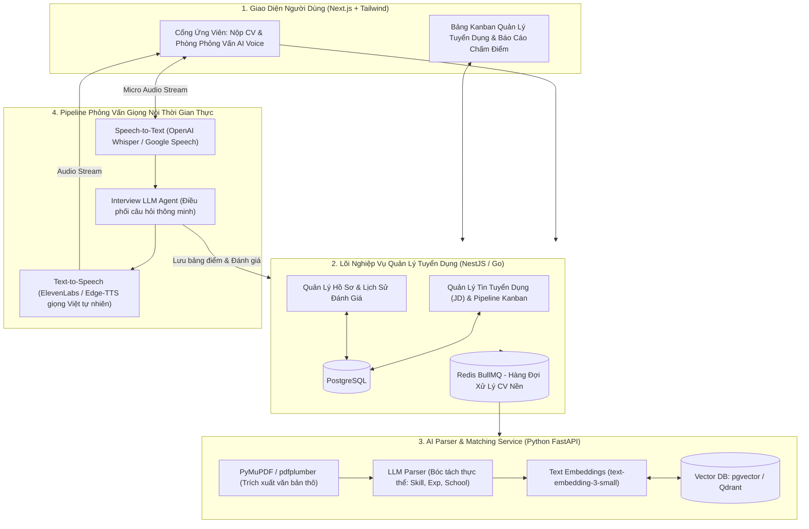
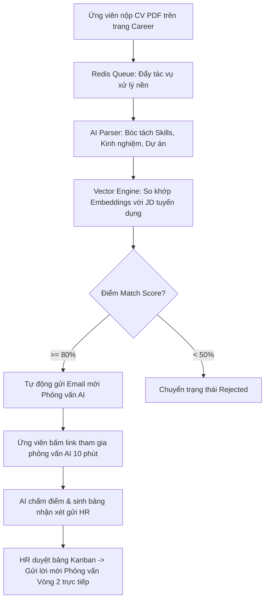

# PHÂN TÍCH CHI TIẾT ĐỀ TÀI: HRTECH & AI TALENT ACQUISITION
## (Hệ Thống Tuyển Dụng Tự Động ATS & Trợ Lý Phỏng Vấn Ứng Viên Bằng Giọng Nói AI)

---

## 1. TỔNG QUAN & BÀI TOÁN KINH DOANH THỰC TẾ

### 1.1. Bối cảnh
Các phòng nhân sự (HR) của công ty công nghệ và tập đoàn lớn nhận từ 500 - 2.000 CV cho mỗi đợt tuyển dụng.
- **Quá tải đọc CV:** HR mất trung bình 3 - 5 phút cho mỗi CV. Hơn $70\%$ CV nộp vào không đáp ứng tiêu chuẩn tối thiểu nhưng vẫn phải lọc bằng mắt.
- **Nút thắt phỏng vấn sơ loại (Screening Call):** HR phải gọi điện 15 - 20 phút cho từng ứng viên chỉ để hỏi các câu hỏi cơ bản (trình độ tiếng Anh, số năm kinh nghiệm, mức lương mong muốn, kỹ năng mềm cơ bản).
- **Thành kiến chủ quan (Bias):** Đánh giá ứng viên dễ bị cảm tính của từng HR cá nhân.

### 1.2. Giải pháp của dự án
1. **Hệ thống theo dõi hồ sơ ứng viên (ATS - Applicant Tracking System):**
   - Quản lý quy trình tuyển dụng theo dạng bảng **Kanban** trực quan (Ứng tuyển -> Lọc CV -> Phỏng vấn AI -> Phỏng vấn chuyên môn -> Gửi Offer).
2. **AI Resume Parser (Bóc tách CV tự động từ PDF):**
   - Ứng viên nộp bất kỳ định dạng CV nào (PDF 1 cột, 2 cột, Canva...), AI tự động trích xuất cấu trúc: Thông tin liên hệ, Học vấn, Kỹ năng công nghệ (Skills), Kinh nghiệm làm việc theo từng công ty, Chứng chỉ.
3. **Thuật toán Matching Điểm Phù Hợp (Semantic JD-CV Matching):**
   - So khớp ngữ nghĩa giữa Bản mô tả công việc (Job Description - JD) và CV ứng viên bằng **Vector Embeddings**. Chấm điểm trên thang 100 điểm và tự động phân loại: Ứng viên tiềm năng (Match > 80%), Xem xét (60-80%), Từ chối (< 60%).
4. **Trợ lý phỏng vấn AI bằng giọng nói (Voice AI Screener):**
   - Ứng viên mở web và tham gia cuộc phỏng vấn tự động 10 phút.
   - AI Agent dùng giọng nói tự nhiên đặt câu hỏi, lắng nghe ứng viên trả lời qua micro (Speech-to-Text), phân tích câu trả lời và tự động sinh bản báo cáo tóm tắt năng lực gửi cho HR.

---

## 2. SƠ ĐỒ KIẾN TRÚC HỆ THỐNG

---

## 3. THUẬT TOÁN ĐÁNH GIÁ ĐỘ TƯƠNG ĐỒNG JD - CV (HYBRID MATCHING)

Hệ thống kết hợp 2 phương pháp chấm điểm để đảm bảo tính khách quan và chính xác:

1. **Hard Skills Matching (Trọng số 40%):**
   - So khớp chính xác từ khóa công nghệ bắt buộc trong JD (ví dụ: `Docker`, `PostgreSQL`, `Java Spring Boot`).
2. **Semantic Meaning Matching (Trọng số 60%):**
   - Đưa đoạn văn bản mô tả kinh nghiệm của ứng viên và yêu cầu công việc qua mô hình Vector Embeddings.
   - Tính toán khoảng cách **Cosine Similarity**:
     $$\text{Cosine Similarity} = \frac{\vec{v}_{\text{JD}} \cdot \vec{v}_{\text{CV}}}{\|\vec{v}_{\text{JD}}\| \|\vec{v}_{\text{CV}}\|}$$
   - Nhờ ngữ nghĩa vector, nếu JD yêu cầu *"Kinh nghiệm làm việc với hệ thống thanh toán"* và CV viết *"Đã từng tích hợp cổng Stripe và VNPay"*, hệ thống vẫn hiểu là trùng khớp dù không cùng từ khóa ngữ pháp.

---

## 4. QUY TRÌNH PHỎNG VẤN AI VOICE SCREENER (KHÔNG CẦN NGƯỜI TRỰC TIẾP)

1. Ứng viên nhận được email mời phỏng vấn sơ bộ có kèm đường link riêng biệt (Magic Link).
2. Khi ứng viên bấm "Bắt đầu phỏng vấn":
   - AI giới thiệu bản thân bằng giọng nói tự nhiên: *"Chào bạn Hoàng, mình là trợ lý tuyển dụng của công ty. Hôm nay mình sẽ trao đổi ngắn 5 câu hỏi chuyên môn với bạn nhé."*
   - AI đặt câu hỏi 1 -> Ứng viên nói câu trả lời -> Whisper chuyển đổi thành văn bản.
   - AI lắng nghe và có khả năng hỏi đào sâu (Follow-up Question) nếu câu trả lời của ứng viên quá sơ sài hoặc chưa rõ ý.
3. Kết thúc buổi phỏng vấn: AI tự động sinh bảng nhận xét gồm:
   - Điểm tự tin & độ lưu loát (Fluency).
   - Điểm kiến thức chuyên môn (Technical Score).
   - Tóm tắt điểm mạnh / điểm yếu và đề xuất: `RECOMMENDED FOR ROUND 2` hoặc `REJECT`.

---

## 5. PHÂN TÍCH NGHIỆP VỤ & CÁC LUỒNG HOẠT ĐỘNG (BUSINESS FLOWS)

### 5.1. Các vai trò & Phân quyền nghiệp vụ (Actors & Roles)
- **Ứng viên (Candidate):** Tìm kiếm vị trí tuyển dụng, nộp CV (PDF/DOCX), nhận lịch hẹn và tham gia phỏng vấn giọng nói AI trực tuyến, tra cứu trạng thái hồ sơ.
- **Chuyên viên tuyển dụng (Recruiter):** Tạo bài đăng tuyển dụng (JD), xem danh sách CV đã được AI xếp hạng theo điểm Match, kéo thả ứng viên trên bảng Kanban, xem video/audio và nhận xét của buổi phỏng vấn AI.
- **Trưởng bộ phận chuyên môn (Hiring Manager):** Duyệt JD, phỏng vấn vòng cuối (Final Round), ra quyết định tuyển dụng và mức lương.

### 5.2. Các quy tắc nghiệp vụ tuyển dụng cốt lõi (Recruitment Rules)
1. **Quy tắc phân loại tự động (Auto-Triage Rule):**
   - Điểm Match $\ge 80\%$: Tự động gửi Email mời tham gia phỏng vấn AI Voice Screener.
   - Điểm Match $50\% - 79\%$: Giữ ở cột *"Cần HR xem xét bằng tay"*.
   - Điểm Match $< 50\%$: Đưa vào hàng chờ từ chối (có thời gian hoãn gửi email từ chối sau 48h để đảm bảo sự tinh tế và trải nghiệm ứng viên).
2. **Quy tắc chống gian lận khi phỏng vấn AI (Anti-Cheating Safeguards):**
   - Ghi nhận độ trễ phản hồi (Response Latency): Nếu câu hỏi vừa dứt mà ứng viên tuôn ra đoạn văn bản quá hoàn hảo không ngắt quãng -> Cảnh báo khả năng copy/paste từ ChatGPT.
   - Phân tích âm thanh nền (Audio Background Noise): Cảnh báo nếu phát hiện giọng nói người thứ hai nhắc bài.
3. **Bảo mật thông tin cá nhân (Candidate Privacy / GDPR):** Tự động ẩn danh tính (Ẩn họ tên, ảnh đại diện, giới tính) ở vòng lọc thô để loại bỏ định kiến vô thức của người tuyển dụng.

### 5.3. Luồng hoạt động 1: Vòng đời Tuyển dụng ATS Khép Kín (Happy Path)

### 5.4. Luồng hoạt động 2: Pipeline Phỏng Vấn Giọng Nói Thời Gian Thực (Audio Streaming)
1. Trình duyệt ứng viên ghi âm mic qua Web Audio API (`MediaRecorder`).
2. Chia nhỏ luồng âm thanh thành các chunk nhị phân gửi liên tục qua WebSocket lên Backend.
3. **OpenAI Whisper** nhận diện giọng nói -> Trả về văn bản tức thì (Real-time Transcript).
4. **LLM Orchestrator** nhận văn bản, kết hợp với ngữ cảnh câu hỏi trước đó để sinh câu phản hồi hoặc câu hỏi tiếp theo trong $\le 800ms$.
5. **Text-to-Speech Engine** sinh file âm thanh giọng nói tự nhiên và phát trực tiếp về tai nghe của ứng viên.

