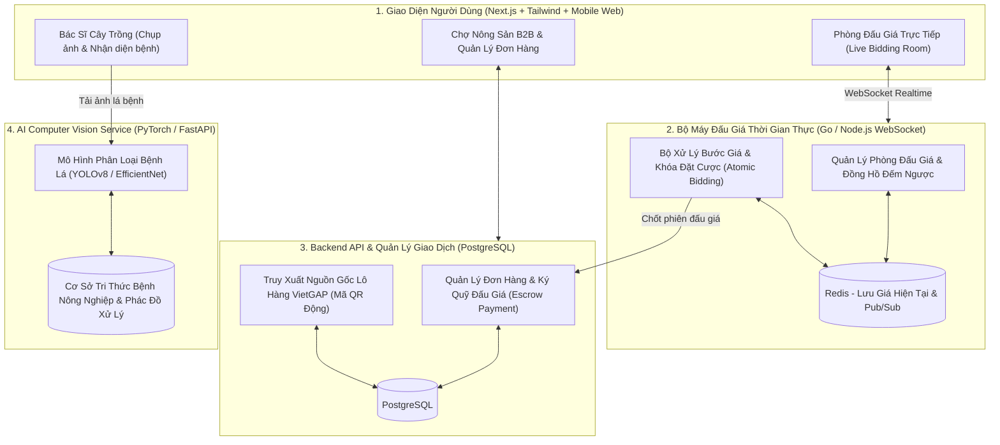
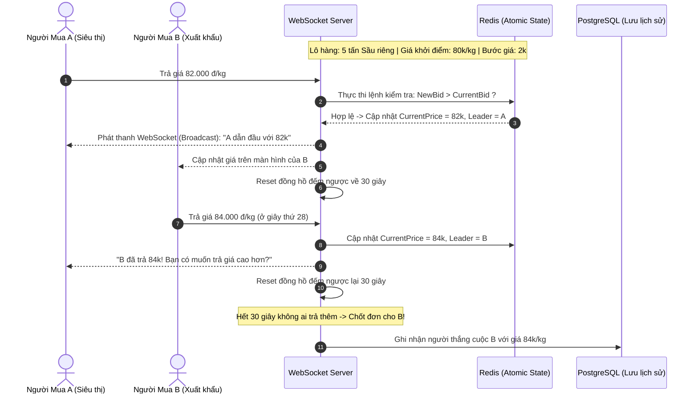
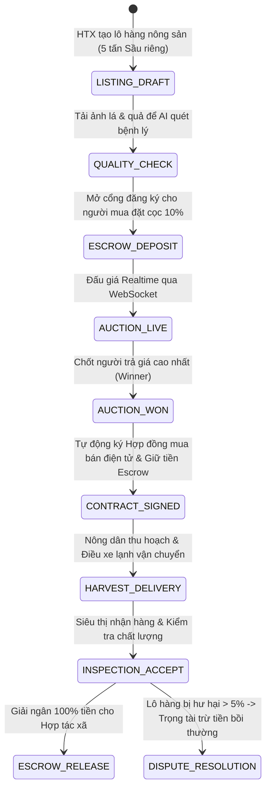

# PHÂN TÍCH CHI TIẾT ĐỀ TÀI: AGRITECH DATA-DRIVEN PLATFORM
## (Sàn Đấu Giá Nông Sản Trực Tuyến Thời Gian Thực & AI Chẩn Đoán Bệnh Cây Trồng Qua Ảnh)

---

## 1. TỔNG QUAN & BÀI TOÁN THỰC TẾ

### 1.1. Bối cảnh
Nông nghiệp Việt Nam (sầu riêng, thanh long, cà phê, lúa gạo) đối mặt với 2 rủi ro lớn nhất:
- **Nông dân bị thương lái ép giá:** Do thiếu kênh kết nối trực tiếp với chuỗi siêu thị, nhà thu mua xuất khẩu và sàn đấu giá công khai. Nông sản thường xuyên rơi vào cảnh *"được mùa mất giá"*.
- **Thiệt hại mùa màng do phát hiện sâu bệnh muộn:** Khi cây bị nấm lá, đốm mắt cua, rệp sáp, nông dân không có chuyên gia nông học bên cạnh để chẩn đoán chính xác, thường mua sai thuốc bảo vệ thực vật khiến cây chết hoặc tồn dư hóa chất vượt ngưỡng xuất khẩu.

### 1.2. Giải pháp của dự án
1. **Sàn đấu giá nông sản trực tuyến (Real-Time B2B Live Auction):**
   - Hợp tác xã/nông dân đăng tải lô hàng (ví dụ: 5 tấn Sầu riêng Ri6 chuẩn VietGAP).
   - Phiên đấu giá diễn ra theo thời gian thực (Real-time WebSocket): Nhà mua sỉ vào trả giá trực tiếp, có đồng hồ đếm ngược (Countdown Timer) và cơ chế khóa tiền cọc đảm bảo giao dịch.
2. **AI Computer Vision chẩn đoán bệnh cây trồng:**
   - Người dùng chỉ cần cầm điện thoại chụp ảnh lá cây hoặc quả bị bệnh -> Mô hình Deep Learning nhận diện chính xác tên bệnh trong 0.3 giây, đưa ra nguyên nhân và phác đồ điều trị an toàn sinh học.
3. **Cảnh báo thời tiết nông vụ (Weather Integration):**
   - Kết nối API khí tượng để cảnh báo sương muối, mưa đá, hạn mặn và gợi ý lịch phun thuốc tối ưu.

---

## 2. SƠ ĐỒ KIẾN TRÚC HỆ THỐNG

---

## 3. THIẾT KẾ ĐỘNG CƠ ĐẤU GIÁ REAL-TIME (AUCTION ENGINE)

Đấu giá trực tuyến đòi hỏi tính nhất quán tuyệt đối về thời gian và giá trị đặt cược:

---

## 4. PIPELINE NHẬN DIỆN BỆNH CÂY TRỒNG (COMPUTER VISION)

1. **Bộ dữ liệu (Dataset):**
   - Sử dụng bộ dữ liệu mở **PlantVillage Dataset** (hơn 54.000 ảnh chụp lá cây của 14 loài cây trồng khác nhau với 38 lớp bệnh lý: bệnh đạo ôn, đốm mắt cua, rỉ sắt, thán thư, xoăn lá do virus...).
2. **Huấn luyện mô hình:**
   - Fine-tune trên kiến trúc mạng **EfficientNet-B0** hoặc **MobileNetV3** (nhẹ, tối ưu để chạy trực tiếp trên web hoặc điện thoại di động).
   - Áp dụng các kỹ thuật tăng cường dữ liệu (Data Augmentation): Lật ảnh, xoay góc, chỉnh độ sáng/tương phản để mô hình nhận diện chính xác kể cả khi chụp ngoài trời nắng gắt hoặc trong bóng râm.
3. **Độ chính xác (Accuracy):**
   - Đạt độ chính xác Top-1 $> 94\%$ trên tập kiểm thử (Test set).
   - Tốc độ suy luận (Inference Time): **dưới 100ms**.

---

## 5. MA TRẬN ACTORS & PHÂN QUYỀN SÀN NÔNG SẢN B2B (MULTI-STAKEHOLDER MATRIX)

| Actor / Vai trò | Trách nhiệm & Quyền hạn nghiệp vụ trong Big Project |
| :--- | :--- |
| **Farmer / Cooperative (Hợp tác xã nông sản)** | Đăng ký mở phiên đấu giá, tải ảnh nông sản và kết quả quét AI bệnh lá, xác nhận chuẩn bị đơn hàng khi có người trúng đấu giá. |
| **B2B Buyer (Chuỗi siêu thị / Doanh nghiệp xuất khẩu)** | Đặt cọc tiền ký quỹ tham gia phòng đấu giá, trả giá thời gian thực (Real-time Bidding), ủy thác thanh toán qua tài khoản Escrow. |
| **Quality Inspector (Chuyên viên kiểm định nông sản)** | Lấy mẫu kiểm định độc lập tại vườn, xác nhận chỉ số độ ngọt Brix, dư lượng thuốc BVTV, cấp chứng chỉ VietGAP/GlobalGAP số hóa. |
| **Platform Escrow Manager (Quản trị viên ký quỹ & Trọng tài)** | Quản lý tài khoản tạm giữ tiền (Escrow), giải ngân tiền cho nông dân sau khi siêu thị nhận hàng nguyên vẹn, xử lý khiếu nại nếu hàng dập nát. |

---

## 6. PHÂN TÍCH NGHIỆP VỤ BIG PROJECT & BẢN ĐỒ QUY TRÌNH (ENTERPRISE AGRI WORKFLOWS)

---

### 6.1. Nghiệp Vụ Ký Quỹ & Chống Bùng Kèo Đấu Giá (Escrow Deposit Guarantee)
- Nông sản là mặt hàng nhanh hỏng (Perishable Goods). Nếu người trúng đấu giá bùng kèo, nông sản sẽ bị thối rữa gây phá sản cho nông dân:
  1. **Quy tắc Ký quỹ trước (Pre-Bid Deposit):** Người mua bắt buộc phải nạp cọc $10\%$ giá trị khởi điểm vào tài khoản Escrow của sàn trước khi được cấp quyền bấm nút đấu giá.
  2. **Quy tắc Phạt vi phạm:** Nếu sau 24h trúng đấu giá người mua không thanh toán phần còn lại:
     - Hệ thống tự động tịch thu $100\%$ tiền đặt cọc để bồi thường cho nông dân.
     - Khóa tài khoản vĩnh viễn và trao quyền mua cho người trả giá cao thứ 2 (Runner-up).

---

### 6.2. Truy Xuất Nguồn Gốc Số Hóa (Farm-to-Fork Traceability QR Code)
- Mỗi lô nông sản sau khi đấu giá thành công được cấp một **Mã QR định danh duy nhất**:
  - Người tiêu dùng quét mã QR tại siêu thị sẽ xem được toàn bộ hành trình: Vị trí tọa độ GPS nông trại, Ngày phun thuốc bảo vệ thực vật cuối cùng, Báo cáo kiểm định AI không có sâu bệnh, và Nhật ký vận chuyển xe lạnh.

