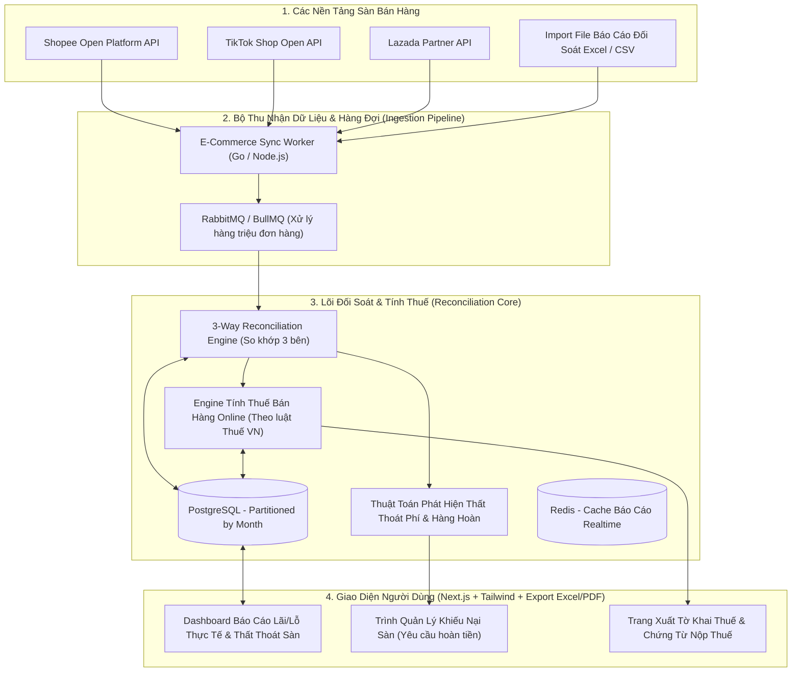
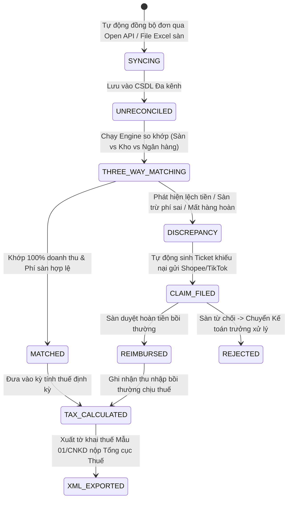

# PHÂN TÍCH CHI TIẾT ĐỀ TÀI: E-COMMERCE TAX & OMNICHANNEL RECONCILIATION
## (Hệ Thống Tự Động Đối Soát Doanh Thu Đa Sàn Shopee / TikTok Shop / Lazada & Quyết Toán Thuế Bán Hàng Online)

---

## 1. TỔNG QUAN & BÀI TOÁN THỰC TẾ NÓNG BỎNG HIỆN NAY

### 1.1. Bối cảnh thị trường
Tại Việt Nam, kinh doanh trên các sàn TMĐT (Shopee, TikTok Shop, Lazada) đang bùng nổ, nhưng các chủ shop đang đối mặt với **cuộc khủng hoảng lớn nhất từ trước đến nay về đối soát và thuế**:
- **Cơ quan thuế siết chặt:** Nghị định 52/2024/NĐ-CP và cơ chế chia sẻ dữ liệu trực tiếp từ các sàn TMĐT về Tổng cục Thuế khiến hàng trăm nghìn người bán hàng online bị truy thu thuế và xử phạt nếu không kê khai chuẩn xác.
- **Ma trận phí của các sàn:** Một đơn hàng bán 200.000 VNĐ nhưng tiền thực nhận về tài khoản chỉ còn 160.000 VNĐ vì sàn trừ: Phí thanh toán, Phí cố định, Phí FreeShip Xtra, Voucher sàn, Phí quảng cáo tiếp thị liên kết (Affiliate).
- **Hàng hoàn / Hủy đơn / Bom hàng thất thoát:** Hàng hoàn về bị thất lạc hoặc sàn hoàn tiền cho khách nhưng shop không nhận lại được hàng, dẫn đến thất thoát hàng trăm triệu mỗi năm mà không có công cụ phát hiện.

### 1.2. Giải pháp của dự án
Xây dựng một nền tảng SaaS B2B chuyên biệt:
1. **Tự động đồng bộ đơn hàng đa sàn:** Kết nối API chính thức (hoặc import file đối soát định kỳ) từ **Shopee Open Platform, TikTok Shop Partner, Lazada Open API**.
2. **Bộ máy đối soát tự động 3 bên (3-Way Reconciliation Engine):**
   - So khớp: `Doanh số trên sàn` $\longleftrightarrow$ `Dữ liệu tồn kho nội bộ` $\longleftrightarrow$ `Dòng tiền thực nhận về ngân hàng`.
   - Bắt chính xác từng đơn hàng bị sàn trừ phí sai, đơn hoàn chưa nhận được tiền bồi thường.
3. **Module Kê khai & Tối ưu Thuế Bán Hàng Online:**
   - Tự động bóc tách doanh thu chịu thuế (Doanh thu gộp vs Doanh thu thuần sau chiết khấu).
   - Xuất tờ khai thuế mẫu biểu chuẩn của Tổng cục Thuế (Mẫu 01/CNKD cá nhân kinh doanh hoặc tờ khai thuế TNDN cho công ty).
   - Cảnh báo ngưỡng doanh thu phải đóng thuế GTGT và TNCN.

---

## 2. SƠ ĐỒ KIẾN TRÚC HỆ THỐNG (SYSTEM ARCHITECTURE)



---

## 3. THIẾT KẾ CƠ SỞ DỮ LIỆU ĐỐI SOÁT & THUẾ (POSTGRESQL)

```sql
-- 1. Bảng cửa hàng trên từng sàn của người dùng
CREATE TABLE marketplace_stores (
    id UUID PRIMARY KEY DEFAULT gen_random_uuid(),
    user_id UUID NOT NULL,
    platform VARCHAR(30) NOT NULL, -- SHOPEE, TIKTOK_SHOP, LAZADA
    shop_id VARCHAR(100) NOT NULL,
    shop_name VARCHAR(255) NOT NULL,
    access_token TEXT,
    refresh_token TEXT,
    is_active BOOLEAN DEFAULT true,
    created_at TIMESTAMP DEFAULT CURRENT_TIMESTAMP
);

-- 2. Chi tiết đơn hàng đa sàn & bóc tách chi phí
CREATE TABLE omnichannel_orders (
    id UUID PRIMARY KEY DEFAULT gen_random_uuid(),
    store_id UUID REFERENCES marketplace_stores(id),
    order_sn VARCHAR(100) NOT NULL, -- Mã đơn hàng trên sàn
    order_status VARCHAR(50) NOT NULL, -- COMPLETED, CANCELLED, RETURNED, SHIPPED
    order_date TIMESTAMP NOT NULL,
    
    -- Dòng tiền doanh thu
    buyer_paid_amount DECIMAL(15, 2) NOT NULL, -- Tiền khách trả
    seller_discount DECIMAL(15, 2) DEFAULT 0, -- Voucher shop chịu
    platform_discount DECIMAL(15, 2) DEFAULT 0, -- Voucher sàn trợ giá
    
    -- Ma trận phí bị sàn khấu trừ
    platform_commission_fee DECIMAL(15, 2) DEFAULT 0, -- Phí cố định sàn
    payment_service_fee DECIMAL(15, 2) DEFAULT 0, -- Phí thanh toán (2-4%)
    shipping_fee_borne_by_seller DECIMAL(15, 2) DEFAULT 0, -- Phí ship shop chịu
    affiliate_commission_fee DECIMAL(15, 2) DEFAULT 0, -- Phí tiếp thị liên kết
    
    -- Tiền thực tế sàn trả về ví shop
    net_settlement_amount DECIMAL(15, 2) NOT NULL,
    
    -- Trạng thái đối soát
    reconciliation_status VARCHAR(30) DEFAULT 'UNRECONCILED', -- MATCHED, DISCREPANCY, CLAIMED
    discrepancy_amount DECIMAL(15, 2) DEFAULT 0,
    created_at TIMESTAMP DEFAULT CURRENT_TIMESTAMP
);
CREATE INDEX idx_orders_date_store ON omnichannel_orders (store_id, order_date);

-- 3. Bảng tổng hợp nghĩa vụ thuế định kỳ
CREATE TABLE tax_reports (
    id UUID PRIMARY KEY DEFAULT gen_random_uuid(),
    user_id UUID NOT NULL,
    period_type VARCHAR(20) NOT NULL, -- MONTHLY, QUARTERLY, ANNUAL
    period_value VARCHAR(20) NOT NULL, -- 'Q3-2026', '10-2026'
    gross_revenue DECIMAL(15, 2) NOT NULL, -- Tổng doanh thu tính thuế
    vat_tax_amount DECIMAL(15, 2) NOT NULL, -- Thuế GTGT phải nộp (1% ngành bán lẻ)
    pit_tax_amount DECIMAL(15, 2) NOT NULL, -- Thuế TNCN phải nộp (0.5% ngành bán lẻ)
    total_tax_due DECIMAL(15, 2) NOT NULL,
    generated_at TIMESTAMP DEFAULT CURRENT_TIMESTAMP
);
```

---

## 4. CÁC QUY TẮC NGHIỆP VỤ & CÔNG THỨC ĐỐI SOÁT CỐT LÕI

### 4.1. Công thức tính Lợi nhuận thực nhận (True Profit Formula)
$$\text{Tiền Thực Nhận (Net)} = \text{Doanh Số Bán} - (\text{Phí Sàn} + \text{Phí Ship Shop Chịu} + \text{Phí Voucher} + \text{Phí Affiliate})$$
- Hệ thống tự động so khớp:
  $$\Delta = \text{Tiền Sàn Báo Trả Về} - \text{Tiền Thực Tế Vào Tài Khoản Ngân Hàng}$$
  - Nếu $\Delta \ne 0$: Đánh dấu cờ đỏ `DISCREPANCY`, tự động sinh đơn khiếu nại (Claim Ticket) có đầy đủ bằng chứng để shop gửi bộ phận hỗ trợ của Shopee/TikTok đòi tiền.

### 4.2. Quy định tính thuế bán hàng Online tại Việt Nam
Theo quy định hiện hành đối với hộ kinh doanh và cá nhân kinh doanh trên sàn TMĐT:
- **Ngưỡng chịu thuế:** Doanh thu trong năm dương lịch $> 100.000.000$ VNĐ.
- **Mức thuế suất ngành phân phối, bán lẻ hàng hóa:**
  - Thuế Giá trị gia tăng (GTGT): $1\%$ trên tổng doanh thu.
  - Thuế Thu nhập cá nhân (TNCN): $0.5\%$ trên tổng doanh thu.
  - Tổng thuế suất: **$1.5\%$**.
- **Bài toán phức tạp:** Khoản trợ giá của sàn (Voucher sàn) có bị tính thuế không? Khoản tiền ship khách trả sàn thu hộ có tính vào doanh thu shop không? -> Hệ thống bóc tách chính xác các khoản này để chủ shop **không bị nộp thừa thuế** nhưng cũng **không bị phạt trốn thuế**.

---

## 5. VÌ SAO ĐỀ TÀI NÀY CỰC KỲ DỄ BÁN & CÓ NHU CẦU THỰC TẾ KHỔNG LỒ?

1. **Khách hàng đang khóc ròng vì thuế:** Hầu hết các chủ shop trên Shopee/TikTok Shop hiện nay đều nhận được giấy mời của cơ quan thuế yêu cầu đối soát số liệu 3 năm qua nhưng không biết lấy số liệu ở đâu để giải trình.
2. **Tiết kiệm hàng chục triệu thất thoát:** Một shop doanh thu 500 triệu/tháng thường bị thất thoát từ $1\%$ đến $3\%$ tiền hoàn hàng và phí sàn trừ vô lý (5 - 15 triệu/tháng). Phần mềm của bạn chỉ cần giúp họ đòi lại được số tiền này thì mức phí thuê bao 300k - 500k/tháng là quá rẻ!
3. **100% Thuần Phần Mềm:** Toàn bộ dữ liệu lấy qua API và file Excel/CSV, xử lý trên Database và hiển thị giao diện báo cáo cực kỳ tiện lợi.

---

## 6. MA TRẬN ACTORS & QUY TRÌNH NGHIỆP VỤ BIG PROJECT (ENTERPRISE TAX & RECONCILIATION)



### 6.1. Ma trận Actors & Phân quyền Doanh nghiệp (Enterprise Roles)
| Actor / Vai trò | Trách nhiệm & Quyền hạn nghiệp vụ trong Big Project |
| :--- | :--- |
| **Merchant Owner (Chủ chuỗi kinh doanh)** | Xem Dashboard P&L lãi/lỗ thực sau thuế, phê duyệt các khoản chiết khấu lớn, ký số tờ khai thuế điện tử. |
| **Chief Accountant (Kế toán trưởng / Tax Auditor)** | Rà soát các đơn hàng lệch tiền, cấu hình danh mục chi phí được trừ, xuất hồ sơ giải trình khi cơ quan thuế thanh tra. |
| **Warehouse & Operations Staff (Thủ kho / Vận hành)** | Quét barcode xác nhận hàng hoàn nhập kho; đánh dấu cờ cảnh báo đơn hàng sàn báo "Đã hoàn trả" nhưng thực tế kho không nhận được hàng. |
| **Automated Platform Sync Workers** | Cụm worker tự động chạy 2h/lần gọi API Shopee/TikTok/Lazada để lấy trạng thái đơn, biểu phí và sao kê ví điện tử sàn. |

---

### 6.2. Quy trình Vòng đời Đối soát 3 Bên Chuyên Sâu (3-Way Reconciliation Workflow)
1. **Bước 1 - Lớp Sàn TMĐT (Platform Data):** Đọc dữ liệu đơn hàng, phí dịch vụ cố định, phí thanh toán, voucher trợ giá từ Shopee/TikTok API.
2. **Bước 2 - Lớp Kho Nội Bộ (WMS Data):** So khớp trạng thái thực tế của sản phẩm: Đã xuất kho $\leftrightarrow$ Đang giao $\leftrightarrow$ Đã giao thành công $\leftrightarrow$ Hàng hoàn về kho.
3. **Bước 3 - Lớp Dòng tiền Ngân hàng (Bank Statement):** Bóc tách giao dịch nạp/rút tiền từ ví người bán về tài khoản ngân hàng thông qua kết nối Open Banking / VietQR Reconciliation.
4. **Phát hiện ngoại lệ (Anomaly Triggers):**
   - **Lệch cân nặng (Weight Overcharge):** Sàn tự ý tăng trọng lượng kiện hàng từ 200g lên 1.200g để trừ thêm 30.000đ cước phí.
   - **Hàng hoàn thất lạc (Ghost Return):** Sàn đã hoàn tiền 100% cho người mua từ 14 ngày trước nhưng kho người bán chưa nhận được hàng hoàn.

---

### 6.3. Quy trình Tự Động Hóa Khiếu Nại Sàn (Automated Dispute Claims Engine)
- Khi phát hiện đơn hàng bị trừ phí sai hoặc mất hàng hoàn:
  - Hệ thống tự động gom bằng chứng: Ảnh chụp đóng gói lúc gửi đi (nếu có barcode), Lịch sử đối soát kho, Lịch sử hành trình đơn hàng.
  - Tự động điền biểu mẫu khiếu nại (Claim Ticket) chuẩn form của Shopee Support / TikTok Shop Partner.
  - Theo dõi trạng thái khiếu nại (Pending $\rightarrow$ Approved $\rightarrow$ Money Returned) và tự động ghi nhận bút toán hoàn tiền vào sổ quỹ khi tiền về ví.

---

### 6.4. Nghiệp vụ Kê Khai Thuế Chuẩn Hóa & Giải Trình Thuế Tự Động (Tax Audit Defense)
- **Tách bạch dòng tiền không chịu thuế:** Hệ thống tự động loại trừ các khoản không cấu thành doanh thu chịu thuế TNCN/GTGT: Tiền sàn hoàn do hủy đơn, Khoản phí vận chuyển mà khách trả trực tiếp cho đơn vị vận chuyển, Tiền bồi thường hàng vỡ hỏng.
- **Xuất file XML nộp qua cổng Thuế Điện Tử (thuedientu.gdt.gov.vn):** Tạo tờ khai thuế tháng/quý chuẩn định dạng XML và bảng kê chi tiết phụ lục 01-1/BK-CNKD có chữ ký số điện tử chỉ với 1 click.

