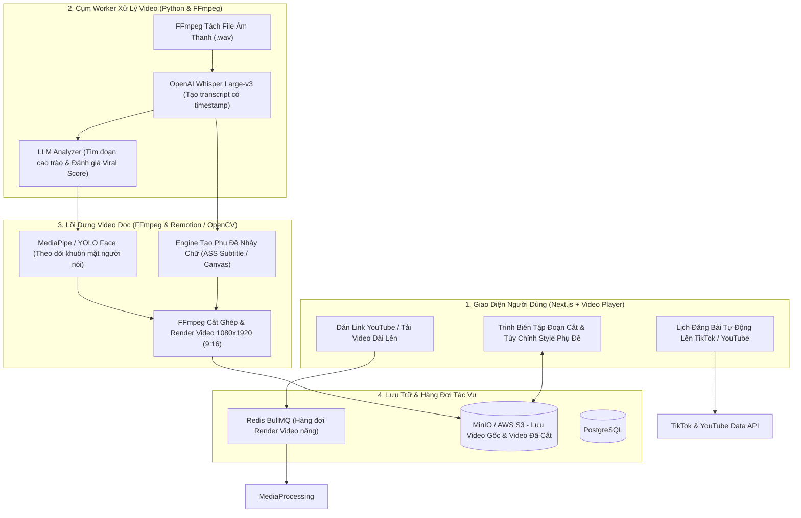
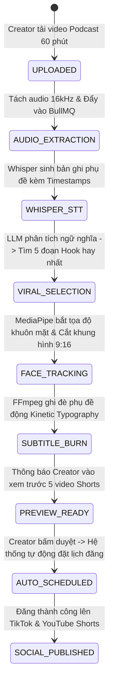

# PHÂN TÍCH CHI TIẾT ĐỀ TÀI: AI VIDEO REPURPOSING & MARTECH AUTOMATION
## (Nền Tảng Tự Động Cắt Video Dài Thành Short-Form Video Kèm Phụ Đề Động & Đăng Đa Nền Tảng)

---

## 1. TỔNG QUAN & BÀI TOÁN THỰC TẾ CỰC HOT

### 1.1. Bối cảnh bùng nổ video ngắn (Short-form Video)
Hiện nay, mọi doanh nghiệp, nhà sáng tạo nội dung (Content Creator), diễn giả, người bán hàng đều có nhu cầu sản xuất video ngắn hàng loạt trên **TikTok, YouTube Shorts, Facebook Reels**.
- Họ có các video dài (Video Podcast, Livestream bán hàng, Video bài giảng, Buổi phỏng vấn dài 30 - 60 phút).
- Để cắt được 5 - 10 đoạn clip ngắn 60 giây hay nhất từ video dài đó, họ phải thuê Editor:
  - Chi phí: 5 - 10 triệu đồng/tháng.
  - Mất 2 - 3 ngày để editor xem hết video, chọn đoạn hay, gõ phụ đề (subtitle) từng chữ, canh nhịp hiệu ứng (zoom-in, sound effect).

### 1.2. Giải pháp của dự án
Xây dựng một nền tảng SaaS tự động hóa bằng AI (tương tự Opus Clip / Klap nhưng tối ưu cho tiếng Việt):
1. **Phát hiện đoạn Viral Hook bằng AI:**
   - Người dùng dán link YouTube dài hoặc upload file MP4.
   - AI Speech-to-Text chuyển đổi toàn bộ âm thanh thành văn bản kèm mốc thời gian (Timestamp).
   - LLM phân tích ngữ nghĩa, phát hiện các đoạn cao trào, hài hước, hoặc có giá trị thông tin cao nhất (Viral Score 0 - 100) và tự động cắt thành các clip dài 30 - 60 giây.
2. **Tự động chuyển đổi tỷ lệ khung hình & Căn giữa khuôn mặt (Active Speaker Detection):**
   - Chuyển từ video ngang $16:9$ sang video dọc $9:16$ (chuẩn TikTok).
   - Computer Vision tự động theo dõi khuôn mặt người đang nói để luôn căn người nói vào chính giữa màn hình.
3. **Sinh phụ đề động nhảy chữ phong cách TikTok (Kinetic Subtitles):**
   - Tự động sinh phụ đề tiếng Việt nhảy chữ theo nhịp nói (Word-level timestamps), tự động highlight màu vàng/đỏ cho các từ quan trọng và thêm emoji tự động.
4. **Lên lịch đăng bài tự động đa kênh (Auto-Publishing):**
   - Đăng thẳng video đã render lên kênh TikTok, YouTube Shorts và Fanpage Facebook qua API.

---

## 2. SƠ ĐỒ KIẾN TRÚC HỆ THỐNG

---

## 3. CÁC ĐIỂM NHẤN CÔNG NGHỆ BÙNG NỔ (100% THUẦN PHẦN MỀM)

1. **Thuật toán tìm đoạn Viral Hook (Transcript Semantic Chunking):**
   - Đưa bản ghi phụ đề qua mô hình LLM với prompt tối ưu cho tâm lý người xem mạng xã hội:
     *"Hãy tìm 3 đoạn hội thoại độc lập trong video có mở đầu gây tò mò (Hook trong 3 giây đầu), thân bài có nội dung giải thích rõ ràng và kết thúc có điểm nhấn. Độ dài mỗi đoạn từ 30 đến 60 giây."*
2. **Kỹ thuật căn chỉnh khuôn mặt tự động (Smart Auto-Reframe):**
   - Sử dụng thư viện **Google MediaPipe Face Detection** để lấy tọa độ khuôn mặt $(x, y)$ trên từng frame hình ảnh.
   - Áp dụng thuật toán làm mượt chuyển động (Moving Average Filter) để camera trượt mượt mà theo người nói khi họ di chuyển, không bị giật cục.
3. **Engine sinh phụ đề động (Kinetic Typography):**
   - Sinh file định dạng **Advanced SubStation Alpha (.ass)** chứa cấu hình font chữ (Montserrat/TheBoldFont), hiệu ứng phóng to (Pop-in animation) và màu sắc thay đổi theo đúng mili-giây người nói phát âm.

---

## 4. TIỀM NĂNG KINH DOANH THỰC TẾ

- Các công cụ như OpusClip, Submagic, Vizard đang thu phí từ **$19 đến $49/tháng** (khoảng 500k - 1.2 triệu đồng/tháng) và có hàng triệu người dùng toàn cầu.
- Nếu bạn làm một phiên bản **tối ưu tiếng Việt cực chuẩn (bắt đúng từ lóng tiếng Việt, font chữ không bị lỗi dấu, tích hợp thẳng TikTok Shop creator)**, bạn có thể dễ dàng kiếm được khách hàng trả tiền thực tế tại Việt Nam ngay trong tháng đầu ra mắt!

---

## 5. MA TRẬN ACTORS & PHÂN QUYỀN MARTECH SAAS (ENTERPRISE CREATOR MATRIX)

| Actor / Vai trò | Trách nhiệm & Quyền hạn nghiệp vụ trong Big Project |
| :--- | :--- |
| **Agency / Brand Manager** | Quản lý không gian làm việc của nhiều nhãn hàng (Workspaces), nạp Credit phút render video, kết nối tài khoản TikTok/YouTube/Reels của thương hiệu. |
| **Content Creator / Video Editor** | Tải video dài lên (Podcast, Livestream bán hàng), tùy chỉnh template phụ đề động, chỉnh sửa khung hình khuôn mặt, phê duyệt danh sách clip ngắn. |
| **GPU Rendering Worker Pool** | Cụm máy chủ chuyên dụng (chạy FFmpeg + NVENC GPU) tiêu thụ hàng đợi render video không làm nghẽn máy chủ web. |
| **Social Distribution Bot** | Tự động đăng video lên TikTok, YouTube Shorts, Facebook Reels theo đúng khung giờ vàng đã lên lịch (Scheduled Publishing). |

---

## 6. PHÂN TÍCH NGHIỆP VỤ BIG PROJECT & BẢN ĐỒ QUY TRÌNH (ENTERPRISE VIDEO AI WORKFLOWS)

---

### 6.1. Quản Trị Hàng Đợi Render Phân Tán & Quota Tín Dụng (Credit & Storage Quotas)
- Video rendering là tác vụ ngốn tài nguyên CPU/GPU và ổ cứng rất lớn:
  1. **Cơ chế Tiêu thụ Credit (Pay-as-you-render):** Mỗi tài khoản được cấp hạn mức phút (VD: Gói Starter: 120 phút video gốc/tháng; Gói Pro: 600 phút/tháng). Trừ credit ngay khi bắt đầu tiến trình STT.
  2. **Chính sách Lưu trữ Tự Hủy (Auto-Purge Retention Policy):** Video gốc và các clip render tạm được lưu trữ trên S3/MinIO trong **7 ngày**. Sau 7 ngày, hệ thống tự động xóa file nhị phân nặng để tối ưu hóa chi phí lưu trữ đám mây, chỉ giữ lại phụ đề và đường dẫn video đã đăng lên mạng xã hội.

---

### 6.2. Kiểm Soát Bản Quyền Âm Nhạc & Tiêu Chuẩn Nền Tảng (Copyright & Policy Compliance)
- Trước khi đăng tải lên TikTok / YouTube:
  - Hệ thống kiểm tra âm lượng chuẩn hóa (**Audio Normalization EBU R128**) để âm thanh không bị rè hoặc quá nhỏ.
  - Quét từ khóa vi phạm tiêu chuẩn cộng đồng (Sensitive Word Filter): Tự động phát hiện và cảnh báo các từ bị bóp tương tác hoặc cấm trên TikTok (VD: "chuyển khoản", "mua bán ngoài", từ ngữ bạo lực) để creator kịp thời biên tập lại.

