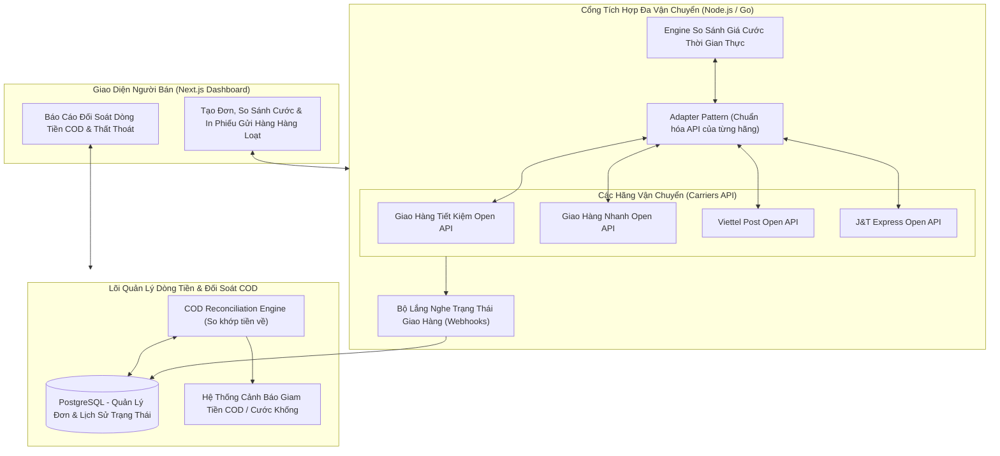
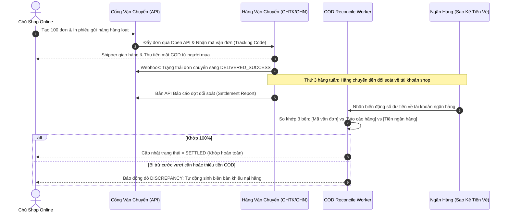
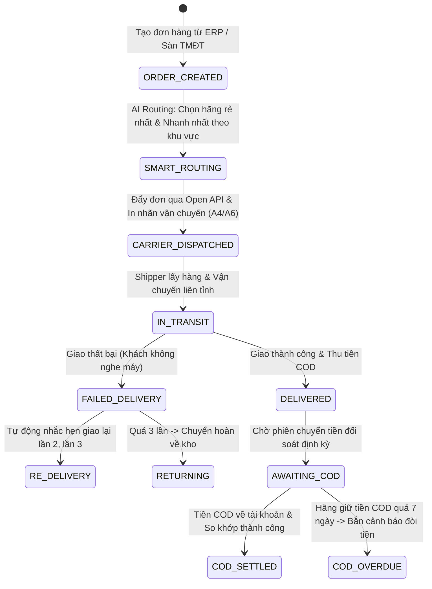

# PHÂN TÍCH CHI TIẾT ĐỀ TÀI: SMART SHIPPING GATEWAY & COD RECONCILIATION
## (Cổng Vận Chuyển Đa Hãng Tự Động So Sánh Cước & Đối Soát Tiền Thu Hộ COD Chống Thất Thoát)

---

## 1. TỔNG QUAN & BÀI TOÁN THỰC TẾ

### 1.1. Bối cảnh
Người bán hàng online, doanh nghiệp D2C (Direct-to-Consumer) tại Việt Nam sử dụng song song nhiều đơn vị vận chuyển:
- **Giao Hàng Tiết Kiệm (GHTK), Giao Hàng Nhanh (GHN), Viettel Post, J&T Express, VNPost**.
- **Nỗi đau 1 - Chênh lệch cước phí:** Cùng 1 kiện hàng 1kg gửi từ Hà Nội vào TP.HCM, Viettel Post có thể lấy 32.000đ, nhưng GHN lấy 40.000đ. Chủ shop mất thời gian mở từng app để so giá thủ công.
- **Nỗi đau 2 - "Om tiền" và thất thoát tiền COD (Cash on Delivery):** Hơn $60\%$ đơn hàng tại Việt Nam vẫn thanh toán tiền mặt khi nhận hàng (COD). Các hãng vận chuyển thu hộ tiền của khách rồi 1 tuần sau mới đối soát trả về cho shop. Nhiều trường hợp hãng đã thu tiền nhưng "quên" đối soát, hoặc trừ phí chuyển hoàn sai quy định khiến chủ shop mất hàng chục triệu mỗi tháng mà không hề hay biết.

### 1.2. Giải pháp của dự án
Xây dựng một nền tảng **Cổng vận chuyển thông minh (Shipping Aggregator SaaS)**:
1. **So sánh giá cước & Thời gian giao thời gian thực (Smart Rate Shopping):**
   - Người bán chỉ cần nhập khối lượng và địa chỉ người nhận. Hệ thống đồng thời gọi API của 5 hãng vận chuyển, hiển thị bảng so sánh cước phí và thời gian dự kiến, tự động chọn hãng rẻ nhất hoặc nhanh nhất theo cấu hình của shop.
2. **Tạo đơn & In phiếu gửi hàng hàng loạt (Bulk Dispatch & Label Printing):**
   - 1-click đẩy hàng trăm đơn sang hãng vận chuyển, tự động gom đơn và sinh mã vận đơn, in nhãn vận chuyển chuẩn kích thước A6/A7.
3. **Bộ máy đối soát tiền thu hộ COD tự động (Automated COD Reconciliation):**
   - Tự động quét lịch sử đối soát từ các hãng vận chuyển, so khớp mã vận đơn với số tiền thực tế đổ về tài khoản ngân hàng của shop.
   - Phát hiện các đơn hàng "Bất thường": Shipper báo đã giao thành công nhưng quá 7 ngày chưa có tiền về, hoặc đơn hàng bị tính sai cân nặng (bị tính cước khống).

---

## 2. SƠ ĐỒ KIẾN TRÚC HỆ THỐNG



---

## 3. CÁC QUY TẮC NGHIỆP VỤ ĐỐI SOÁT CỐT LÕI

1. **Thuật toán phát hiện gian lận cước cân nặng (Weight Overcharging Detector):**
   - Khi shop tạo đơn, shop khai báo cân nặng là $500g$.
   - Khi hãng xuất hóa đơn đối soát, hãng tự động điều chỉnh cân nặng lên $1.200g$ và trừ thêm 15.000đ cước vượt cân.
   - Hệ thống tự động so sánh $|W_{\text{shop}} - W_{\text{carrier}}|$. Nếu chênh lệch $> 300g$, lập tức gắn nhãn cảnh báo `OVERCHARGED_ALERT` để shop khiếu nại.
2. **Cơ chế phát hiện giam tiền COD (COD Holding Alert):**
   - Đơn hàng chuyển trạng thái `DELIVERED_SUCCESS` vào ngày $T$.
   - Quy định của hãng là đối soát vào thứ 3 và thứ 5 hàng tuần. Nếu sau ngày $T + 7$ mà trạng thái dòng tiền COD vẫn là `UNPAID` $\rightarrow$ Tự động sinh báo cáo danh sách đơn bị giam tiền để nhân viên bưu cục xử lý ngay.

---

## 4. THIẾT KẾ CƠ SỞ DỮ LIỆU ĐỀ XUẤT (POSTGRESQL)

```sql
-- 1. Cấu hình tài khoản hãng vận chuyển của Shop
CREATE TABLE carrier_accounts (
    id UUID PRIMARY KEY DEFAULT gen_random_uuid(),
    shop_id UUID NOT NULL,
    carrier_code VARCHAR(30) NOT NULL, -- GHTK, GHN, VIETTEL_POST, JT_EXPRESS
    api_token TEXT NOT NULL,
    client_id VARCHAR(100),
    is_active BOOLEAN DEFAULT true,
    created_at TIMESTAMP DEFAULT CURRENT_TIMESTAMP
);

-- 2. Đơn vận chuyển đa hãng
CREATE TABLE shipping_orders (
    id UUID PRIMARY KEY DEFAULT gen_random_uuid(),
    tracking_code VARCHAR(100) UNIQUE NOT NULL, -- Mã vận đơn của hãng
    carrier_code VARCHAR(30) NOT NULL,
    declared_weight_grams INT NOT NULL, -- Cân nặng shop khai báo
    carrier_measured_weight_grams INT, -- Cân nặng hãng đo lúc đối soát
    cod_amount DECIMAL(15, 2) DEFAULT 0, -- Số tiền cần thu hộ
    shipping_fee DECIMAL(15, 2) NOT NULL, -- Cước phí ước tính lúc tạo đơn
    actual_shipping_fee DECIMAL(15, 2), -- Cước phí thực tế hãng trừ lúc đối soát
    delivery_status VARCHAR(50) DEFAULT 'PENDING', -- PICKING, IN_TRANSIT, DELIVERED, RETURNED, CANCELLED
    cod_settlement_status VARCHAR(30) DEFAULT 'UNSETTLED', -- UNSETTLED, SETTLED, DISCREPANCY, OVERDUE
    delivered_at TIMESTAMP,
    settled_at TIMESTAMP,
    created_at TIMESTAMP DEFAULT CURRENT_TIMESTAMP
);
CREATE INDEX idx_shipping_status_carrier ON shipping_orders(carrier_code, cod_settlement_status);

-- 3. Đợt đối soát tiền COD từ hãng
CREATE TABLE cod_reconciliation_batches (
    id UUID PRIMARY KEY DEFAULT gen_random_uuid(),
    carrier_code VARCHAR(30) NOT NULL,
    batch_code VARCHAR(100) NOT NULL, -- Mã phiên đối soát của hãng
    total_orders_count INT NOT NULL,
    total_cod_expected DECIMAL(15, 2) NOT NULL,
    total_cod_received DECIMAL(15, 2) NOT NULL,
    total_discrepancy DECIMAL(15, 2) DEFAULT 0,
    bank_transaction_ref VARCHAR(100), -- Mã giao dịch ngân hàng tiền về
    reconciled_at TIMESTAMP DEFAULT CURRENT_TIMESTAMP
);
```

---

## 5. SƠ ĐỒ TUẦN TỰ ĐỐI SOÁT COD (SEQUENCE DIAGRAM)



---

## 6. MA TRẬN ACTORS & QUY TRÌNH NGHIỆP VỤ BIG PROJECT (ENTERPRISE LOGISTICS WORKFLOWS)



### 6.1. Ma trận Actors & Phân quyền Logistics Đa Chi Nhánh
| Actor / Vai trò | Trách nhiệm & Quyền hạn nghiệp vụ trong Big Project |
| :--- | :--- |
| **Logistics Manager (Giám đốc chuỗi cung ứng)** | Cấu hình hạn mức cước, ký hợp đồng chiết khấu với các hãng, theo dõi chỉ số On-Time Delivery (OTD) toàn hệ thống. |
| **Warehouse Fulfillment Lead (Trưởng kho đóng gói)** | In mã vận đơn hàng loạt, quét mã barcode bàn giao hàng cho shipper, xác nhận biên bản giao nhận (Handover Record). |
| **COD Reconciliation Accountant (Kế toán đối soát COD)** | Rà soát các đơn bị lệch cước vượt cân, đối soát file sao kê định kỳ từ 5 hãng vận chuyển, phê duyệt xuất hóa đơn cước vận chuyển. |
| **Carrier Open APIs (GHTK, GHN, Viettel Post, J&T, NinjaVan)** | Cung cấp Webhook trạng thái hành trình đơn hàng, bảng tính cước thời gian thực và lịch sử phiên chuyển tiền COD. |

---

### 6.2. Nghiệp vụ Tự Động Định Tuyến Hãng Tối Ưu (Smart Carrier Routing Engine)
Khi nhân viên bấm "Tạo vận đơn", hệ thống không chọn hãng thủ công mà áp dụng thuật toán tối ưu hóa đa mục tiêu:
1. **Tiêu chí chi phí (Cost Minimization):** Tra cứu bảng giá cước đồng thời qua API của 5 hãng theo trọng lượng và tuyến đường (Nội tỉnh, Nội vùng, Liên tỉnh).
2. **Tiêu chí chất lượng dịch vụ (SLA & Carrier Reliability Score):**
   - Đánh giá chỉ số giao đúng hạn (OTD%) và tỷ lệ hoàn hàng của từng hãng trong 30 ngày gần nhất tại chính phường/xã của người nhận.
   - Nếu Hãng A rẻ hơn 2.000đ nhưng tại Quận 12 tỷ lệ giao trễ lên tới $25\%$, hệ thống tự động ưu tiên Hãng B để bảo vệ trải nghiệm khách hàng.

---

### 6.3. Thuật Toán Phát Hiện Gian Lận Cân Nặng (Volumetric & Weight Fraud Prevention)
- **Quy tắc thể tích chuẩn:**
  $$\text{Khối lượng quy đổi (g)} = \frac{\text{Dài (cm)} \times \text{Rộng (cm)} \times \text{Cao (cm)}}{5000} \times 1000$$
- **Cơ chế bẫy lệch cước:**
  - Nếu shop khai báo kiện hàng là 300g (kích thước $15 \times 10 \times 5$ cm), nhưng trong bảng đối soát tuần hãng tính 1.500g và trừ thêm 35.000đ cước:
  - Hệ thống tự động kích hoạt cờ đỏ `WEIGHT_OVERCHARGED`, đính kèm ảnh chụp kiện hàng lúc quét mã tại kho và sinh công văn khiếu nại yêu cầu hãng hoàn tiền cước chênh lệch.

---

### 6.4. Nghiệp vụ Cảnh Báo Giam Tiền COD & Thất Thoát Dòng Tiền (COD Holding Alerts)
- **Giới hạn thời gian giữ tiền (COD Aging SLA):** Các hãng cam kết chuyển tiền COD vào Thứ 3 & Thứ 6 hàng tuần.
- Nếu một đơn hàng đã chuyển trạng thái `DELIVERED_SUCCESS` quá 7 ngày mà chưa xuất hiện trong bất kỳ phiên đối soát nào của hãng:
  - Hệ thống tự động xếp vào danh mục `COD_HELD_BY_CARRIER`.
  - Tổng hợp danh sách đơn bị giam tiền thành báo cáo "Nợ đọng COD", tự động gửi email cảnh báo tới Quản lý tài khoản (Account Manager) của hãng vận chuyển.


