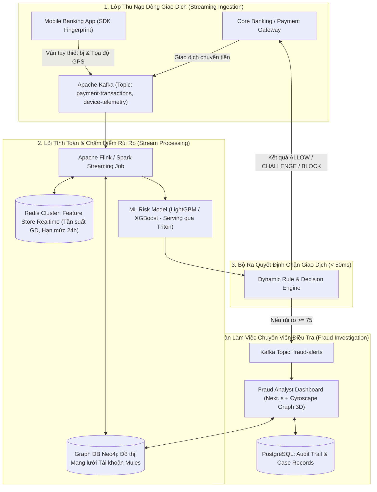
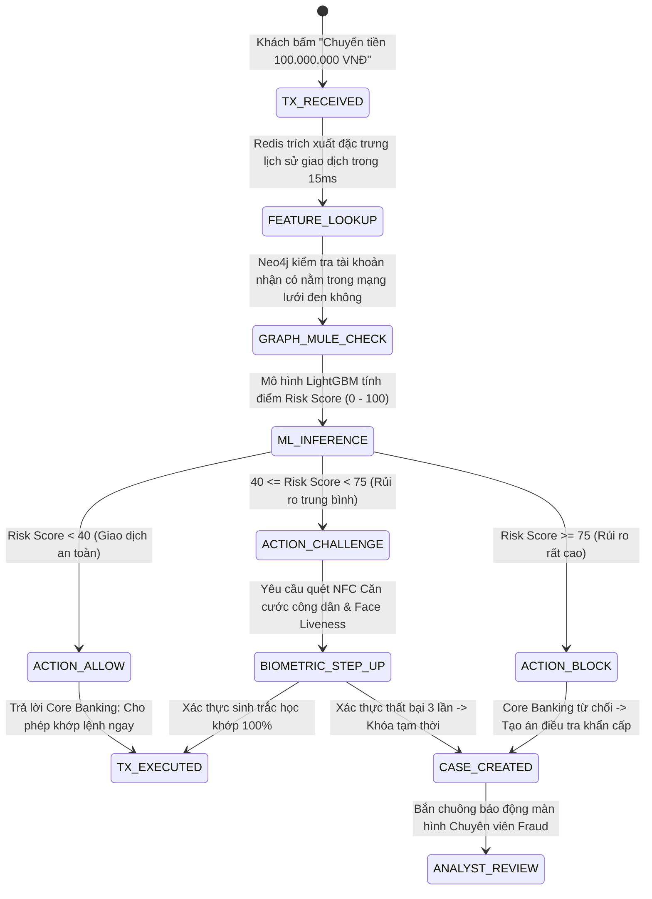

# PHÂN TÍCH CHI TIẾT ĐỀ TÀI 17: REAL-TIME FINANCIAL FRAUD DETECTION & AML RISK SCORING ENGINE
## (Hệ Thống Phát Hiện Gian Lận Giao Dịch Ngân Hàng Thời Gian Thực & Truy Vết Đồ Thị Rửa Tiền)

---

## 1. TỔNG QUAN & BÀI TOÁN THỰC TẾ NÓNG BỎNG HIỆN NAY

### 1.1. Bối cảnh thị trường
Tại Việt Nam và quốc tế, tội phạm công nghệ cao trong lĩnh vực tài chính đang bùng nổ với các thủ đoạn tinh vi:
- **Chiếm đoạt tài khoản & Bẫy Deepfake:** Lừa nạn nhân cài mã độc chiếm quyền điều khiển điện thoại (Accessibility Service), giả mạo khuôn mặt sinh trắc học để chuyển sạch tiền trong tài khoản.
- **Mạng lưới Tài khoản Rác (Money Mule Rings):** Tiền lừa đảo sau khi chiếm đoạt được lập tức chuyển vòng vèo qua hàng chục tài khoản trung gian khác nhau trong vòng chưa đầy 60 giây trước khi rút ra tiền mặt tại ATM hoặc mua tiền số (Crypto).
- **Quy định pháp lý siết chặt:** Quyết định 2345/QĐ-NHNN và Luật Phòng chống rửa tiền (AML) yêu cầu mọi tổ chức tín dụng phải có hệ thống giám sát giao dịch bất thường và chấm điểm rủi ro thời gian thực.

### 1.2. Giải pháp của dự án
Xây dựng một **Công cụ Giám sát Giao dịch Phân tán (Distributed Transaction Risk Engine)** chuẩn cấp độ Ngân hàng:
1. **Chấm điểm rủi ro thời gian thực (Sub-50ms Risk Scoring):** Tiếp nhận dòng giao dịch chuyển khoản qua Kafka, chạy mô hình chấm điểm rủi ro và trả về quyết định: `ALLOW (Cho phép)`, `CHALLENGE (Yêu cầu xác thực sinh trắc học Face Scan bổ sung)`, hoặc `BLOCK (Đóng băng tạm thời)`.
2. **Đồ thị Dòng tiền Truy vết Rửa tiền (Graph-based Money Mule Tracker):** Sử dụng **Graph Database (Neo4j / Memgraph)** dựng bản đồ quan hệ giữa các tài khoản, tự động phát hiện các chu trình chuyển tiền lòng vòng (Circular Transfers) và mạng lưới tài khoản rác có chung thiết bị đăng nhập.
3. **Quản lý Tập luật Linh hoạt (Dynamic Rule Engine):** Cho phép Chuyên viên phòng chống gian lận cấu hình luật chặn (VD: *"Nếu tài khoản mở dưới 7 ngày mà nhận > 10 giao dịch từ 10 tỉnh thành khác nhau trong 1 giờ -> Cảnh báo ngay"*) mà không cần khởi động lại server.

---

## 2. SƠ ĐỒ KIẾN TRÚC HỆ THỐNG (SYSTEM ARCHITECTURE)



---

## 3. THIẾT KẾ CƠ SỞ DỮ LIỆU ĐỒ THỊ & QUAN HỆ (GRAPH DB + POSTGRESQL)

### 3.1. Thiết kế Đồ thị dòng tiền rửa tiền (Neo4j Cypher Schema)
```cypher
// 1. Tạo node Khách hàng, Tài khoản và Thiết bị
CREATE (u:User {id: "USR_101", national_id: "001200001234", full_name: "Nguyen Van A"})
CREATE (a:Account {account_number: "190388889999", bank_code: "TCB", opened_at: datetime()})
CREATE (d:Device {device_fingerprint: "a9f8b2c1d3e4", os: "Android 14", is_rooted: true})

// 2. Tạo quan hệ sở hữu và liên kết
CREATE (u)-[:OWNS]->(a)
CREATE (u)-[:LOGGED_IN_WITH {last_ip: "14.232.10.5", timestamp: datetime()}]->(d)

// 3. Quan hệ chuyển tiền giữa các tài khoản
CREATE (a1:Account)-[:TRANSFERRED {amount: 50000000, tx_id: "TX_9901", timestamp: datetime()}]->(a2:Account)

// 4. Truy vấn phát hiện chu trình rửa tiền vòng tròn (Circular Mule Ring) trong 3 bước nhảy
MATCH path = (start:Account)-[t:TRANSFERRED*2..5]->(start)
WHERE all(rel in relationships(path) WHERE duration.inSeconds(rel.timestamp, relationships(path)[0].timestamp).minutes < 30)
RETURN path;
```

### 3.2. Bảng quản lý hồ sơ điều tra gian lận (PostgreSQL DDL)
```sql
CREATE TABLE fraud_cases (
    id UUID PRIMARY KEY DEFAULT gen_random_uuid(),
    case_number VARCHAR(50) UNIQUE NOT NULL, -- Ví dụ: CASE-2026-0089
    target_account VARCHAR(50) NOT NULL,
    suspect_name VARCHAR(255),
    risk_score INT NOT NULL, -- Thang điểm 0 - 100
    risk_level VARCHAR(20) NOT NULL, -- LOW, MEDIUM, HIGH, CRITICAL
    triggered_rules JSONB NOT NULL, -- Danh sách các luật vi phạm
    status VARCHAR(30) DEFAULT 'OPEN', -- OPEN, UNDER_REVIEW, CONFIRMED_FRAUD, FALSE_POSITIVE
    assigned_analyst_id UUID,
    total_prevented_amount DECIMAL(18, 2) DEFAULT 0,
    created_at TIMESTAMP DEFAULT CURRENT_TIMESTAMP,
    resolved_at TIMESTAMP
);
CREATE INDEX idx_fraud_status_risk ON fraud_cases(status, risk_score DESC);
```

---

## 4. CÁC ĐIỂM NHẤN CÔNG NGHỆ & THUẬT TOÁN ĂN ĐIỂM

1. **Feature Store Thời gian thực (Sliding Windows trên Redis):**
   - Hệ thống duy trì các đặc trưng thống kê thời gian thực trong cửa sổ trượt: *Số lần chuyển tiền trong 5 phút qua*, *Tỷ lệ số dư bị rút sạch trong 1 giờ*, *Tốc độ di chuyển địa lý (Nếu 10 phút trước đăng nhập tại Hà Nội, 10 phút sau chuyển tiền từ IP TP.HCM -> Bất khả thi về mặt vật lý, Flag cảnh báo ngay)*.
2. **Mô hình học máy phân lớp mất cân bằng (Cost-Sensitive Imbalanced Learning):**
   - Dữ liệu gian lận thực tế chỉ chiếm $< 0.1\%$ tổng giao dịch.
   - Sử dụng **Focal Loss** kết hợp thuật toán **LightGBM**, tối ưu hóa diện tích dưới đường cong ROC (PR-AUC $\ge 0.92$), giảm tối đa tỷ lệ báo động giả (False Positive) làm phiền khách hàng lương thiện.
3. **Biểu diễn Mạng lưới Trực quan 3D (Graph Visualizer):**
   - Giao diện điều tra cho phép chuyên viên click vào 1 tài khoản để bung ra toàn bộ cây quan hệ dòng tiền chuyển đi đâu, những tài khoản nào dùng chung 1 số IMEI hoặc số điện thoại đăng ký.

---

## 5. MA TRẬN ACTORS & PHÂN QUYỀN TRONG HỆ THỐNG AN NINH TÀI CHÍNH

| Actor / Vai trò | Trách nhiệm & Quyền hạn nghiệp vụ trong Big Project |
| :--- | :--- |
| **End Customer (Chủ tài khoản thanh toán)** | Thực hiện giao dịch chuyển tiền; nhận thông báo xác thực sinh trắc học nếu giao dịch bị đánh giá rủi ro. |
| **Fraud Investigation Analyst (Chuyên viên phòng chống gian lận)** | Tiếp nhận các ca cảnh báo mức độ HIGH/CRITICAL; kiểm tra đồ thị dòng tiền, ra lệnh phong tỏa tài khoản tức thì. |
| **Rule & Policy Manager (Quản trị chính sách rủi ro)** | Thiết lập ngưỡng điểm rủi ro, cấu hình các quy tắc động trên giao diện (Rule Builder), chạy backtest luật trên dữ liệu lịch sử. |
| **Compliance Officer (Cán bộ tuân thủ Ngân hàng Nhà nước)** | Xuất báo cáo giao dịch đáng ngờ (STR - Suspicious Transaction Report) theo mẫu biểu của Cục Phòng chống rửa tiền. |
| **Core Banking Gateway Agent** | Tích hợp API kiểm tra rủi ro trong luồng xử lý chuyển mạch tài chính (Napas / Swift / FastTransfer). |

---

## 6. PHÂN TÍCH NGHIỆP VỤ BIG PROJECT & BẢN ĐỒ QUY TRÌNH (ENTERPRISE FRAUD WORKFLOWS)



---

### 6.1. Nghiệp Vụ Xác Thực Bậc Thang Tương Thích Rủi Ro (Risk-Based Adaptive Authentication)
Thay vì bắt tất cả giao dịch đều quét khuôn mặt gây ức chế cho người dùng:
1. **Giao dịch thông thường (Điểm rủi ro < 40):** Chuyển tiền tới người quen, cùng thiết bị tin cậy, số tiền dưới 10 triệu $\rightarrow$ Chỉ cần mã PIN / OTP thông thường.
2. **Giao dịch nghi vấn (Điểm rủi ro 40 - 74):** Thiết bị mới đăng nhập lần đầu, chuyển số tiền lớn vào khung giờ 02:00 sáng $\rightarrow$ Bắt buộc kích hoạt **Face Liveness Scan** đối chiếu với dữ liệu chip CCCD.
3. **Giao dịch nguy cơ cao (Điểm rủi ro $\ge 75$):** Tài khoản nhận nằm trong Blacklist của Bộ Công An hoặc có dấu hiệu chiếm quyền điện thoại $\rightarrow$ Từ chối giao dịch ngay lập tức, tạm khóa tính năng chuyển tiền trực tuyến trong 24h.

---

### 6.2. Quy Trình Điều Tra & Đóng Băng Khẩn Cấp (Emergency Freeze & Investigation Flow)
- Khi phát hiện một vụ lừa đảo đang diễn ra:
  1. Hệ thống tự động kích hoạt **Lệnh ngăn chặn khẩn cấp (Emergency Outbound Lock)** trên tài khoản đích để tiền không bị rút ra cây ATM.
  2. Tự động truy quét toàn bộ các nhánh rẽ của dòng tiền trong đồ thị Neo4j đến cấp 3 (Sub-accounts).
  3. Tự động xuất file hồ sơ bằng chứng số: Nhật ký IP, Mã định danh thiết bị, Lịch sử chuyển tiền để phục vụ cơ quan an ninh điều tra.
