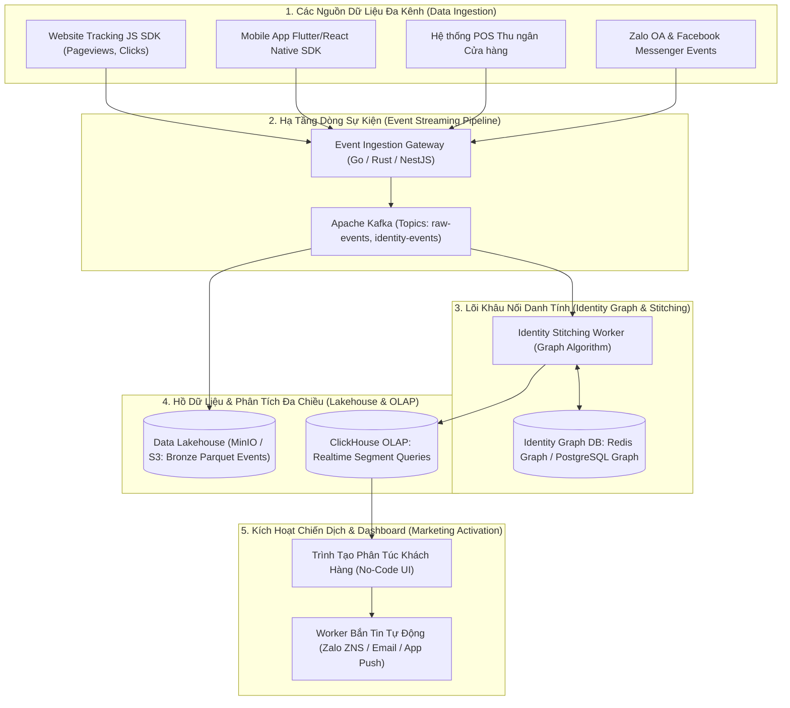
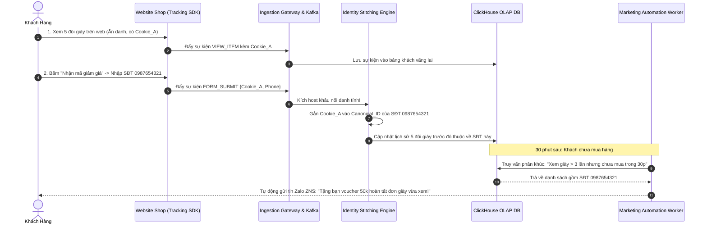

# PHÂN TÍCH CHI TIẾT ĐỀ TÀI 18: ENTERPRISE CUSTOMER DATA PLATFORM (CDP) & REAL-TIME IDENTITY STITCHING
## (Nền Tảng Dữ Liệu Khách Hàng Doanh Nghiệp Hợp Nhất 360 Độ & Phân Túc Thời Gian Thực)

---

## 1. TỔNG QUAN & BÀI TOÁN DOANH NGHIỆP THỰC TẾ

### 1.1. Bối cảnh thị trường
Các tập đoàn bán lẻ, chuỗi dịch vụ và doanh nghiệp TMĐT lớn (như Thế Giới Di Động, PNJ, Highlands Coffee) đều gặp phải cuộc khủng hoảng **Dữ liệu bị phân mảnh (Data Silos)**:
- Một khách hàng có thể:
  - Lướt xem sản phẩm trên Website bằng trình duyệt Chrome (ẩn danh, chỉ có `cookie_id`).
  - Tải App di động về dùng bằng số điện thoại (`phone_number`).
  - Mua hàng trực tiếp tại quầy thu ngân POS bằng thẻ thành viên (`loyalty_card_id`).
  - Nhắn tin hỏi bảo hành qua Zalo OA (`zalo_user_id`).
- **Nỗi đau lớn:** Doanh nghiệp không biết 4 hành vi trên thuộc về **cùng một người duy nhất**!
  - Kết quả: Khách vừa bỏ 20 triệu mua chiếc điện thoại tại cửa hàng, nhưng khi mở web lên vẫn bị quảng cáo bám đuổi (retargeting) mời mua đúng chiếc điện thoại đó, gây lãng phí hàng trăm triệu ngân sách quảng cáo.

### 1.2. Giải pháp của dự án
Xây dựng một **Customer Data Platform (CDP) cấp Enterprise**:
1. **Bộ máy Khâu nối Danh tính thời gian thực (Real-time Identity Stitching Engine):** Tự động liên kết các mã định danh rời rạc (`anonymous_id`, `email`, `phone`, `device_id`) thành **Hồ sơ Khách hàng Thống nhất 360 độ (Unified Customer Profile)**.
2. **Kho Dữ liệu Sự kiện Chuỗi hành vi (Event Stream Lakehouse):** Thu thập và lưu trữ hàng triệu sự kiện click chuột, xem trang, thêm giỏ hàng mỗi ngày qua Kafka và nén vào Data Lake.
3. **Bộ Lọc Phân Túc Động Siêu Tốc (Dynamic Audience Segmentation via ClickHouse):** Cho phép phòng Marketing tạo các tập khách hàng phức tạp trong vài giây: *"Tìm tất cả khách nữ ở Hà Nội đã xem đồ mùa đông trên 3 lần trong tuần qua nhưng chưa mua hàng"*.
4. **Kích hoạt Chiến dịch Đa kênh (Omnichannel Activation):** Tự động gửi voucher cá nhân hóa qua Zalo ZNS / Push Notification đúng thời điểm vàng khách có khả năng chốt đơn cao nhất.

---

## 2. SƠ ĐỒ KIẾN TRÚC HỆ THỐNG (SYSTEM ARCHITECTURE)



---

## 3. THIẾT KẾ CƠ SỞ DỮ LIỆU ĐỊNH DANH & SỰ KIỆN (CLICKHOUSE + POSTGRESQL)

### 3.1. Bảng Sự kiện Hành vi Thời gian thực trên ClickHouse (Triệu bản ghi/ngày)
```sql
CREATE TABLE customer_events (
    event_id UUID DEFAULT generateUUIDv4(),
    canonical_user_id UUID, -- ID hợp nhất duy nhất của khách
    anonymous_id String,    -- Cookie ID trên trình duyệt
    event_type LowCardinality(String), -- 'VIEW_ITEM', 'ADD_TO_CART', 'PURCHASE', 'APP_OPEN'
    properties JSON,        -- Thuộc tính sự kiện: {item_id, category, price, screen_name}
    channel LowCardinality(String), -- 'WEB', 'MOBILE_APP', 'STORE_POS', 'ZALO'
    device_os LowCardinality(String),
    ip_address String,
    timestamp DateTime64(3, 'Asia/Ho_Chi_Minh')
) ENGINE = MergeTree()
PARTITION BY toYYYYMM(timestamp)
ORDER BY (event_type, timestamp, canonical_user_id);
```

### 3.2. Bảng Đồ thị Khâu nối Danh tính (PostgreSQL / Redis)
```sql
CREATE TABLE identity_nodes (
    id UUID PRIMARY KEY DEFAULT gen_random_uuid(),
    canonical_id UUID NOT NULL, -- Định danh khách hàng thống nhất (Master ID)
    identifier_type VARCHAR(30) NOT NULL, -- 'PHONE', 'EMAIL', 'COOKIE_ID', 'LOYALTY_ID'
    identifier_value VARCHAR(255) NOT NULL,
    confidence_score FLOAT DEFAULT 1.0, -- Độ tin cậy (1.0 = xác định, 0.7 = dự đoán)
    first_seen_at TIMESTAMP DEFAULT CURRENT_TIMESTAMP,
    last_seen_at TIMESTAMP DEFAULT CURRENT_TIMESTAMP,
    UNIQUE(identifier_type, identifier_value)
);
CREATE INDEX idx_identities_lookup ON identity_nodes(identifier_type, identifier_value);
```

---

## 4. CÁC ĐIỂM NHẤN CÔNG NGHỆ & THUẬT TOÁN ĂN ĐIỂM

1. **Thuật toán Khâu nối Danh tính Hợp nhất (Deterministic Identity Stitching):**
   - Khi một sự kiện gửi lên có cả `cookie_id = "abc"` và `phone = "0987654321"` (do khách vừa đăng nhập trên web):
   - Hệ thống tự động hợp nhất đồ thị: Toàn bộ lịch sử hành vi ẩn danh trước đó của `cookie_id = "abc"` được gán vào `canonical_id` chính thức của số điện thoại đó.
2. **Tính toán Phân hạng RFM (Recency, Frequency, Monetary) Tự động:**
   - ClickHouse tự động chạy Job tổng hợp hàng đêm:
     - $R$ (Ngày mua gần nhất), $F$ (Tần suất mua hàng), $M$ (Tổng tiền đã chi tiêu).
     - Tự động gắn nhãn phân khúc: *Champions (Khách hàng VIP nhất), At Risk (Khách VIP sắp bỏ đi), Lost Customers (Khách đã ngừng mua).*
3. **Tuân thủ Quyền Riêng Tư (Decree 13 / GDPR Consent Management):**
   - Hỗ trợ cơ chế "Quyền được lãng quên (Right to be Forgotten)": Khi khách gửi yêu cầu xóa dữ liệu, hệ thống tự động ẩn danh hóa toàn bộ PII (Số điện thoại, Email) trong toàn bộ Lakehouse.

---

## 5. MA TRẬN ACTORS & PHÂN QUYỀN HỆ THỐNG CDP DOANH NGHIỆP

| Actor / Vai trò | Trách nhiệm & Quyền hạn nghiệp vụ trong Big Project |
| :--- | :--- |
| **Chief Marketing Officer (Giám đốc Tiếp thị)** | Xem Dashboard phân tích tổng thể: Tỷ lệ giữ chân khách (Retention), Giá trị vòng đời khách hàng (CLV), Doanh thu theo từng phân khúc. |
| **Growth / CRM Campaign Marketer** | Sử dụng giao diện kéo thả No-Code để tạo tập đối tượng (Audience Segment), lên kịch bản gửi voucher tự động đa kênh. |
| **Data Platform Engineer / DataOps** | Quản lý hạ tầng SDK Tracking, giám sát độ trễ Kafka streaming, bảo trì các bảng dữ liệu trên ClickHouse. |
| **Data Privacy & DPO Officer** | Quản lý sự đồng ý thu thập dữ liệu (Consent Management), xử lý yêu cầu trích xuất/xóa dữ liệu cá nhân theo Nghị định 13. |

---

## 6. PHÂN TÍCH NGHIỆP VỤ BIG PROJECT & BẢN ĐỒ QUY TRÌNH (ENTERPRISE CDP WORKFLOWS)



---

### 6.1. Nghiệp Vụ Phân Túc Tập Khách Hàng Tự Động (Dynamic Audience Segmentation)
- **Tập đối tượng tĩnh (Static List):** Danh sách khách được import từ file Excel cố định.
- **Tập đối tượng động (Dynamic Real-time Segment):**
  - Khách hàng tự động rơi vào hoặc thoát ra khỏi danh sách dựa trên hành vi thực tế:
  - *Ví dụ:* Tập "Khách hàng có nguy cơ rời bỏ (Churn Risk)": Khách từng chi tiêu trên 5 triệu nhưng không có bất kỳ tương tác nào trên Web/App trong 45 ngày qua. Ngay khi khách này mở app trở lại, hệ thống tự động loại họ ra khỏi tập Churn Risk và dừng kịch bản gửi email nhắc nhở.

---

### 6.2. Kịch Bản Tự Động Hóa Kích Hoạt Đa Kênh (Omnichannel Trigger Workflows)
- Không gửi spam hàng loạt:
  - Hệ thống áp dụng luật **Tần suất tiếp cận tối đa (Fatigue Rules / Frequency Capping):** Mỗi khách hàng chỉ được nhận tối đa 1 tin nhắn quảng cáo / 3 ngày và không bao giờ gửi vào khung giờ từ 22:00 đến 07:00 sáng.
