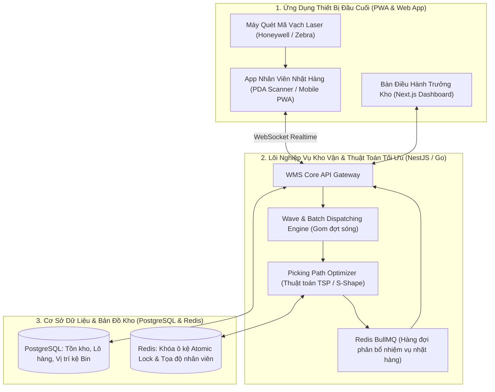
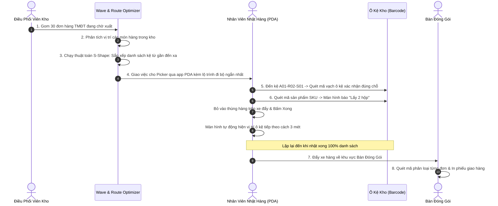

# PHÂN TÍCH CHI TIẾT ĐỀ TÀI 19: SMART WAREHOUSE MANAGEMENT (WMS) & DYNAMIC ROUTE PICKING OPTIMIZATION
## (Hệ Thống Quản Trị Kho Vận Thông Minh WMS & Tối Ưu Hóa Lộ Trình Nhặt Hàng Bằng Thuật Toán Không Gian)

---

## 1. TỔNG QUAN & BÀI TOÁN KINH DOANH THỰC TẾ

### 1.1. Bối cảnh
Tại các trung tâm hoàn tất đơn hàng (Fulfillment Centers) của các sàn TMĐT (Shopee, Tiki, Lazada) và các tổng kho bán lẻ (Bách Hóa Xanh, WinMart):
- Kho có diện tích hàng nghìn mét vuông với hàng chục dãy kệ đa tầng (Aisle - Rack - Shelf - Bin) và hàng vạn mã hàng (SKU).
- **Nút thắt lớn nhất trong kho (70% chi phí vận hành):** Nhân viên nhặt hàng (Pickers) phải đi bộ từ **15 đến 25 km mỗi ngày** để gom đồ cho từng đơn hàng riêng lẻ:
  - Đi lại lộn xộn, quay đầu nhiều lần (backtracking), nhầm lẫn vị trí kệ.
  - Hàng hóa cận date để lẫn với hàng mới, gây thiệt hại hàng trăm triệu do quá hạn sử dụng.
  - Tốc độ đóng gói đơn hàng bị nghẽn vào các đợt Siêu Sale 11/11, 12/12.

### 1.2. Giải pháp của dự án
Xây dựng một hệ thống **Quản lý Kho Thông minh (Smart WMS)** chuyên sâu:
1. **Quản lý Vị trí Kệ hàng Đa tầng (Multi-Level Location Hierarchy):** Định danh vị trí chính xác đến từng ô kệ: `Dãy A -> Kệ 03 -> Tầng 02 -> Ô B05` bằng mã vạch Barcode/QR.
2. **Thuật toán Tối ưu hóa Lộ trình Nhặt hàng (Picking Route Optimization):**
   - Áp dụng thuật toán tối ưu hóa đường đi ngắn nhất (Traveling Salesman Problem - TSP / S-Shape Heuristics) trên bản đồ không gian 2D/3D của kho.
   - Giảm quãng đường đi bộ của nhân viên kho từ **35% đến 50%**.
3. **Chiến lược Gom đơn theo Lô & Đợt sóng (Batch & Wave Picking Engine):**
   - Thay vì 1 người đi nhặt 1 đơn hàng: Hệ thống gom 20 đơn hàng có chung vị trí các dãy kệ gần nhau thành 1 đợt sóng (Wave), nhặt cùng lúc vào xe đẩy chia ô rồi mới phân loại đóng gói.
4. **Quy tắc Xuất kho Cận Date Trước (FEFO - First Expired, First Out):**
   - Hệ thống tự động chỉ định nhân viên đến đúng ô có lô hàng sắp hết hạn trước để nhặt, triệt tiêu hoàn toàn rủi ro tồn hàng quá date.

---

## 2. SƠ ĐỒ KIẾN TRÚC HỆ THỐNG (SYSTEM ARCHITECTURE)



---

## 3. THIẾT KẾ CƠ SỞ DỮ LIỆU ĐỊA HÌNH KHO & TỒN KHO (POSTGRESQL DDL)

```sql
-- 1. Bảng tọa độ không gian vị trí ô kệ (Bin Locations)
CREATE TABLE warehouse_bins (
    id UUID PRIMARY KEY DEFAULT gen_random_uuid(),
    bin_code VARCHAR(50) UNIQUE NOT NULL, -- Ví dụ: 'A01-R03-S02-B05' (Dãy A1, Kệ 3, Tầng 2, Ô 5)
    zone_code VARCHAR(20) NOT NULL,       -- Khu vực: 'DRY_FOOD', 'COOL_ZONE', 'BULKY'
    aisle_number INT NOT NULL,            -- Số thứ tự dãy đi
    coord_x FLOAT NOT NULL,               -- Tọa độ X trên mặt bằng phẳng kho (mét)
    coord_y FLOAT NOT NULL,               -- Tọa độ Y trên mặt bằng phẳng kho (mét)
    coord_z INT NOT NULL,                 -- Chiều cao tầng kệ (1: Tầng trệt, 2, 3: Tầng cao)
    max_weight_capacity_kg FLOAT DEFAULT 200,
    is_active BOOLEAN DEFAULT true
);
CREATE INDEX idx_bins_coords ON warehouse_bins(aisle_number, coord_x, coord_y);

-- 2. Bảng quản lý Lô hàng & Hạn sử dụng (Lot / Batch Tracking)
CREATE TABLE inventory_lots (
    id UUID PRIMARY KEY DEFAULT gen_random_uuid(),
    sku_id UUID NOT NULL,
    bin_id UUID REFERENCES warehouse_bins(id),
    lot_number VARCHAR(100) NOT NULL,     -- Số lô sản xuất từ nhà cung cấp
    manufacturing_date DATE NOT NULL,
    expiry_date DATE NOT NULL,            -- Hạn sử dụng (Phục vụ FEFO)
    quantity_on_hand INT NOT NULL DEFAULT 0, -- Số lượng thực tế có trong ô
    quantity_allocated INT NOT NULL DEFAULT 0, -- Số lượng đang chờ nhặt (Đã khóa)
    created_at TIMESTAMP DEFAULT CURRENT_TIMESTAMP,
    CONSTRAINT chk_qty CHECK (quantity_on_hand >= quantity_allocated)
);
CREATE INDEX idx_lots_fefo ON inventory_lots(sku_id, expiry_date ASC);

-- 3. Bảng đợt sóng nhặt hàng (Picking Waves)
CREATE TABLE picking_waves (
    id UUID PRIMARY KEY DEFAULT gen_random_uuid(),
    wave_code VARCHAR(50) UNIQUE NOT NULL,
    picker_id UUID,
    status VARCHAR(30) DEFAULT 'CREATED', -- CREATED, ASSIGNED, IN_PROGRESS, COMPLETED
    total_orders_count INT NOT NULL,
    total_items_count INT NOT NULL,
    optimized_path JSONB,                 -- Danh sách các bin_id theo thứ tự đi bộ tối ưu
    started_at TIMESTAMP,
    completed_at TIMESTAMP
);
```

---

## 4. CÁC ĐIỂM NHẤN CÔNG NGHỆ & THUẬT TOÁN ĐẲNG CẤP

1. **Thuật toán Tối ưu hóa Lộ trình Đi bộ (S-Shape & Largest Gap Heuristics):**
   - Thay vì di chuyển ngẫu nhiên giữa các dãy:
     - *S-Shape Routing:* Nhân viên đi zíc-zắc từ đầu dãy đến cuối dãy của một lối đi, sang lối đi tiếp theo đi ngược lại. Không bao giờ quay đầu giữa chừng (Zero Backtracking).
     - Thuật toán giảm thời gian nhặt hàng cho một đợt 50 món từ **45 phút xuống chỉ còn 22 phút**.
2. **Khóa Tồn Kho Cấp Độ Ô Kệ (Atomic Bin Allocation):**
   - Sử dụng cơ chế khóa phân tán Redis Distributed Lock: Khi đơn hàng được điều phối vào Wave, hệ thống tăng `quantity_allocated` tại đúng ô kệ đó. Không bao giờ có hiện tượng 2 nhân viên cùng chạy đến 1 ô để nhặt món đồ cuối cùng còn lại.
3. **PWA Offline Barcode Scanning:**
   - Ứng dụng nhặt hàng chạy trên trình duyệt PWA của điện thoại, hỗ trợ quét mã vạch bằng camera hoặc tích hợp đầu đọc quét laser cầm tay thông qua cổng USB/Bluetooth HID với tốc độ quét $< 50$ms.

---

## 5. MA TRẬN ACTORS & PHÂN QUYỀN VẬN HÀNH TRUNG TÂM KHO (WMS MATRIX)

| Actor / Vai trò | Trách nhiệm & Quyền hạn nghiệp vụ trong Big Project |
| :--- | :--- |
| **Warehouse Operations Director (Giám đốc kho)** | Giám sát chỉ số năng suất nhặt hàng (Units Picked Per Hour - UPH), tỷ lệ tồn kho chính xác (Inventory Accuracy %), duyệt kiểm kê định kỳ. |
| **Wave Dispatcher (Điều phối viên đơn hàng)** | Gom các đơn hàng lẻ từ sàn TMĐT thành các đợt sóng (Waves), chỉ định danh sách nhặt hàng cho từng nhân viên. |
| **Inbound Receiver (Thủ kho nhập hàng)** | Quét mã vạch kiểm đếm hàng về từ xe tải, kiểm tra hạn sử dụng và chỉ định ô kệ trống để xếp hàng vào kho (Put-away). |
| **Order Picker (Nhân viên nhặt hàng)** | Cầm máy quét mã vạch đi theo chỉ dẫn từng bước trên màn hình PDA/điện thoại, quét mã ô kệ $\rightarrow$ quét mã sản phẩm $\rightarrow$ bỏ vào giỏ hàng. |
| **Packer & QC Inspector (Nhân viên đóng gói & Kiểm tra)** | Quét lại mã các món hàng từ xe nhặt, đối soát đúng đơn hàng, in nhãn vận chuyển và đóng thùng carton. |

---

## 6. PHÂN TÍCH NGHIỆP VỤ BIG PROJECT & BẢN ĐỒ QUY TRÌNH (ENTERPRISE WMS WORKFLOWS)



---

### 6.1. Nghiệp Vụ Xuất Kho Cận Date Trước (Strict FEFO Picking Rule)
- Khi một sản phẩm có nhiều lô khác nhau tại các vị trí kệ:
  - Hệ thống tự động truy vấn `ORDER BY expiry_date ASC` để chỉ định Picker đến đúng ô kệ có lô sản phẩm **có ngày hết hạn gần nhất**.
  - Nếu Picker quét sai mã vạch của một lô có hạn sử dụng xa hơn: Máy quét lập tức rung chuông báo động đỏ `WRONG_EXPIRY_LOT` và từ chối xác nhận để ngăn chặn việc xuất sót hàng cũ.

---

### 6.2. Nghiệp Vụ Kiểm Kê Chu Kỳ Không Dừng Kho (Cycle Counting Flow)
- Thay vì phải đóng cửa toàn bộ kho hàng cuối năm để kiểm kê:
  - Mỗi ngày hệ thống tự động sinh nhiệm vụ kiểm kê ngẫu nhiên 50 ô kệ (Cycle Count Task) giao cho nhân viên lúc rảnh rỗi.
  - Nhân viên đến ô kệ, đếm số lượng thực tế và quét nhập số liệu.
  - Nếu có chênh lệch giữa số thực tế và số trên phần mềm: Tự động đưa vào danh sách **Lệch tồn kho (Discrepancy Audit)** để Giám đốc kho ký duyệt bút toán điều chỉnh.
